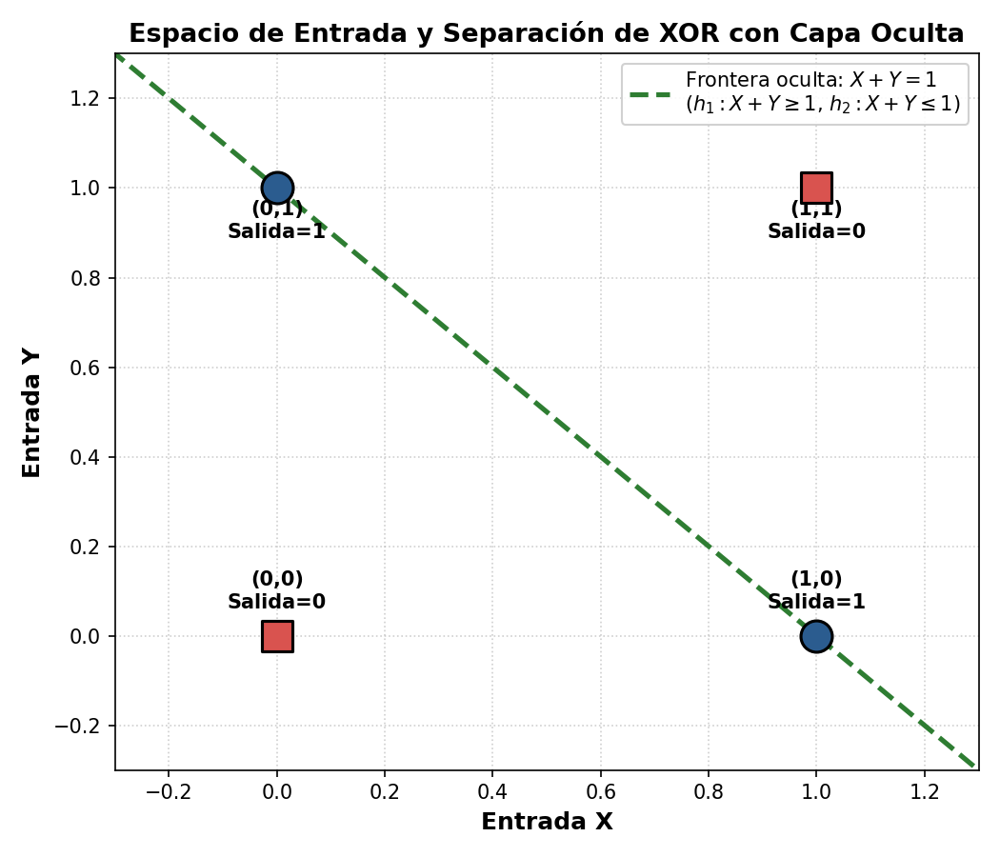

# INFORME TÉCNICO-CIENTÍFICO
## Comprobación Formal y Computacional de la Resolución del Operador XOR Mediante un Perceptrón Multicapa

**Programa:** Doctorado — Universidad Católica del Norte (UCN)  
**Asignatura:** Ciencia de Datos  
**Semestre:** 2 - 2026  
**Autor:** J. Alexander Acosta  
**Fecha:** 26 de octubre de 2026  
**Repositorio:** [https://github.com/j-alexander-acosta/Perceptron.git](https://github.com/j-alexander-acosta/Perceptron.git)  

---

### Resumen

Este informe presenta la fundamentación teórica, deducción matemática e implementación computacional de una red neuronal artificial del tipo **Perceptrón Multicapa (MLP)** de dos capas, diseñada específicamente para resolver el problema de la función lógica **XOR** ($\oplus$). Se valida empírica y formalmente la afirmación teórica: *"El perceptrón multicapa resuelve XOR; componer capas sí resuelve XOR"*, sustentada en la descomposición booleana $X \oplus Y = (X \lor Y) \land (\bar{X} \lor \bar{Y})$. Mediante el uso de neuronas con funciones de activación de escalón unitario con umbral $\theta$, se demuestra cómo la capa oculta efectúa una transformación de representación que proyecta un espacio de entrada no linealmente separable en un espacio intermedio donde la función de salida es linealmente separable. La verificación computacional confirma una exactitud del 100% para todos los estados del espacio discreto $\{0, 1\}^2$.

---

## 0. Unidad Inicial CD01 (Primera en Orden de Cátedra): Introducción al Curso de Ciencia de Datos (63 Diapositivas)

Siguiendo el orden cronológico de las unidades del curso (`CD01`, ..., `CD13`–`CD18`), el módulo [`introduccion_curso.py`](introduccion_curso.py) y los laboratorios `0.1` a `0.4` de [`web/index.html`](web/index.html) abren la suite verificando numérica y conceptualmente las 63 diapositivas de **CD01 — Introducción al Curso** (basado en material de CMU 15-388/688 de Z. Kolter, Harvard CS109 de P. Protopapas et al., Stanford CS221 de P. Liang et al., y UC Berkeley DS100):

### 0.1. Caso Real 1: Ciencia de Datos en la Pandemia, Sesgo en la Tasa de Letalidad y Causalidad (Diapositivas 5–11 y 19–21)
* **Los 5 pasos y las 4 preguntas clave (Diaps. 6–7):**
  1. *¿Qué tan rápido se propaga el virus?* $\to$ **Modelamiento** (modelo compartimental SIR).
  2. *¿Cuándo se saturarán los hospitales?* $\to$ **Predicción** (proyección de curvas UCI a corto plazo).
  3. *¿Funcionan las cuarentenas?* $\to$ **Inferencia causal** (estimación contrafactual de intervenciones no farmacológicas; Flaxman et al., 2020, *Nature*).
  4. *¿Cómo distribuir vacunas con equidad?* $\to$ **Optimización** (asignación sujeta a restricciones y principios éticos).
* **El sesgo en acción — Tasa de letalidad aparente vs. real (Diapositiva 9):**
  $$\text{letalidad aparente (CFR)} = \frac{\text{muertes}}{\text{casos confirmados}}, \qquad \text{letalidad real (IFR)} = \frac{\text{muertes}}{\text{infecciones reales}}$$
  Con $100$ muertes y $2\,000$ casos confirmados (sesgados hacia pacientes sintomáticos), $\text{CFR} = 100/2\,000 = \mathbf{5.0\%}$. Si las infecciones reales fueron $20\,000$, $\text{IFR} = 100/20\,000 = \mathbf{0.5\%}$. El mismo numerador con un denominador sesgado **infla la letalidad aparente $10$ veces** (cambia el orden de magnitud).
* **Evaluación del toque de queda nocturno con datos de Google Mobility (Diapositiva 21):** (1) Es un problema de **inferencia causal**; (2) sub-representa a quienes no poseen *smartphone*; (3) observar que bajaron movilidad y contagios no basta para probar causalidad debido a **variables de confusión** (el miedo al virus reduce ambos simultáneamente).

### 0.2. El Modelo Epidemiológico SIR a Mano, $R_0 = \beta/\gamma$ y «Aplanar la Curva» (Diapositivas 12–18)
* **Ecuaciones en diferencias diarias (Diapositiva 12):** Para una población $N = S_t + I_t + R_t = 1\,000$:
  $$\text{contagios}_t = \frac{\beta S_t I_t}{N}, \qquad \text{recuperaciones}_t = \gamma I_t$$
  $$S_{t+1} = S_t - \text{contagios}_t, \qquad I_{t+1} = I_t + \text{contagios}_t - \text{recuperaciones}_t, \qquad R_{t+1} = R_t + \text{recuperaciones}_t$$
* **Verificación exacta de la tabla «La dinámica SIR, a mano» (Diapositiva 13):** Con $\beta = 0.3$, $\gamma = 0.1$ ($1/\gamma = 10$ días), $S_0 = 990.0$, $I_0 = 10.0$, $R_0 = 0.0$:
  * **Día 0:** $\text{contagios} = 2.97$, $\text{recuperaciones} = 1.00$, $S = 990.0$, $I = 10.0$, $R = 0.0$.
  * **Día 1:** $\text{contagios} = 3.54$, $\text{recuperaciones} = 1.20$, $S = 987.0$, $I = 12.0$, $R = 1.0$.
  * **Día 2:** $\text{contagios} = 4.22$, $\text{recuperaciones} = 1.43$, $S = 983.5$, $I = 14.3$, $R = 2.2$.
  * **Día 28 (pico):** $\text{contagios} = 30.24$, $\text{recuperaciones} = 31.59$, $S = 319.0$, $I = \mathbf{315.9}$, $R = 365.0$, y al día 160 cerca del **$95\%$** ($94.7\%$) de la población ha sido infectada (Diapositiva 14).
* **Efecto de las cuarentenas sobre $R_0 = \beta/\gamma$ (Diapositiva 15):** Reducir $\beta$ de $0.30$ ($R_0 = 3.0$) a $0.16$ ($R_0 = 1.6$) baja el pico de infectados simultáneos de $\approx \mathbf{316}$ (día 28) a $\approx \mathbf{89}$ (día 61).

### 0.3. ¿Qué es Ciencia de Datos?, El Caso Netflix Prize (2006–2009) y la Paradoja de la Sobre-optimización (Diapositivas 22–40)
* **Tamaño del vacío en la matriz de Netflix (Diapositivas 27–28):** $480\,189 \text{ usuarios} \times 17\,770 \text{ películas} = \mathbf{8\,532\,958\,530} \approx \mathbf{8\,533\text{ millones}}$ de celdas, con solo $\mathbf{100\,480\,507}$ calificaciones observadas ($\approx \mathbf{1.18\% \approx 1.2\%}$ observado y **$98.82\%$ faltante no al azar — MNAR**).
* **Evolución del RMSE y la confesión de 2012 (Diapositivas 30–34):** De Cinematch ($\text{RMSE} = 0.951$) a $+8.43\%$ (Año 1), $+9.44\%$ (Año 2) y $+10.06\%$ ($\text{RMSE} = 0.856$, *BellKor's Pragmatic Chaos* en 2009 por 20 minutos). Como revelaron Amatriain y Basilico (2012), el ensamble de $>100$ modelos **nunca se desplegó en producción** porque el costo de ingeniería no justificaba la ganancia offline y porque el paso al *streaming* cambió el problema de predecir estrellas a *ranking*.

### 0.4. Los Tres Relatos de la IA, el Mapa de 4 Niveles y la Política de Uso de LLMs (Diapositivas 1–4 y 41–63)
* **Los 3 relatos históricos de la IA (Diapositivas 41–51):**
  1. **Relato simbólico (1956–1987):** Taller de Dartmouth (1956), fracaso en traducción automática ruso-inglés (*«el vodka es bueno, pero la carne está podrida»* $\to$ Informe ALPAC, 1966, 1.er invierno) y sistemas expertos ($\to$ 2.º invierno en 1987).
  2. **Relato neuronal (1943–hoy):** McCulloch y Pitts (1943) $\to$ Hebb (1949) $\to$ Rosenblatt (1958) $\to$ Minsky y Papert (1969, límite XOR) $\to$ Backpropagation (1986) $\to$ AlexNet (2012), donde el salto entre 1986 y 2012 fue impulsado por **datos y cómputo (GPUs)**.
  3. **Relato estadístico (1801–hoy):** Gauss y Legendre (1801, mínimos cuadrados para la órbita de Ceres) $\to$ Fisher (1936) $\to$ Bellman (1957, MDP) $\to$ Cortes y Vapnik (1995, SVM).
* **Mapa de 4 niveles en IA (Diapositivas 3 y 50):** **Reflejos** (se recorre entero), **Estados** (búsqueda, MDP y refuerzo, sin juegos), **Variables** (modelos probabilísticos, sin CSP) y **Lógica** (fuera del curso).
* **Política de Uso de LLMs (Diapositivas 58–61, UC Berkeley DS100):** Desglose en Contexto, Planificación y Ejecución; casos 1 y 3 son **Apropiados**, mientras que los casos 2 (pedir el EDA completo) y 4 (usar código de visualización que no puedes explicar) son **Inapropiados**.

---

## 0.5. Segunda Unidad CD02 (Segunda en Orden de Cátedra): Preprocesamiento y Análisis Exploratorio de Datos (74 Diapositivas)

Inmediatamente después de `CD01`, el módulo [`preprocesamiento_eda.py`](preprocesamiento_eda.py) y los laboratorios `02.1` a `02.4` de [`web/index.html`](web/index.html) implementan y verifican las 74 diapositivas de **CD02 — Preprocesamiento y Análisis Exploratorio de Datos** (basado en Harvard CS109 de P. Protopapas, K. Rader et al.):

### 0.5.1. ¿Qué son los Datos?, Advertencias de Fábrica, Alcances y Sesgos de Muestreo (Diapositivas 1–20)
* **Tres definiciones de «datos» (Diap. 6):** Diccionario (información factual para razonar o calcular), Informática (información digital transmisible o procesable) y **Señales** (salida de un sensor que mezcla información útil, irrelevante y redundante, y debe procesarse).
* **Diagnóstico por procedimiento de registro (Diaps. 7–8 y 11):**
  * *Termómetro cada hora / GPS de app de transporte* $\implies$ **Vacíos** (cortes de luz, túneles sin señal).
  * *Diario del colibrí / Cuaderno de asistencia a taller* $\implies$ **Imprecisión humana**.
  * *Tweets de un político / Biografías de red social* $\implies$ **Veracidad** (decir no es ser).
  * *Sensor de feria persa / Columna `v37` sin documentar* $\implies$ **Sin semántica**.
* **Gallup vs. Yelp y la Encuesta QR de la Cafetería (Diaps. 16–20):** Gallup utiliza muestreo diseñado (~500 llamadas/día RDD, regla del cumpleaños más reciente en fijos, 50 estados con 70% celulares / 30% fijos y ponderación demográfica) para describir a la **población general**; Yelp sufre de autoselección sin corrección y describe **a quien opina en Yelp**; la encuesta QR de la cafetería (480 respuestas, media **2.1/5**) combina **autoselección** y **cobertura** (no mide satisfacción del estudiantado, pero sí sirve para identificar qué reclama quien está descontento).

### 0.5.2. Matriz 2×2 de Formatos, Preguntas Medibles, CRISP-DM vs. KDD/SEMMA y Web Scraping DOM (Diapositivas 21–44)
* **Matriz 2×2 según el lector (Diap. 21):** Fácil Personas / Fácil Computadores = **Tabla CSV**; Fácil Personas / Difícil Computadores = **Prosa, fotos**; Difícil Personas / Fácil Computadores = **JSON anidado, QR**; Difícil Personas / Difícil Computadores = **Audio con ruido**.
* **Metodologías con nombre (Diaps. 30–35):** Las 6 fases de **CRISP-DM (2000)** (1. Comprensión del negocio $\leftrightarrow$ 2. Comprensión de los datos $\to$ 3. Preparación de los datos $\leftrightarrow$ 4. Modelado $\to$ 5. Evaluación $\to$ 6. Despliegue) frente a **KDD (1996)** y **SEMMA (SAS)**, las cuales omiten las dos puntas del ciclo (**Comprensión del negocio** y **Despliegue**).
* **Obtención de datos y Web Scraping Responsable (Diaps. 36–44):** Orden de preferencia $\text{Archivo} > \text{API} > \text{Scraping}$, respeto de `robots.txt` y términos de servicio, pausas e identificación en `User-Agent`, y verificación de `page.status_code == 200` (vs `404`) antes de extraer del árbol DOM con `BeautifulSoup`.

### 0.5.3. Pandas Esencial y Caso Real Premier League 2017 (`epl_mini`, 23 jugadores) (Diapositivas 45–70)
* **Verificación exacta de `epl_mini.csv` (`shape = (23, 5)`, Diaps. 46, 52, 60, 63–70):**
  * **Promedios por club (`groupby("club")["market_value"].mean()`, Diap. 52):** `Arsenal = 32.80`, `Chelsea = 35.01`, `Liverpool = 34.00`, `Man City = 46.67`, `Man United = 45.75`, `Tottenham = 41.25`.
  * **Resumen global `describe()` (Diap. 63):** `age` ($\text{mean} = 27.13, \text{std} = 3.99, \min = 21.00, Q_1 = 24.00, \text{mediana} = 26.00, Q_3 = 30.50, \max = 35.00$) y `market_value` ($\text{mean} = 38.87, \text{std} = 23.51, \min = 0.05, Q_1 = 21.00, \text{mediana} = 40.00, Q_3 = 52.50, \max = 90.00$).
  * **Caza de extremos y validación externa (Diaps. 64–66):** `idxmin() -> 8` corresponde a `Eduardo` (`Chelsea`, 34 años, `GK`, `0.05M` = 50 mil €; tercer arquero veterano en 2017 sin minutos en liga $\implies$ **dato real**, *extremo $\neq$ error*), mientras que `idxmax()` corresponde a `Paul Pogba` (`Man United`, 24 años, `90.0M`, récord mundial de traspaso en 2016 $\implies$ **dato coherente**).
  * **Resumen por edad (`groupby("age")["market_value"].agg(["mean", "median"])`, Diaps. 67–69):** A los 23 años, `Harry Kane` (`Tottenham`, `60.0M`) separa la media (`38.33M`) de la mediana (`30.00M`).

### 0.5.4. Media vs. Mediana en el Arsenal y el Cuarteto de Anscombe (1973) (Diapositivas 71–74)
* **Sensibilidad en el Arsenal (Diap. 72):** Los 5 jugadores del Arsenal (`[7, 20, 22, 50, 65]`) tienen media $\mathbf{32.80\text{ M}}$ y mediana $\mathbf{22.00\text{ M}}$; si fichan a un jugador de $100\text{ M}$, la media salta a $\mathbf{44.00\text{ M}}$ ($+34.1\%$) mientras la mediana pasa a $\mathbf{36.00\text{ M}}$.
* **El Cuarteto de Anscombe (1973, Diap. 71):** Cuatro conjuntos de $n=11$ observaciones que comparten exactamente $\bar{x}=9.0$, $\bar{y}\approx 7.50$, $s_x^2=11.0$, $s_y^2\approx 4.125$, $r\approx 0.816$ y la recta $\hat{y} = 3.00 + 0.500x$, demostrando que los resúmenes numéricos y los gráficos se necesitan mutuamente.

---

## 0.6. Tercera Unidad CD03 (Tercera en Orden de Cátedra): Visualización de Datos Efectiva y Engañosa (103 Diapositivas)

A continuación de `CD02`, el módulo [`visualizacion_datos.py`](visualizacion_datos.py) y los laboratorios `03.1` a `03.4` de [`web/index.html`](web/index.html) implementan y auditan las 103 diapositivas de **CD03 — Visualización de Datos Efectiva y Engañosa** (basado en CMU 15-388/688 de Z. Kolter y Michael Correll, Tableau Research):

### 0.6.1. Explorar vs. Comunicar, Datasaurus Dozen (CHI 2017), Escalas de Medición y Catálogo de Gráficos (Diapositivas 1–27 y 50–56)
* **Dos propósitos simultáneos (Diaps. 3–6):** La visualización opera en dos pasos del proceso de 5 pasos a la vez: **explorar** los datos propios (rápido, desechable, para ti: *descubrir qué es verdad*) y **comunicar/presentar** resultados a otros (pulido, con un mensaje: *convencer de que es verdad*).
* **Datasaurus Dozen (Matejka y Fitzmaurice, CHI 2017, Diaps. 10–12):** **13 nubes de $n = 142$ puntos** (*dino*, *star*, *circle*, *x shape*, etc.) comparten exactamente las 5 estadísticas hasta el segundo decimal:
  $$\bar{x} = \mathbf{54.26}, \quad \bar{y} = \mathbf{47.83}, \quad s_x = \mathbf{16.76}, \quad s_y = \mathbf{26.93}, \quad r = \mathbf{-0.06}$$
  Porque $m$ estadísticas son $m$ ecuaciones y los $n$ puntos tienen muchos más grados de libertad ($n > m$).
* **Las 4 escalas de medición (Diaps. 13–14):**
  1. **Nominal:** categorías sin orden (`=`, $\neq$; ej. `club del jugador`).
  2. **Ordinal:** categorías con orden pero sin distancia con significado (`=`, $\neq$, `<`, `>`; ej. `puesto en el ranking`).
  3. **Intervalo:** numérico con cero arbitrario (`+`, `-`; ej. °C, `año de debut`).
  4. **Razón:** numérico donde el cero significa ausencia total (todas, incluida `÷`; ej. Kelvin, `precio de mercado`).
* **Cálculo exacto del Box Plot (Diap. 21):** Para $\{2, 3, 3, 4, 5, 5, 6, 7, 8, 9, 15\}$ ($n=11$), se obtiene $\text{mediana} = \mathbf{5.0}$, $Q_1 = \mathbf{3.5}$, $Q_3 = \mathbf{7.5}$, $\text{IQR} = Q_3 - Q_1 = \mathbf{4.0}$ y cerca superior $Q_3 + 1.5\,\text{IQR} = \mathbf{13.5}$, identificando a $\mathbf{15} > 13.5$ como **atípico**.
* **Por qué NO dispersión 3D (Diaps. 24–25) y el ancho de intervalo en histogramas (Diap. 56):** En 3D la cámara elige la conclusión y la oclusión oculta el $78\%$ de un grupo real (sobrevive solo el **$22\%$ de su tinta**). En un histograma sobre $n = 200$ datos, *bins* de ancho $1.0$ muestran 3 barras planas (`[66, 68, 66]`, «uniforme»), mientras que *bins* de ancho $0.2$ revelan **dos modos** (dos poblaciones mezcladas).

### 0.6.2. Caso Clásico: Los Antibióticos de Will Burtin (1951) y el Gráfico que Corrigió a la Biología (Diapositivas 28–38)
* **La tabla de 16 bacterias y 3 antibióticos (Burtin, 1951, *Scope*; Wainer y Lysen, 2009, Diap. 29):** Concentración inhibitoria mínima (**CIM**: menor = más potente) de penicilina, estreptomicina y neomicina a través de **6 órdenes de magnitud** (`0.001` a `870`), más tinción de Gram ($7$ Gram+ y $9$ Gram-).
* **Pregunta 1 (del médico) — Medianas por grupo en escala logarítmica (Diap. 33):**
  * **Gram positivas:** $\text{penicilina} = \mathbf{0.005}$, $\text{estreptomicina} = \mathbf{1.0}$, $\text{neomicina} = \mathbf{0.1}$ $\implies$ la penicilina es **$200\times$ más potente** ($1/0.005 = 200$) que la estreptomicina.
  * **Gram negativas:** $\text{penicilina} = \mathbf{100.0}$, $\text{estreptomicina} = \mathbf{1.0}$, $\text{neomicina} = \mathbf{0.1}$ $\implies$ gana la neomicina (`0.1`) y la penicilina pasa de `0.005` a `100` (**$20\,000\times$ menos potente**).
* **Pregunta 2 (del biólogo) — Dos etiquetas que no calzaban y que anticiparon la microbiología por décadas (Diaps. 34–36):** Al graficar $\log_{10}(\text{penicilina})$ vs. $\log_{10}(\text{neomicina})$ con color por género:
  1. **`Diplococcus pneumoniae` (`pen=0.005, neo=10`):** no se llamaba estreptococo en 1951, pero cae justo junto a *S. hemolyticus* (`0.001, 10`) y *S. viridans* (`0.005, 40`). En **1974** la microbiología la reclasificó como **`Streptococcus pneumoniae`**.
  2. **`Streptococcus fecalis` (`pen=1.0, neo=0.1`):** sí se llamaba estreptococo, pero requiere entre **$200\times$ y $1\,000\times$ más penicilina** que los verdaderos estreptococos. En **1984** pasó al nuevo género **`Enterococcus faecalis`**.

### 0.6.3. Integridad Gráfica (Tufte, 1983), Efectividad Perceptual (Stevens, Cleveland-McGill, Mackinlay) y Uso del Color (Diapositivas 39–49 y 57–75)
* **Factor de Mentira (*Lie Factor*, Tufte, 1983, Diaps. 40–41):**
  $$\text{LieFactor} = \frac{\text{tamaño del efecto en el gráfico}}{\text{tamaño del efecto en los datos}}$$
  En *If Bush Tax Cuts Expire* (Fox Business, 2012: $35\% \to 39.6\%$ con el eje truncado en $34\%$), las alturas visuales son $1.0$ y $5.6$ (**$5.6\times$ más alta** $\implies$ efecto gráfico $+460\% = 4.6$), mientras el efecto real en los datos es $(39.6-35)/35 \approx 13.14\% = 0.1314$, dando $\text{LieFactor} = 4.6 / 0.131428 = \mathbf{35.0}$. En la auditoría de las 4 marcas $A=52\%..D=56\%$ con base en $50\%$ (Diap. 49), $D$ parece el triple de $A$ ($\text{LieFactor} = \mathbf{26.0}$).
* **Ley de Potencias de Stevens (1961, Diaps. 61–62) y Rankings de Cleveland-McGill (1984) y Mackinlay (1986, Diaps. 63–64):** $\text{percibido} \propto \text{intensidad}^\beta$:
  * **Longitud ($\beta \approx 1.0$):** un valor $10\times$ se percibe como $10^{1.0} = \mathbf{10.0\times}$ (fiel).
  * **Área ($\beta \approx 0.7$):** un valor $10\times$ se percibe como $10^{0.7} \approx \mathbf{5.0\times}$ (a la mitad).
  * **Brillo ($\beta \approx 0.33$):** un valor $10\times$ se percibe como $10^{0.33} \approx \mathbf{2.1\times}$ (a un quinto).
  * **Descarga eléctrica ($\beta = 3.5$):** el doble de corriente ($2\times$) se siente $2^{3.5} \approx \mathbf{11.3\times}$ más fuerte.
* **Uso del Color y Luminancia Relativa Rec. 709 (Diaps. 67–74):** La luminancia relativa $Y = 0.2126R + 0.7152G + 0.0722B$ en la paleta arcoíris (`jet`) sube y baja 3 veces creando bordes falsos (Rogowitz y Treinish, 1998), mientras que en **`viridis`** crece monótonamente de $\mathbf{0.02}$ a $\mathbf{0.78}$. Regla de Ware: máximo **5 a 8 colores** para categorías; daltonismo: ~**8% de los hombres** (**azul vs. naranjo** como pareja segura).

### 0.6.4. Visualización Engañosa: Taxonomía de Correll, Espejismos (*Mirages*, CHI 2020) y Ética Visual (Diapositivas 76–103)
* **Las 4 categorías de Michael Correll (Tableau Research, Diap. 77):**
  1. **Incorrectas:** codifican mal los datos (CNN Hong Kong en Brasil, Fox $2385^\circ$, *Daily Nexus* sin escala, circular de Fox News que suma $70\%+63\%+60\%=\mathbf{193\%}$ y doble eje manipulado `300->340` vs `88->101`).
  2. **Ilegibles:** ahogan al lector en detalle u ocultan el patrón (circular de 24 porciones y serie temporal de cesantía en Alabama graficada como burbujas).
  3. **Bullshit (Harry Frankfurt):** indiferencia por la verdad (*Decline of Artistic Standards* sin unidades ni fuente).
  4. **No convencionales:** invierten convenciones de lectura (*Gun deaths in Florida*, Reuters 2014: eje con el **0 arriba** donde el alza a **873 muertes** tras la ley *Stand Your Ground* de 2005 parece una caída, frente a *Iraq's Bloody Toll* de S. Scarr; mapa de ITS donde más oscuro = menos infecciones).
* **Espejismos de visualización (*Visualization Mirages*, McNutt, Kindlmann y Correll, CHI 2020, Diaps. 96–98):** Cuando en 2012 los países sin dato saltan de $\approx 72$ a $\approx 177$, sobre la misma tabla `SUM(Energy Usage)` muestra un **desplome** ($-39.3\%$) y `AVG(Energy Usage)` muestra un **auge brusco** ($+119.9\%$). Auditar `COUNT(NULL)` va antes de leer cualquier agregado.
* **Clasificación de los 4 casos de la Diapositiva 100:** (1) Mapa donde el verde intenso marca menos áreas verdes $\to$ **No convencional**; (2) Curva de felicidad sin unidades ni fuente $\to$ **Bullshit**; (3) Circular que suma $140\%$ $\to$ **Incorrecta**; (4) Red de $3\,000$ nodos y $40\,000$ aristas como resumen ejecutivo $\to$ **Ilegible**.

---

## 0.7. Cuarta Unidad CD04 (Cuarta en Orden de Cátedra): Introducción a Machine Learning (56 Diapositivas)

Siguiendo inmediatamente a `CD03` en la secuencia didáctica, el módulo [`introduccion_ml.py`](introduccion_ml.py) y los laboratorios `04.1` a `04.4` de [`web/index.html`](web/index.html) implementan y demuestran las 56 diapositivas de **CD04 — Introducción a Machine Learning** (basado en material de Stanford CS221 de Percy Liang et al.):

### 0.7.1. Panorama General de IA, Modelos de Reflejo y Tipos de Tareas de Predicción (Diapositivas 1–17)
* **El Mapa de 4 Niveles en Inteligencia Artificial (Diaps. 2–8):**
  1. **Reflejos (*Reflex-based models*):** Procesamiento instantáneo $x \to y$ de costo computacional fijo por inferencia, sin búsqueda explícita de trayectorias (regresión lineal, clasificadores lineales, redes neuronales feedforward). Es el nivel cubierto en el inicio del modelado predictivo.
  2. **Estados (*State-based models*):** Modelan secuencias de acciones en entornos dinámicos (búsqueda en grafos $A^*$, programación dinámica, MDPs y Aprendizaje por Refuerzo).
  3. **Variables (*Variable-based models*):** Razonamiento sobre asignaciones conjuntas y relaciones de incertidumbre (redes bayesianas, modelos gráficos probabilísticos, satisfacción de restricciones CSP).
  4. **Lógica (*Logic-based models*):** Deducción formal de primer orden, demostración de teoremas y conocimiento declarativo composicional.
* **Paradigma de Modelos de Reflejo (Diap. 8):** Entrada $x$ $\to$ Extracción de características $\phi(x) \in \mathbb{R}^d$ $\to$ Ponderación con parámetros $w \in \mathbb{R}^d$ $\to$ Salida predicha $f_w(x)$.
* **Taxonomía de Tareas de Predicción (Diaps. 9–17):**
  * **Clasificación Binaria:** $y \in \{-1, +1\}$ o $\{0, 1\}$ (diagnóstico médico, detección de spam).
  * **Clasificación Multiclase:** $y \in \{1, 2, \dots, K\}$ (reconocimiento de dígitos manuscritos, etiquetas de visión).
  * **Regresión:** $y \in \mathbb{R}$ (predicción de precios, concentración de compuestos, trayectorias continuas).
  * **Predicción Estructurada (*Structured Prediction*):** $y = (y_1, y_2, \dots, y_m)$ es un objeto combinatorio complejo (árbol sintáctico, traducción de texto, segmentación densa). Se descompone en decisiones locales de reflejo o búsquedas en espacio de estados.

### 0.7.2. Regresión Lineal, Pérdida Cuadrática y Descenso por Gradiente (Diapositivas 18–33)
* **Gauss, Ceres (1801) y la Hipótesis Lineal (Diaps. 18–22):** En 1801, Carl Friedrich Gauss recuperó la órbita del planeta enano Ceres a partir de apenas 41 días de observaciones celestes usando el principio de **Mínimos Cuadrados**. Se define la clase de hipótesis lineal:
  $$f_w(x) = w \cdot \phi(x) = \sum_{j=1}^d w_j \phi_j(x)$$
* **Pérdida Cuadrática y Pérdida de Entrenamiento (Diaps. 23–25):**
  $$\text{Loss}_{\text{squared}}(x, y, w) = \left(f_w(x) - y\right)^2 = \left(w \cdot \phi(x) - y\right)^2$$
  $$\text{TrainLoss}(w) = \frac{1}{|\mathcal{D}_{\text{train}}|} \sum_{(x,y) \in \mathcal{D}_{\text{train}}} \left(w \cdot \phi(x) - y\right)^2$$
* **Verificación Numérica Exacta del Ejemplo de Cátedra (Diaps. 24–27):**
  * Datos: $\mathcal{D}_{\text{train}} = \{(1, 1), (2, 3), (4, 3)\}$ con características $\phi(x) = [1, x]$ ($d=2$).
  * Para $w = [1, 0.57]$:
    * Predicción en $x=3$: $f_w(3) = 1 + 0.57(3) = \mathbf{2.71}$.
    * Errores individuales: $e_1 = (1 + 0.57(1)) - 1 = 0.57 \implies e_1^2 \approx 0.3249$; $e_2 = (1 + 0.57(2)) - 3 = -0.86 \implies e_2^2 \approx 0.7396$; $e_3 = (1 + 0.57(4)) - 3 = 0.28 \implies e_3^2 \approx 0.0784$.
    * Pérdida empírica: $\text{TrainLoss}([1, 0.57]) = \frac{0.3249 + 0.7396 + 0.0784}{3} \approx \mathbf{0.38}$.
* **Gradiente y Tabla de Descenso por Gradiente (Diaps. 28–33):**
  $$\nabla_w \text{Loss}_{\text{squared}}(x, y, w) = 2\left(w \cdot \phi(x) - y\right)\phi(x)$$
  $$\nabla_w \text{TrainLoss}(w) = \frac{1}{|\mathcal{D}_{\text{train}}|} \sum_{(x,y) \in \mathcal{D}_{\text{train}}} 2\left(w \cdot \phi(x) - y\right)\phi(x)$$
  Con inicio $w^{(0)} = [0, 0]$ y tasa de aprendizaje $\eta = 0.1$:
  * **$t=1$:** $f_{w^{(0)}} - y = [-1, -3, -3] \implies \nabla = \frac{2}{3} ([-1,-1] + [-3,-6] + [-3,-12]) = \frac{2}{3}[-7, -19] \approx [-4.67, -12.67] \implies w^{(1)} = [0, 0] - 0.1[-4.67, -12.67] = \mathbf{[0.47, 1.27]}$.
  * **$t=2$:** $\nabla \approx [-0.60, 4.31] \implies w^{(2)} = \mathbf{[0.53, 0.84]}$.
  * **$t=200$ (convergencia óptima):** $w^* = \mathbf{[1.00, 0.57]}$, con $\text{TrainLoss} = \mathbf{0.38}$.

### 0.7.3. Clasificación Lineal, Margen y Pérdida Hinge (Diapositivas 34–43)
* **Clasificador Lineal en $\mathbb{R}^2$ y Superficie de Decisión (Diaps. 34–36):**
  $$f_w(x) = \text{sign}(w \cdot \phi(x)) = \begin{cases} +1 & \text{si } w \cdot \phi(x) > 0 \\ -1 & \text{si } w \cdot \phi(x) < 0 \\ 0 & \text{indeciso} \end{cases}$$
  El límite de decisión es el hiperplano $\{x : w \cdot \phi(x) = 0\}$, ortogonal al vector de pesos $w$.
* **Puntuación (*Score*) y Margen (Diap. 37):**
  $$\text{score} = w \cdot \phi(x), \qquad \text{margen } m = (w \cdot \phi(x)) y = \text{score} \cdot y$$
  * Si $m > 0$: predicción correcta. Cuanto mayor sea $m$, mayor la confianza y holgura.
  * Si $m < 0$: predicción errónea.
* **Falla de la Pérdida Cero-Uno $\text{Loss}_{0-1}(m) = \mathbb{I}[m \le 0]$ (Diap. 38):**
  Su gradiente respecto a $w$ es idénticamente cero en casi todo $\mathbb{R}^d$ ($\nabla_w \text{Loss}_{0-1} = 0$ para $m \ne 0$) e indefinido en el salto discontinuo $m=0$. Por consiguiente, los métodos basados en gradiente no pueden optimizar la tasa de error directa.
* **Pérdida Hinge (Bisagra) y Subgradiente (Diaps. 39–43):**
  $$\text{Loss}_{\text{hinge}}(x, y, w) = \max\{0, 1 - m\} = \max\{0, 1 - (w \cdot \phi(x)) y\}$$
  $$\nabla_w \text{Loss}_{\text{hinge}}(x, y, w) = \begin{cases} -\phi(x) y & \text{si } m < 1 \\ 0 & \text{si } m > 1 \end{cases}$$
* **Verificación Numérica del Ejemplo de Cátedra (Diaps. 41–42):**
  * Datos: $\mathcal{D}_{\text{train}} = \{([0, 2], +1), ([-2, 0], +1), ([1, -1], -1)\}$ con pesos $w = [2, -1]$.
  * Para el punto $([1, -1], y = -1)$:
    * $\text{score} = w \cdot x = 2(1) + (-1)(-1) = 2 + 1 = \mathbf{3}$.
    * $\text{margen } m = \text{score} \cdot y = 3 \cdot (-1) = \mathbf{-3}$.
    * $\text{Loss}_{\text{hinge}} = \max\{0, 1 - (-3)\} = \mathbf{4}$.
    * Dado que $m = -3 < 1$, el gradiente es $-\phi(x)y = -[1, -1](-1) = \mathbf{[1, -1]}$.
  * Evaluando los 3 puntos con $w=[2,-1]$:
    * $x^{(1)}=[0,2], y=+1 \implies m = -2 \implies \text{hinge} = 3, \nabla = [0, -2]$.
    * $x^{(2)}=[-2,0], y=+1 \implies m = -4 \implies \text{hinge} = 5, \nabla = [2, 0]$.
    * $x^{(3)}=[1,-1], y=-1 \implies m = -3 \implies \text{hinge} = 4, \nabla = [1, -1]$.
    * Promedios sobre $\mathcal{D}_{\text{train}}$: $\text{TrainLoss}_{0-1} = \frac{3}{3} = \mathbf{1.0}$, $\text{TrainLoss}_{\text{hinge}} = \frac{3+5+4}{3} = \mathbf{4.0}$, y $\nabla_w = \frac{1}{3}[3, -3] = \mathbf{[1.0, -1.0]}$.
  * Y con el vector $w = [-1, 1]$ que separa el conjunto:
    * $x^{(1)}=[0,2], y=+1 \implies m = 2 \implies \text{hinge} = 0$.
    * $x^{(2)}=[-2,0], y=+1 \implies m = 2 \implies \text{hinge} = 0$.
    * $x^{(3)}=[1,-1], y=-1 \implies m = 2 \implies \text{hinge} = 0$.
    * $\text{TrainLoss}_{0-1} = \mathbf{0.0}$, $\text{TrainLoss}_{\text{hinge}} = \mathbf{0.0}$.

### 0.7.4. Regresión Logística, Máxima Verosimilitud y Extensión Multiclase (Diapositivas 44–56)
* **Función Logística Sigmoide (Diap. 45):**
  $$\sigma(z) = \frac{1}{1 + e^{-z}}, \qquad p(y=+1 \mid x) = \sigma(w \cdot \phi(x)) = \frac{1}{1 + e^{-w \cdot \phi(x)}}$$
  Propiedad de simetría fundamental:
  $$1 - \sigma(z) = \sigma(-z), \qquad p(y \mid x) = \sigma((w \cdot \phi(x)) y) = \sigma(m)$$
* **Deducción de la Pérdida Logística por Máxima Verosimilitud (MLE) (Diaps. 46–48):**
  Maximizar la verosimilitud condicional bajo ejemplos independientes equivale a minimizar la log-verosimilitud negativa:
  $$\text{Loss}_{\text{logistic}}(x, y, w) = -\log p(y \mid x) = -\log \sigma(m) = -\log \left(\frac{1}{1 + e^{-m}}\right) = \mathbf{\log\left(1 + e^{-m}\right)}$$
* **Gradiente de la Pérdida Logística (Diap. 49):**
  $$\nabla_w \text{Loss}_{\text{logistic}}(x, y, w) = \frac{-e^{-m}}{1 + e^{-m}} \nabla_w m = -\left(1 - \sigma(m)\right)\phi(x)y = \mathbf{-\sigma(-m)\phi(x)y}$$
  Interpretación física: $-\sigma(-m)$ es la probabilidad que el modelo asigna a la etiqueta equivocada; cuanto más seguro esté del error ($m \ll 0 \implies \sigma(-m) \to 1$), mayor es la corrección $-\phi(x)y$. Si clasifica con amplio margen correcto ($m \gg 0 \implies \sigma(-m) \to 0$), el gradiente se desvanece de manera suave.
* **Comportamiento en Datos Separables y la Necesidad de Regularización (Diap. 50):**
  En un conjunto linealmente separable, para que $\text{Loss}_{\text{logistic}} \to 0$ se requiere que $m = (w \cdot \phi(x))y \to +\infty$ para todo ejemplo, lo que obliga a que **$\|w\| \to \infty$**. Al simular descenso por gradiente ($\eta=0.5$):
  * A $t=100$: $w = [-2.29, 2.29]$, $\|w\| \approx 3.24$, $\text{Loss} \approx 0.010$.
  * A $t=1000$: $w = [-3.45, 3.45]$, $\|w\| \approx 4.88$, $\text{Loss} \approx 0.001$.
  Los pesos no se estabilizan en ningún valor finito a menos que se introduzca un término de regularización L2 ($\lambda \|w\|_2^2$), motivación directa para las unidades posteriores.
* **Umbral de Decisión como Perilla de Control (*Threshold Knob*, Diap. 52):**
  Decidir $\hat{y} = +1$ si $p(y=+1 \mid x) \ge \tau$:
  * En diagnóstico de cáncer: bajar $\tau$ (e.g. $0.1$) para maximizar *Recall* (evitar falsos negativos críticos).
  * En filtro de spam: subir $\tau$ (e.g. $0.9$) para maximizar *Precision* (evitar enviar correos legítimos al basurero).
* **Extensión Multiclase: Softmax y Riesgo Empírico (Diaps. 53–56):**
  Para $K$ clases con vectores de pesos $w_1, \dots, w_K$:
  $$p(y = k \mid x) = \frac{e^{w_k \cdot \phi(x)}}{\sum_{j=1}^K e^{w_j \cdot \phi(x)}}$$
  El objetivo del aprendizaje en todos los modelos de reflejo se resume en la **Minimización del Riesgo Empírico (ERM)**:
  $$\min_w \frac{1}{|\mathcal{D}_{\text{train}}|} \sum_{(x,y) \in \mathcal{D}_{\text{train}}} \text{Loss}(x, y, w)$$

---

## 0.8. Quinta Unidad CD05 (Quinta en Orden de Cátedra): Generalización y Validación (63 Diapositivas)

Continuando la progresión de los modelos de reflejos lineales y antes de adentrarnos en las redes neuronales profundas y la optimización avanzada, el módulo [`generalizacion_validacion.py`](generalizacion_validacion.py) y los laboratorios `05.1` a `05.4` de [`web/index.html`](web/index.html) desarrollan y demuestran las 63 diapositivas de **CD05 — Generalización y Validación** (basado en material de Stanford CS221 de Percy Liang et al., Harvard CS109 y CMU 11-785):

### 0.8.1. El Objetivo Real: Generalizar, Sobreajuste, Correlación Espuria y Descomposición de Liang (Diapositivas 1–16)
* **La Falacia de la Memorización Empírica (Diaps. 4–5):**
  Minimizar el riesgo de entrenamiento $\text{TrainLoss}(w) = 0.0$ es un objetivo instrumental engañoso. El algoritmo trivial *Memorize*:
  $$h(x) = \begin{cases} y_i & \text{si } x = x_i \text{ para algún } (x_i, y_i) \in \mathcal{D}_{\text{train}} \\ \text{default} & \text{en otro caso} \end{cases}$$
  alcanza $\text{TrainLoss} = 0.0$ exacto pero es incapaz de predecir en puntos no vistos. El objetivo real del aprendizaje automático es **generalizar** a la distribución no observada $\mathcal{D}$.
* **Correlación Espuria y el Falso Atajo Clínico (Oakden-Rayner et al., 2019, Diap. 6):**
  Un modelo de visión profunda entrenado para detectar neumotórax en radiografías de tórax alcanzó un aparente $95\%$ de precisión. La auditoría reveló que la red no detectaba el tejido colapsado del pulmón, sino la presencia del **tubo de drenaje torácico** (catéter naranja) ya instalado por el equipo médico de urgencias. En pacientes graves que aún no habían recibido el tubo, el clasificador falló catastróficamente.
* **Maldición de la Dimensionalidad e Imposibilidad de Cobertura Pura (Diaps. 7–8):**
  En un espacio de $d = 100$ variables binarias, existen $2^{100} \approx 1.2676 \times 10^{30}$ estados posibles. Incluso si dispusiéramos de un conjunto colosal de un petabyte de datos ($n = 10^{15}$ ejemplos), la fracción del espacio muestreada es:
  $$\frac{n}{2^d} = \frac{10^{15}}{1.2676 \times 10^{30}} \approx 7.89 \times 10^{-16}$$
  El $99.9999999999999\%$ del espacio queda completamente inexplorado. Por consiguiente, es **matemáticamente imposible generalizar** sin restringir la clase de hipótesis $\mathcal{F}$ (sesgo inductivo).
* **Descomposición Teórica del Error (Percy Liang / Stanford CS221, Diap. 12):**
  Sea $\mathcal{A}$ la clase universal de todos los predictores, $\mathcal{F}$ nuestra clase de hipótesis elegida (e.g. lineal), $f^* = \arg\min_{f \in \mathcal{A}} \text{Err}(f)$ el predictor óptimo de Bayes, $g = \arg\min_{f \in \mathcal{F}} \text{Err}(f)$ la mejor hipótesis de la clase, y $\hat{f} \in \mathcal{F}$ el predictor estimado por minimización del riesgo empírico sobre $\mathcal{D}_{\text{train}}$. El exceso de error se descompone de forma exacta como:
  $$\text{Err}(\hat{f}) - \text{Err}(f^*) = \underbrace{\left(\text{Err}(\hat{f}) - \text{Err}(g)\right)}_{\text{Error de Estimación (Varianza)}} + \underbrace{\left(\text{Err}(g) - \text{Err}(f^*)\right)}_{\text{Error de Aproximación (Sesgo)}}$$
  * Aumentar la riqueza de $\mathcal{F}$ reduce el error de aproximación pero dispara el de estimación.
  * Restringir $\mathcal{F}$ reduce el error de estimación pero incrementa el de aproximación.
* **Auditoría de los 3 Equipos de Fraude (Diaps. 14–15, baseline 2%):**
  * **Equipo A (Train 0.0%, Test 25.0%):** Sobreajuste severo / alto error de estimación. Solución: regularización $\lambda$, reducción de características o recopilar más datos $n$.
  * **Equipo B (Train 23.0%, Test 24.0%):** Subajuste severo / alto error de aproximación. Solución: enriquecer la hipótesis con no linealidades o nuevas features predictivas.
  * **Equipo C (Probó 50 modelos en Test y eligió el de 5.0%):** Conjunto de prueba contaminado (*Data Leakage* / *P-Hacking*). La métrica del $5\%$ carece de validez estadística fuera de muestra.

### 0.8.2. Controlar la Clase de Hipótesis: Dimensión, Cota de Cauchy-Schwarz, Regularización L2/L1 y Early Stopping (Diapositivas 17–27)
* **Estrategia 1 — Reducir Dimensión y Selección Secuencial Hacia Adelante (Diap. 18):**
  Para $J$ variables, la búsqueda exhaustiva sobre los subconjuntos requiere evaluar $2^J$ modelos (para $J=20 \implies 2^{20} = 1\,048\,576$, combinatoriamente intratable). La selección codiciosa (*Greedy Forward Selection*) incorpora en cada paso la variable que más reduce la pérdida, evaluando solo:
  $$\sum_{k=1}^J k = \frac{J(J+1)}{2} \implies \text{Para } J=20: \quad \frac{20 \times 21}{2} = \mathbf{210} \text{ modelos}$$
  lo que representa una aceleración de **$4\,993\times$** menos cómputo.
* **Estrategia 2 — Cota de Suavidad por Cauchy-Schwarz (Diap. 21):**
  La cota de variación del puntaje entre dos entradas $x$ y $x'$ satisface la desigualdad de Cauchy-Schwarz:
  $$|s(x) - s(x')| = |w \cdot (\phi(x) - \phi(x'))| \le \|w\|_2 \|\phi(x) - \phi(x')\|_2$$
  Por ende, acotar la norma euclidiana $\|w\|_2$ controla de manera directa la constante de Lipschitz del predictor, forzando funciones suaves e insensibles a fluctuaciones locales de ruido.
* **Regularización L2 (Ridge / Weight Decay) y el Paso a Mano Exacto de la Diapositiva 26 (Págs. 103–107):**
  La función objetivo regularizada es:
  $$\mathcal{L}_{\text{reg}}(w) = \text{TrainLoss}(w) + \frac{\lambda}{2}\|w\|_2^2 \implies \nabla_w \mathcal{L}_{\text{reg}}(w) = \nabla_w \text{TrainLoss}(w) + \lambda w$$
  Dando lugar a la regla de contracción de pesos (*weight decay*):
  $$w \leftarrow w - \eta(\nabla_w \text{TrainLoss}(w) + \lambda w) = (1 - \eta\lambda)w - \eta\nabla_w \text{TrainLoss}(w)$$
  **Verificación del Cálculo Numérico Paso a Paso (Diapositiva 26):**
  Con $w = [2.0, -2.0]$, $\nabla\text{TrainLoss}(w) = [1.0, 1.0]$, $\lambda = 0.5$ y $\eta = 0.1$:
  1. Penalización L2: $\lambda w = 0.5 \times [2, -2] = \mathbf{[1.0, -1.0]}$.
  2. Gradiente total regularizado: $\nabla_{\text{total}} = [1, 1] + [1, -1] = \mathbf{[2.0, 0.0]}$.
  3. Actualización de pesos:
     $$w_{\text{nuevo}} = [2.0, -2.0] - 0.1 \times [2.0, 0.0] = [2.0 - 0.2, -2.0 - 0.0] = \mathbf{[1.8, -2.0]}$$
     Coincidencia exacta con la diapositiva y con la contracción: $(1 - 0.05)[2, -2] - 0.1[1, 1] = [1.9 - 0.1, -1.9 - 0.1] = [1.8, -2.0]$.
* **Regularización L1 (LASSO) y Early Stopping (Diaps. 24 y 27):**
  * L1 penaliza $\|w\|_1 = \sum |w_j|$ con subgradiente $\text{sign}(w_j)$, cuyos contornos en diamante colisionan en los ejes coordenados forzando coeficientes irrelevantes exactamente a cero (**selección intrínseca de características**).
  * *Early Stopping*: Partiendo de $w^{(0)} = 0$, tras $T$ iteraciones con gradientes acotados $\|\nabla\| \le G$, se cumple $\|w^{(T)}\| \le \eta G T$. Detener el descenso antes actúa como un radio de bola implícito sobre la norma de pesos.

### 0.8.3. Hiperparámetros, Validación y K-Fold Cross-Validation: El Experimento Controlado Oficial (Diapositivas 28–52)
* **La Trinidad de Datos y la Regla Sagrada (Diaps. 28–33):**
  $\mathcal{D}_{\text{train}} \setminus \mathcal{D}_{\text{val}}$, $\mathcal{D}_{\text{val}}$ y $\mathcal{D}_{\text{test}}$. El conjunto de prueba solo se consulta una única vez al final del proyecto para certificar el rendimiento en producción.
* **El Experimento Numérico Controlado Oficial (Diapositivas 42–47 / Págs. 173–199):**
  Se genera un conjunto sintético con la verdad terreno conocida:
  $$y = x^3 - 3x + \varepsilon, \qquad \varepsilon \sim \mathcal{N}(0, 2^2) \implies \sigma^2 = \mathbf{4.0} \quad (\text{piso de error irreducible})$$
  con $n = 30$ observaciones distribuidas uniformemente en $[-2.2, 2.2]$ ($22$ para entrenamiento y $8$ para validación simple). Se ajustan polinomios por mínimos cuadrados con grados $d \in \{1, \dots, 8\}$. El grado real del generador es $d = 3$.
* **Tabla Comparativa Oficial: Desenmascarando la Ilusión de la Validación Simple (Diaps. 44–45):**
  $$\begin{array}{c|c|c|l}
  \hline
  \text{Grado } d & \text{Validación Simple (8 pts)} & \text{5-Fold Cross-Validation } (K=5) & \text{Diagnóstico} \\
  \hline
  d = 1 & 26.7 & 23.5 & \text{Subajuste severo (línea recta rígida)} \\
  d = 2 & 23.4 & 29.8 & \text{Parábola sesgada} \\
  \mathbf{d = 3} & 3.1 & \mathbf{3.8} & \mathbf{\text{Mínimo óptimo real (CV elige la verdad } d=3)} \\
  d = 4 & 3.2 & 5.6 & \text{Inicio de varianza innecesaria} \\
  d = 5 & 2.2 & 4.5 & \text{Fluctuaciones de frontera} \\
  \mathbf{d = 6} & \mathbf{1.9} & 9.5 & \mathbf{\text{Falso mínimo engañoso (Val. Simple engañada)}} \\
  d = 7 & 2.0 & 5.7 & \text{Inestabilidad} \\
  d = 8 & 2.1 & \mathbf{80.0} & \mathbf{\text{Colapso catastrófico por sobreajuste extremo}} \\
  \hline
  \end{array}$$
  * *La ilusión:* En validación simple, $d=6$ parece milagroso con $\text{MSE} = 1.9$, ¡incluso inferior al piso irreducible de ruido $\sigma^2 = 4.0$! Esto delata que el modelo sobreajustó a los 8 puntos particulares de esa partición afortunada.
  * *La realidad:* 5-Fold Cross-Validation promedia sobre todos los datos y desenmascara la alta inestabilidad de $d=6$ ($\text{MSE} = 9.5$) y el colapso de $d=8$ ($\text{MSE} = 80.0$), seleccionando con honestidad el grado verdadero **$d = 3$** ($\text{MSE} = 3.8$).
* **¿Por qué 5-Fold Desenmascara a $d=6$? Desglose por Rondas (Diapositiva 46 / Pág. 190):**
  * Para $d=3$: Folds $= [2.4, 2.6, 7.6, 4.7, 1.5] \implies \text{Promedio} = \mathbf{3.8}$, $\text{std} = 2.18$ (comportamiento parejo y controlado).
  * Para $d=6$: Folds $= [1.9, 1.7, 8.2, \mathbf{32.3}, 3.3] \implies \text{Promedio} = \mathbf{9.5}$, $\text{std} = 11.66$.
  * ¡En el **Fold 4**, el polinomio de grado 6 explota violentamente a un error de $\mathbf{32.3}$! La validación simple tuvo la casualidad de no evaluar esa región difícil, pero K-Fold no perdona ningún punto.
* **Auditoría Final en 200,000 Datos Nuevos No Vistos (Diapositiva 47):**
  Al evaluar los dos modelos candidatos en una muestra independiente masiva de $200\,000$ puntos:
  * Modelo elegido por 5-Fold CV ($d=3$): $\text{MSE}_{\text{real}} = \mathbf{4.2}$ (a solo $+5\%$ del piso óptimo $\sigma^2 = 4.0$).
  * Modelo elegido por Validación Simple ($d=6$): $\text{MSE}_{\text{real}} = \mathbf{5.1}$ ($+27.5\%$ de error respecto al óptimo).
  * Conclusión: El modelo elegido por Cross-Validation rinde **$21.4\%$ mejor** en el mundo real.
* **Estabilidad y Variantes de Validación (Diaps. 48–52):**
  * Comparación de modelos con idéntico promedio: Modelo A ($[3.1, 2.7, 3.4, 2.9, 3.0] \implies \mu=3.02, \sigma=0.23$) es netamente superior a Modelo B ($[1.9, 4.8, 2.1, 4.5, 2.2] \implies \mu=3.10, \sigma=1.25$) por su baja dispersión y previsibilidad.
  * *Stratified K-Fold*: Preserva la proporción de clases en datasets desbalanceados (e.g. 98% no fraude / 2% fraude).
  * *TimeSeriesSplit (Purged Walk-Forward)*: Ventana expansiva temporal donde el futuro jamás se filtra para predecir el pasado.

### 0.8.4. Descomposición Sesgo-Varianza, Matriz de Control de Ingeniería y Curvas de Aprendizaje (Diapositivas 53–63)
* **Deducción de la Descomposición del Error Cuadrático Medio Esperado (Diaps. 54–57):**
  Para una entrada fija $x_0$, con $y = f^*(x_0) + \varepsilon$, donde $\mathbb{E}[\varepsilon]=0$ y $\text{Var}(\varepsilon)=\sigma^2$:
  $$\mathbb{E}_{\mathcal{D}, \varepsilon}\left[\left(y - \hat{f}(x_0)\right)^2\right] = \text{Bias}\left[\hat{f}(x_0)\right]^2 + \text{Var}\left[\hat{f}(x_0)\right] + \sigma^2$$
  donde:
  $$\text{Bias}\left[\hat{f}(x_0)\right] = \mathbb{E}_{\mathcal{D}}\left[\hat{f}(x_0)\right] - f^*(x_0)$$
  $$\text{Var}\left[\hat{f}(x_0)\right] = \mathbb{E}_{\mathcal{D}}\left[\left(\hat{f}(x_0) - \mathbb{E}_{\mathcal{D}}\left[\hat{f}(x_0)\right]\right)^2\right]$$
* **La Analogía de la Diana (*Bullseye Target*):**
  * **Alto Sesgo, Baja Varianza:** Disparos agrupados compactamente pero desplazados lejos del centro (modelo demasiado simple / subajuste).
  * **Bajo Sesgo, Alta Varianza:** Disparos cuyo centro de masa está en el blanco pero dispersos por toda la diana (modelo hipersensible a la muestra particular / sobreajuste).
  * **Alto Sesgo, Alta Varianza:** Disparos dispersos y descentrados (el peor escenario).
  * **Bajo Sesgo, Baja Varianza:** Disparos compactos y centrados en el punto medio (el óptimo del aprendizaje).
* **La Matriz de Control de Ingeniería (Diapositiva 58):**
  $$\begin{array}{l|c|c|l}
  \hline
  \text{Perilla de Ingeniería} & \text{Efecto en Sesgo} & \text{Efecto en Varianza} & \text{Riesgo Clave} \\
  \hline
  \text{Más features / mayor grado } d & \downarrow & \uparrow & \text{Sobreajuste si supera la señal} \\
  \text{Mayor regularización } \lambda \uparrow & \uparrow & \downarrow & \text{Subajuste si la contracción es excesiva} \\
  \text{Early Stopping } T \downarrow & \uparrow & \downarrow & \text{Subajuste si detiene antes de aprender} \\
  \mathbf{\text{Más datos de entrenamiento } n \uparrow} & \mathbf{=} & \mathbf{\downarrow} & \mathbf{\text{¡Ninguno! Es el único botón con costo estadístico cero}} \\
  \hline
  \end{array}$$
* **Diagnóstico Mediante Curvas de Aprendizaje (Diapositivas 59–60):**
  * **Caso Alta Varianza (Sobreajuste):** Pérdida de entrenamiento muy baja ($\text{Train} \approx 0.1$) y pérdida de validación alta ($\text{Val} \approx 12.0$). La brecha abierta indica que aumentar el tamaño muestral $n$ cerrará la brecha reduciendo la varianza.
  * **Caso Alto Sesgo (Subajuste):** Pérdida de entrenamiento alta ($\text{Train} \approx 11.8$) y pérdida de validación casi igual ($\text{Val} \approx 12.1$). Ambas curvas están estancadas en un nivel inaceptable. **Recopilar más datos no ayudará en absoluto**; se requiere obligatoriamente una hipótesis más expresiva o nuevas variables.

---

## 0.9. Sexta Unidad CD06 (Sexta en Orden de Cátedra): Clustering — Agrupamiento No Supervisado (57 Diapositivas)

### 0.9.1. K-Means: Compresión, Minimización Alternada de Lloyd y Codo (Diapositivas 1–21)
* **Doble naturaleza de K-Means (Diapositiva 4):** En la literatura coexisten dos conceptos bajo el término *K-Means*:
  1. **La función objetivo de pérdida cuadrática de compresión:**
     $$\text{Loss}_{\text{kmeans}}(z, \mu) = \frac{1}{n}\sum_{i=1}^n \|\phi(x_i) - \mu_{z_i}\|_2^2$$
     donde $z_i \in \{1, \dots, K\}$ asigna el punto $x_i$ a un cluster, y $\mu_k \in \mathbb{R}^d$ representa el centroide prototípico del cluster $k$.
  2. **El algoritmo de Lloyd (1982):** Un esquema iterativo de optimización alternada por bloques de coordenadas (*coordinate descent*):
     * **Paso 1 (Asignar $z$ fijando $\mu$):** $z_i \leftarrow \arg\min_{k \in \{1,\dots,K\}} \|\phi(x_i) - \mu_k\|_2^2$ (partición de Voronoi).
     * **Paso 2 (Recentrar $\mu$ fijando $z$):** $\mu_k \leftarrow \frac{1}{|C_k|}\sum_{i \in C_k}\phi(x_i)$ (media aritmética del cluster $C_k = \{i : z_i = k\}$).
* **Teorema de Convergencia Monótona en Pasos Finitos:**
  En cada paso, el algoritmo minimiza la pérdida respecto a un subconjunto de variables:
  $$\text{Loss}(z^{(t+1)}, \mu^{(t)}) \le \text{Loss}(z^{(t)}, \mu^{(t)}) \quad \text{y} \quad \text{Loss}(z^{(t+1)}, \mu^{(t+1)}) \le \text{Loss}(z^{(t+1)}, \mu^{(t)})$$
  Como el número de asignaciones posibles es finito ($K^n$), y la función es estrictamente decreciente ante cambios de asignación, el algoritmo **garantiza converger monótonamente en un número finito de pasos a un mínimo local**. Sin embargo, la pérdida no es convexa y **no garantiza el óptimo global**.
* **Traza Manual Exacta 1D (Diapositiva 12 / Págs. 36–45):**
  Puntos $\{0, 2, 10, 12\}$, $K=2$, inicializados en centroides $\mu_1 = 0, \mu_2 = 2$:
  * **Iteración 1:**
    - Distancias a $\mu_1=0$: $[0, 2, 10, 12]$. Distancias a $\mu_2=2$: $[2, 0, 8, 10]$.
    - Asignaciones: $z_1 = 1$, $z_2 = 2, z_3 = 2, z_4 = 2$ (empate en $2$ asignado a $2$).
    - Nuevos centroides: $\mu_1 = 0 / 1 = \mathbf{0}$, $\mu_2 = (2 + 10 + 12)/3 = \mathbf{8}$.
  * **Iteración 2:**
    - Distancias a $\mu_1=0$: $[0, 4, 100, 144]$. Distancias a $\mu_2=8$: $[64, 36, 4, 16]$.
    - Reasignación: $x_2=2$ prefiere $\mu_1=0$ (distancia 2 vs 6) $\implies z = [1, 1, 2, 2]$.
    - Nuevos centroides: $\mu_1 = (0 + 2)/2 = \mathbf{1}$, $\mu_2 = (10 + 12)/2 = \mathbf{11}$.
  * **Convergencia y Pérdida Final:**
    $$\text{Loss} = (0-1)^2 + (2-1)^2 + (10-11)^2 + (12-11)^2 = 1 + 1 + 1 + 1 = \mathbf{4.0}$$
* **Paso 2D a Mano Exacto (Diapositiva 15 / Págs. 58–63):**
  Puntos $(0,0), (2,0), (6,4), (8,4)$ con $\mu_1 = (0,0), \mu_2 = (2,0)$:
  * **Iteración 1:** Punto 1 a $\mu_1$; Puntos 2, 3 y 4 a $\mu_2$ $\implies \mu_1 = (0,0)$, $\mu_2 = \frac{(2,0)+(6,4)+(8,4)}{3} = \mathbf{(\frac{16}{3}, \frac{8}{3})} \approx (5.33, 2.67)$. Pérdida $\text{Loss} = 26.67$.
  * **Iteración 2:** Puntos 1 y 2 a $\mu_1$; Puntos 3 y 4 a $\mu_2$ $\implies \mu_1 = \mathbf{(1,0)}, \mu_2 = \mathbf{(7,4)}$.
    $$\text{Loss} = \|(0,0)-(1,0)\|^2 + \|(2,0)-(1,0)\|^2 + \|(6,4)-(7,4)\|^2 + \|(8,4)-(7,4)\|^2 = 1 + 1 + 1 + 1 = \mathbf{4.0}$$
    Convergencia total alcanzada en 2 pasos.
* **Simulación de 210 Puntos en 3 Grupos (Diapositiva 18):**
  Demostración de la vulnerabilidad ante inicializaciones desfavorables:
  * Inicialización aleatoria atrapada: 2 centroides en el cluster superior y 1 en el punto medio de los inferiores $\implies \text{Loss} \approx \mathbf{1\,450}$ (mínimo local severo con 2 clusters fundidos).
  * Inicialización K-Means++: separa los 3 centros en $(0, 3.5), (-3, -2), (3, -2) \implies \text{Loss} \approx \mathbf{328}$ (óptimo global).
* **Curva Oficial del Codo (Elbow Method, Diapositiva 21):**
  Para $K=1..8$, la pérdida decrece como $[1863.2, 955.1, \mathbf{107.5}, 90.1, 77.9, 66.1, 58.4, 50.7]$.
  La reducción marginal de $K=2 \to 3$ es $\Delta = 847.6$, mientras que de $K=3 \to 4$ cae bruscamente a $\Delta = 17.4$ ($48.7\times$ menor), estableciendo el codo formal en **$K=3$**.
* **Sensibilidad Extrema a Outliers:**
  Al incorporar el dato atípico $x=30$ a $\{0, 2, 10, 12\}$, con $K=2$ el punto $30$ secuestra el centroide $\mu_2=30.0$, forzando a $\mu_1=6.0$ a absorber los 4 datos reales, con pérdida $\text{Loss} = 104.0$ frente a $365.0$ si se respeta la partición natural, evidenciando la no robustez de la norma $L_2$ cuadrática.

### 0.9.2. Evaluación de Clusters: Índice de Rand (RI), Rand Ajustado (ARI) y Ruido (Diapositivas 22–30)
* **Matriz de Contingencia y Conteo de Pares $\binom{n}{2}$ (Diapositiva 24):**
  Dada una verdad terreno $Y$ y una partición generada $Z$, se clasifican los $\binom{n}{2} = \frac{n(n-1)}{2}$ pares de observaciones:
  * $a$: puntos en el **mismo** cluster en $Y$ y en el **mismo** en $Z$ (acuerdo positivo).
  * $b$: puntos en **distintos** clusters en $Y$ y en **distintos** en $Z$ (acuerdo negativo).
  * $c$: puntos en el **mismo** cluster en $Y$ pero en **distintos** en $Z$ (falso negativo).
  * $d$: puntos en **distintos** clusters en $Y$ pero en el **mismo** en $Z$ (falso positivo).
* **Rand Index Simple:**
  $$\text{RI} = \frac{a + b}{\binom{n}{2}} = \frac{a + b}{a + b + c + d}$$
* **Patología de Inflación de Base del Rand Index (Diapositivas 25–26):**
  En un conjunto de $n=6$ puntos con dos clases balanceadas ($Y = [1,1,1,2,2,2]$):
  * **Asignación Trivial 1 (Un solo supercluster $Z=[1,1,1,1,1,1]$):** $a=6, b=0, c=0, d=9 \implies \text{RI} = 6/15 = \mathbf{0.40}$.
  * **Asignación Trivial 2 (Cada punto en su propio cluster $Z=[1,2,3,4,5,6]$):** $a=0, b=9, c=6, d=0 \implies \text{RI} = 9/15 = \mathbf{0.60}$.
  ¡El índice en bruto otorga hasta 60% de exactitud a agrupamientos completamente inútiles debido a la sobreabundancia natural de pares separados!
* **Ajuste por Azar de Hubert y Arabie (1985, Diapositiva 27):**
  Bajo el modelo hipergeométrico de asignación aleatoria con marginales fijos:
  $$\text{ARI} = \frac{\text{RI} - \mathbb{E}[\text{RI}]}{\max(\text{RI}) - \mathbb{E}[\text{RI}]} = \frac{\sum_{ij} \binom{n_{ij}}{2} - \frac{\sum_i \binom{a_i}{2}\sum_j \binom{b_j}{2}}{\binom{n}{2}}}{\frac{1}{2}\left[\sum_i \binom{a_i}{2} + \sum_j \binom{b_j}{2}\right] - \frac{\sum_i \binom{a_i}{2}\sum_j \binom{b_j}{2}}{\binom{n}{2}}}$$
  * En ambas patologías triviales, $\text{ARI} = \mathbf{0.0000}$ (acuerdo nulo descontado el azar).
  * En la partición con 1 error de la Diapositiva 27 ($Z=[1,1,2,2,2,2]$): $a=4, b=6, c=2, d=3 \implies \text{RI} = 10/15 \approx \mathbf{0.6667}$, corregido a $\text{ARI} = \mathbf{0.3243}$.

### 0.9.3. Agrupamiento Jerárquico: Dendrogramas, Criterios de Enlace y GMM (Diapositivas 31–37)
* **Algoritmo Aglomerativo Bottom-Up sobre $\{1, 2, 5, 9, 12\}$:**
  * **Single Linkage (Distancia mínima):** $D(A, B) = \min_{x \in A, y \in B} d(x, y)$.
    - Fusiones: $\{1, 2\}$ a $d=1.0$; $\{1,2\}$ con $5$ a $d=3.0$; $\{9, 12\}$ a $d=3.0$; $\{1,2,5\}$ con $\{9,12\}$ a $d=4.0$.
    - **Empate en $h=3.0$:** Como $d(2,5) = 3.0$ y $d(9,12) = 3.0$ ocurren simultáneamente, **es imposible aislar $K=3$ clusters**. Cortar a $h=3.5$ produce 2 clusters ($\{1,2,5\}$ y $\{9,12\}$); cortar a $h=2.9$ produce 4 clusters ($\{1,2\}, \{5\}, \{9\}, \{12\}$).
  * **Complete Linkage (Distancia máxima):** $D(A, B) = \max_{x \in A, y \in B} d(x, y)$.
    - Fusiones: $\{1,2\}$ a $d=1.0$; $\{9,12\}$ a $d=3.0$; $\{1,2\}$ con $5$ a $d=\max(4,3)=4.0$; raíz uniendo ambos a $d=12-1=11.0$. Permite aislar $K=3$ en $h \in [3.0, 4.0)$.
* **Modelos de Mezclas Gaussianas (GMM, Diapositivas 36–37):**
  Supera la asignación dura (*hard clustering*) de K-Means calculando responsabilidades probabilísticas continuas (*soft clustering*):
  $$\gamma_{ik} = P(z_i = k \mid x_i) = \frac{\pi_k \mathcal{N}(x_i; \mu_k, \Sigma_k)}{\sum_{j=1}^K \pi_j \mathcal{N}(x_i; \mu_j, \Sigma_j)}$$
  En la zona fronteriza entre clusters, un punto $x$ recibe responsabilidades suaves (p. ej. $\gamma_{i1} = 0.70, \gamma_{i2} = 0.30$) optimizadas mediante el algoritmo Esperanza-Maximización (EM).

### 0.9.4. Basado en Densidad: DBSCAN, Dos Lunas, Densidades Heterogéneas y HDBSCAN (Diapositivas 38–57)
* **Fundamento de DBSCAN (Ester et al., 1996):**
  Definido por radio $\varepsilon > 0$ y umbral $\text{minPts} \in \mathbb{N}$:
  1. $p$ es **Punto Núcleo (Core):** si $|N_\varepsilon(p)| \ge \text{minPts}$, donde $N_\varepsilon(p) = \{q : \|p - q\| \le \varepsilon\}$.
  2. $q$ es **Directamente Alcanzable por Densidad** desde $p$: si $p$ es núcleo y $q \in N_\varepsilon(p)$.
  3. $q$ es **Alcanzable por Densidad** desde $p$: si existe una cadena $p_1, \dots, p_k$ con $p_1=p, p_k=q$ donde cada $p_{i+1}$ es directamente alcanzable desde $p_i$.
  4. $p$ y $q$ son **Conectados por Densidad:** si existe $o$ tal que ambos son alcanzables desde $o$.
  5. Punto de **Frontera (Border):** no es núcleo pero pertenece a la $\varepsilon$-vecindad de un núcleo.
  6. Punto de **Ruido (Noise):** no es núcleo ni frontera.
* **Ejemplo Numérico de 10 Puntos (Diapositivas 43–48):**
  Arco de 5 puntos, bloque de 4 puntos y 1 punto atípico:
  * Con $\varepsilon = 1.05, \text{minPts} = 3$: 7 núcleos, 2 fronteras y 1 ruido (2 clusters conectados).
  * Con $\varepsilon = 1.05, \text{minPts} = 4$: El bloque mantiene 4 núcleos. Pero los 5 puntos del arco tienen a lo más 3 vecinos, de modo que **ninguno es núcleo** $\implies$ el arco completo colapsa catastróficamente a 5 puntos de ruido.
* **Experimento de las Dos Lunas (Diapositiva 38):**
  En 120 puntos entrelazados no convexos:
  * K-Means ($K=2$): impone fronteras hiperplanares y corta ambas lunas a la mitad $\implies \mathbf{31\text{ a }33}$ errores de clasificación ($\text{ARI} \approx \mathbf{0.490}$).
  * DBSCAN ($\varepsilon=0.25, \text{minPts}=5$): conecta la densidad continua a lo largo de las curvas $\implies \mathbf{0}$ errores, $0$ puntos de ruido y $\mathbf{\text{ARI} = 1.0000}$.
* **Dilema de Densidades Heterogéneas y HDBSCAN (Diapositivas 50–57):**
  DBSCAN falla ante densidades dispares porque un único $\varepsilon$ global crea un compromiso imposible:
  - $\varepsilon$ pequeño ($0.25$): detecta los clusters compactos pero fragmenta el cluster difuso enviando 22 puntos a ruido.
  - $\varepsilon$ grande ($0.60$): rescata el cluster difuso pero funde los dos clusters compactos vecinos en uno solo.
  * **Solución HDBSCAN (Campello et al., 2013):** Utiliza la distancia de alcanzabilidad mutua:
    $$d_{\text{mreach}, k}(a, b) = \max\{d_{\text{core}, k}(a), d_{\text{core}, k}(b), d(a, b)\}$$
    y construye un árbol condensado variando la escala $\lambda = 1/\varepsilon$, seleccionando clusters por máxima persistencia (estabilidad integral $\sum (\lambda_{\text{end}} - \lambda_{\text{birth}})$) con un único parámetro intuitivo: `min_cluster_size`.

---

## 0.10. Séptima Unidad CD07 (Séptima en Orden de Cátedra): Reducción de Dimensionalidad (73 Diapositivas)

El módulo [`reduccion_dimensionalidad.py`](reduccion_dimensionalidad.py) y los laboratorios `07.1` a `07.4` de [`web/index.html`](web/index.html) formalizan los fundamentos matemáticos y computacionales de **CD07 — Reducción de Dimensionalidad** (basado en CMU 15-388/688 de Z. Kolter, Harvard CS109 de P. Protopapas et al., y C. M. Bishop *PRML*):

### 0.10.1. La Maldición de la Dimensionalidad: Hiperesferas en Hipercubos y Concentración de Medida (Diapositivas 5–11)
* **Deducción de la Razón de Volumen $P_d$ (Diapositivas 8–10):**
  Consideremos una bola euclidiana de radio $r=1$ inscrita dentro de un hipercubo de lado $l=2$ (aristas en $[-1, 1]$) en $\mathbb{R}^d$. El volumen del hipercubo es:
  $$	ext{Vol}(C_d(2)) = 2^d$$
  El volumen de la bola hiperesférica $d$-dimensional de radio $r=1$ viene dado por la integral gaussiana multivariada:
  $$	ext{Vol}(B_d(1)) = rac{\pi^{d/2}}{\Gamma\left(rac{d}{2} + 1
ight)}$$
  donde $\Gamma(z) = \int_0^\infty t^{z-1}e^{-t}\,dt$ es la función Gamma de Euler, cumpliendo $\Gamma(k+1) = k!$ para enteros y $\Gamma(1/2) = \sqrt{\pi}$. Por consiguiente, la fracción de volumen ocupada por la bola central es:
  $$P_d = rac{	ext{Vol}(B_d(1))}{	ext{Vol}(C_d(2))} = rac{\pi^{d/2}}{\Gamma\left(rac{d}{2} + 1
ight) \cdot 2^d}$$
* **Evaluación Numérica Exacta (Diapositiva 9):**
  * $d=1$: $P_1 = rac{\sqrt{\pi}}{(1/2)\sqrt{\pi} \cdot 2} = \mathbf{1.0}$ (el segmento coincide al $100\%$ con la bola).
  * $d=2$: $P_2 = rac{\pi}{1 \cdot 4} = rac{\pi}{4} pprox \mathbf{0.7854}$ ($78.5\%$ en el círculo, $21.5\%$ en las 4 esquinas).
  * $d=3$: $P_3 = rac{\pi^{3/2}}{(3/4)\sqrt{\pi} \cdot 8} = rac{\pi}{6} pprox \mathbf{0.5236}$ ($52.4\%$ en la esfera; casi la mitad en las 8 esquinas).
  * $d=6$: $P_6 = rac{\pi^3}{6 \cdot 64} pprox \mathbf{0.0807}$ ($8.07\%$).
  * $d=10$: $P_{10} = rac{\pi^5}{120 \cdot 1024} pprox \mathbf{0.00249}$ (**$0.25\%$**; solo 1 de cada 401 puntos cae en el centro).
  * $d=15$: $P_{15} pprox \mathbf{1.16 	imes 10^{-5}}$.
  * $d=100$: $P_{100} pprox \mathbf{1.87 	imes 10^{-70}}$ (prácticamente cero; todo el volumen vive en las $2^{100}$ esquinas del cubo).
* **Fenómeno de Concentración de Distancias (Teorema de Beyer et al., 1999):**
  Bajo distribuciones continuas independientes en $[0, 1]^d$, la distancia entre puntos aleatorios se concentra fuertemente alrededor de su media $\sqrt{d/6}$, de modo que:
  $$\lim_{d 	o \infty} rac{d_{\max} - d_{\min}}{d_{\min}} = 0$$
  El concepto euclidiano de «vecino más cercano» pierde todo contraste discriminativo en espacios de dimensión muy alta.

### 0.10.2. Análisis de Componentes Principales (PCA) Paso a Paso y SVD (Diapositivas 12–37)
* **Formulación Dual: Varianza Máxima vs. Error Mínimo de Reconstrucción (Diapositivas 16–24):**
  Dado un conjunto de $N$ vectores centrados en $\mathbb{R}^d$ ($\sum_{i=1}^N 	ilde{x}_i = 0$), buscamos un vector unitario $v \in \mathbb{R}^d$ ($\|v\|=1$) tal que:
  1. **Maximice la varianza de la proyección $z_i = v^T 	ilde{x}_i$:**
     $$\max_{\|v\|=1} rac{1}{N}\sum_{i=1}^N (v^T 	ilde{x}_i)^2 = \max_{\|v\|=1} v^T \left(rac{1}{N}	ilde{X}^T 	ilde{X}
ight) v = \max_{\|v\|=1} v^T S v$$
     Aplicando multiplicadores de Lagrange con $\mathcal{L}(v, \lambda) = v^T S v - \lambda(v^T v - 1)$:
     $$
abla_v \mathcal{L} = 2 S v - 2\lambda v = 0 \implies S v = \lambda v$$
     La dirección óptima $v$ es el autovector asociado al **mayor autovalor $\lambda_1$** de la matriz de covarianza $S$.
  2. **Minimice el error de reconstrucción $\hat{x}_i = z_i v$:**
     Por el Teorema de Pitágoras sobre el triángulo rectángulo formado por $	ilde{x}_i$, su proyección ortogonal $\hat{x}_i$ y el residual $	ilde{x}_i - \hat{x}_i$:
     $$\|	ilde{x}_i\|^2 = \|\hat{x}_i\|^2 + \|	ilde{x}_i - \hat{x}_i\|^2 \implies 	ext{tr}(S) = v^T S v + rac{1}{N}\sum_{i=1}^N \|	ilde{x}_i - \hat{x}_i\|^2$$
     Como la traza $	ext{tr}(S)$ es una constante fija de los datos, maximizar la varianza proyectada es matemáticamente idéntico a minimizar el error cuadrático medio de compresión.
* **Ejemplo Trabajado a Mano Completo (6 Puntos en 2D, Diapositivas 25–32):**
  Puntos originales: $(6,4), (5,5), (5,2), (3,4), (3,1), (2,2)$.
  1. **Media:** $ar{x} = rac{1}{6}(24, 18) = (4.0, 3.0)$.
  2. **Puntos centrados $	ilde{x}_i = x_i - ar{x}$:** $(2,1), (1,2), (1,-1), (-1,1), (-1,-2), (-2,-1)$.
  3. **Matriz de covarianza $S = rac{1}{6}	ilde{X}^T 	ilde{X}$:**
     $$S_{11} = rac{1}{6}(4 + 1 + 1 + 1 + 1 + 4) = rac{12}{6} = 2.0$$
     $$S_{22} = rac{1}{6}(1 + 4 + 1 + 1 + 4 + 1) = rac{12}{6} = 2.0$$
     $$S_{12} = rac{1}{6}(2 + 2 - 1 - 1 + 2 + 2) = rac{6}{6} = 1.0 \implies S = egin{bmatrix} 2.0 & 1.0 \ 1.0 & 2.0 \end{bmatrix}$$
  4. **Autovalores:** $\det(S - \lambda I) = (2-\lambda)^2 - 1 = \lambda^2 - 4\lambda + 3 = 0 \implies \mathbf{\lambda_1 = 3.0}, \mathbf{\lambda_2 = 1.0}$.
     * Comprobación: $	ext{tr}(S) = 2+2 = 4 = \lambda_1 + \lambda_2$; $\det(S) = 4-1 = 3 = \lambda_1 \lambda_2$.
     * Varianza explicada: PC1 = $3/(3+1) = \mathbf{75.0\%}$, PC2 = $1/(3+1) = \mathbf{25.0\%}$.
  5. **Autovectores ortogonales unitarios:**
     Para $\lambda_1 = 3$: $egin{bmatrix} -1 & 1 \ 1 & -1 \end{bmatrix} egin{bmatrix} v_1 \ v_2 \end{bmatrix} = 0 \implies v^{(1)} = rac{1}{\sqrt{2}}egin{bmatrix} 1 \ 1 \end{bmatrix} pprox [0.7071, 0.7071]^T$ ($45^\circ$).
     Para $\lambda_2 = 1$: $egin{bmatrix} 1 & 1 \ 1 & 1 \end{bmatrix} egin{bmatrix} v_1 \ v_2 \end{bmatrix} = 0 \implies v^{(2)} = rac{1}{\sqrt{2}}egin{bmatrix} 1 \ -1 \end{bmatrix} pprox [0.7071, -0.7071]^T$ ($135^\circ$).
  6. **Proyecciones escalares $z_i = 	ilde{x}_i^T v^{(1)}$:**
     $$z_1 = rac{2+1}{\sqrt{2}} = rac{3}{\sqrt{2}}, \quad z_2 = rac{1+2}{\sqrt{2}} = rac{3}{\sqrt{2}}, \quad z_3 = rac{1-1}{\sqrt{2}} = 0$$
     $$z_4 = rac{-1+1}{\sqrt{2}} = 0, \quad z_5 = rac{-1-2}{\sqrt{2}} = -rac{3}{\sqrt{2}}, \quad z_6 = rac{-2-1}{\sqrt{2}} = -rac{3}{\sqrt{2}}$$
  7. **Reconstrucción y Pérdida Total Exacta:**
     $$\hat{x}_i = ar{x} + z_i v^{(1)} \implies \hat{x} \in \{(5.5, 4.5), (5.5, 4.5), (4, 3), (4, 3), (2.5, 1.5), (2.5, 1.5)\}$$
     $$\sum_{i=1}^6 \|\hat{x}_i - x_i\|^2 = 0.5 + 0.5 + 2.0 + 2.0 + 0.5 + 0.5 = \mathbf{6.0} = N \cdot \lambda_2 = 6 	imes 1.0 = \mathbf{6.0}$$
* **SVD y Teorema de Eckart-Young-Mirsky (Diapositivas 33–37):**
  Dada la matriz de datos centrada $	ilde{X} = U \Sigma V^T$, la descomposición en valores singulares satisface $S = rac{1}{N}	ilde{X}^T 	ilde{X} = V (rac{\Sigma^2}{N}) V^T$. Los valores propios de la covarianza corresponden a los valores singulares escalados $\lambda_j = s_j^2 / N$, y la truncación a rango $k$ garantiza la mínima distancia en norma de Frobenius $\|X - X_k\|_F^2 = \sum_{j=k+1}^d s_j^2$.

### 0.10.3. Análisis Discriminante Lineal (LDA) y Criterio de Fisher (Diapositivas 38–49)
* **Criterio de Fisher (1936, Diapositivas 40–42):**
  A diferencia de PCA (no supervisado), Fisher busca un vector de proyección $w$ que maximice la separación entre las medias de las clases relativa a la dispersión intra-clase:
  $$J(w) = rac{w^T S_B w}{w^T S_W w} = rac{(w^T (m_2 - m_1))^2}{w^T S_W w}$$
  donde $S_B = (m_2 - m_1)(m_2 - m_1)^T$ es la matriz de dispersión inter-clases y $S_W = \sum_{k=1}^2 \sum_{i \in C_k} (x_i - m_k)(x_i - m_k)^T$ es la matriz intra-clase.
  Calculando el gradiente $
abla_w J(w) = 0$:
  $$
abla_w J(w) = rac{2(w^T(m_2-m_1))(m_2-m_1)(w^T S_W w) - 2(w^T S_B w) S_W w}{(w^T S_W w)^2} = 0 \implies w^* \propto S_W^{-1}(m_2 - m_1)$$
* **Ejemplo Trabajado de 8 Puntos (Diapositivas 42–44):**
  * $m_1 = (2, 4)$, $m_2 = (5, 5) \implies m_2 - m_1 = (3, 1)$.
  * Matriz intra-clase: $S_W = egin{bmatrix} 4 & 0 \ 0 & 36 \end{bmatrix}$ (la dispersión vertical es 9 veces mayor que la horizontal).
  * Inversa: $S_W^{-1} = egin{bmatrix} 1/4 & 0 \ 0 & 1/36 \end{bmatrix}$.
  * Dirección de Fisher: $w^* \propto egin{bmatrix} 1/4 & 0 \ 0 & 1/36 \end{bmatrix} egin{bmatrix} 3 \ 1 \end{bmatrix} = egin{bmatrix} 3/4 \ 1/36 \end{bmatrix} \propto \mathbf{egin{bmatrix} 27 \ 1 \end{bmatrix}}$.
  * Normalizado: $w^* pprox [0.9993, 0.0370]^T$ (ángulo $pprox 2.12^\circ$).
  * Comparación con PCA: PCA se alinea con la dirección de varianza máxima global ($v_{	ext{PCA}} pprox [0.7071, 0.7071]^T$ a $45^\circ$).
  * **Evaluación de $J$:**
    $$J(w^*) = rac{(3 	imes 0.9993 + 1 	imes 0.0370)^2}{4(0.9993)^2 + 36(0.0370)^2} = rac{9.21}{4.04} pprox \mathbf{2.28}$$
    $$J(v_{	ext{PCA}}) = rac{(3 	imes 0.7071 + 1 	imes 0.7071)^2}{4(0.7071)^2 + 36(0.7071)^2} = rac{8.0}{20.0} = \mathbf{0.03}$$
    Fisher LDA produce una separabilidad **$82$ veces superior a PCA**, demostrando que la dirección de máxima varianza no supervisada puede arruinar la clasificación supervisada.
* **Segundo Caso de Fisher (Diapositiva 49):**
  $m_2 - m_1 = (2, 2)$, $S_W = 	ext{diag}(2, 8) \implies w^* \propto (2/2, 2/8) = (1, 1/4) \propto [4, 1]^T$. Aunque la separación de medias es simétrica, la dimensión $x_2$ dispersa 4 veces más y por ende se penaliza con 4 veces menor peso.
* **Propiedad de Rango:** Como $S_B = \sum_{k=1}^C N_k (m_k - m)(m_k - m)^T$ tiene a lo más rango $C-1$, para $C$ clases LDA reduce a lo sumo a **$C-1$ dimensiones**.

### 0.10.4. Manifold Learning: t-SNE, Distribución t de Student, UMAP y Pipeline HDBSCAN (Diapositivas 50–73)
* **Probabilidades de Vecindad y Perplejidad en t-SNE (Diapositivas 54–58, van der Maaten y Hinton, 2008):**
  En alta dimensión, la similitud condicional entre $x_i$ y $x_j$ es:
  $$p_{j|i} = rac{\exp(-\|x_i - x_j\|^2 / 2\sigma_i^2)}{\sum_{k 
eq i}\exp(-\|x_i - x_k\|^2 / 2\sigma_i^2)}, \qquad p_{ij} = rac{p_{j|i} + p_{i|j}}{2N}$$
  La varianza local $\sigma_i$ se adapta automáticamente mediante búsqueda binaria para igualar la perplejidad predeterminada $	ext{Perp}(P_i) = 2^{H(P_i)}$ con $H(P_i) = -\sum_j p_{j|i}\log_2 p_{j|i}$.
  En el conjunto $\{0, 1, 2, 8\}$ con $	ext{Perp}=2$: para $x=1$, $\sigma=1.0$ asigna $p(0|1)=0.5, p(2|1)=0.5$; para el punto aislado $x=8$, $\sigma$ se ensancha automáticamente a **$2.26$** ($p=[0.05, 0.21, 0.74]$).
* **Solución al «Crowding Problem» vía Colas Pesadas de Student-t (Diapositiva 60):**
  En baja dimensión, si se usara una gaussiana, el volumen disponible a distancia $r$ crece solo linealmente en 2D ($\propto r$), mientras que en alta dimensión crece como $r^{d-1}$, provocando que todos los puntos no muy cercanos colapsen en el centro.
  t-SNE adopta la distribución $t$ de Student con 1 grado de libertad (Cauchy):
  $$q_{ij} = rac{(1 + \|y_i - y_j\|^2)^{-1}}{\sum_{k 
eq l}(1 + \|y_k - y_l\|^2)^{-1}}$$
  A distancia moderada $d=3$, la cola de Student-t $1/(1+9) = 0.100000$ es **$810$ veces más densa** que la cola gaussiana $e^{-9} = 0.000123$, permitiendo mapear distancias moderadas sin tensión destructiva.
* **Optimización por Divergencia KL y Gradiente:**
  $$C = 	ext{KL}(P \| Q) = \sum_{i 
eq j} p_{ij} \log rac{p_{ij}}{q_{ij}}$$
  $$rac{\partial C}{\partial y_i} = 4 \sum_j (p_{ij} - q_{ij})(y_i - y_j)(1 + \|y_i - y_j\|^2)^{-1}$$
  interpretado mecánicamente como un sistema de resortes atractivos ($p_{ij}$) y repulsivos ($q_{ij}$).
* **UMAP y Pipeline Moderno hacia HDBSCAN (Diapositivas 68–71):**
  UMAP (McInnes et al., 2018) optimiza entropía cruzada difusa preservando la topología de conjuntos simpliciales locales con mayor velocidad y mejor preservación global que t-SNE.
  **Reglas de oro de interpretación (Wattenberg et al., 2016):**
  1. Los tamaños visuales de los clusters en 2D no reflejan su dispersión real (el $\sigma_i$ adaptativo infla clusters densos y comprime clusters dispersos).
  2. Las distancias entre clusters en el mapa 2D no reflejan distancias métricas euclidianas.
  3. **Pipeline industrial estándar:** Jamás ejecutar clustering directamente sobre la proyección visual 2D. Se reduce con UMAP a una dimensión intermedia (ej. 10 dimensiones) y se alimenta al algoritmo basado en densidad persistente **HDBSCAN**.

---

## 0.11. Octava Unidad CD08 (Octava en Orden de Cátedra): Modelos de Árboles de Clasificación y Regresión (68 Diapositivas)

El módulo [`arboles_decision.py`](arboles_decision.py) y los laboratorios `53` a `56` (Labs 08.1 a 08.4) de [`web/index.html`](web/index.html) formalizan los fundamentos matemáticos y computacionales de **CD08 — Modelos de Árboles de Clasificación y Regresión (CART e ID3)** (basado en Harvard CS109 de P. Protopapas, K. Rader et al., Stanford CS221, y Breiman et al., 1984):

### 0.11.1. Particionado Ortogonal, Complejidad Booleana $2^{2^n}$ y NP-Completitud (Diapositivas 1–19)
* **La Geometría del Particionado Ortogonal (Diapositivas 3–5):**
  Un árbol de decisión divide recursivamente el espacio de características $\mathbb{R}^d$ en regiones disjuntas $R_1, R_2, \dots, R_M$ mediante hiperplanos estrictamente paralelos a los ejes coordenados de la forma:
  $$x_j \le t \quad \text{vs.} \quad x_j > t$$
  Mientras un clasificador lineal paramétrico modela una frontera inclinada con una sola ecuación ($x_2 - 0.8 x_1 = 0$), el árbol CART se ve forzado a construir una **aproximación en escalera** ortogonal (requiriendo múltiples hiperplanos axiales para acotar un simple plano oblicuo), introduciendo un sesgo geométrico intrínseco.
* **Explosión Combinatoria de Funciones Booleanas (Diapositivas 6–10):**
  Para $n$ variables de entrada binarias $x \in \{0, 1\}^n$, el número de configuraciones de entrada (filas en la tabla de verdad) es $2^n$. Dado que cada configuración puede mapearse a $\{0, 1\}$, el espacio total de funciones booleanas posibles crece a una tasa doblemente exponencial:
  $$|\mathcal{F}_n| = 2^{2^n}$$
  * $n=1 \implies 2^2 = 4$ funciones.
  * $n=2 \implies 2^4 = 16$ funciones.
  * $n=3 \implies 2^8 = 256$ funciones.
  * $n=4 \implies 2^{16} = 65\,536$ funciones.
  * $n=7 \implies 2^{128} \approx \mathbf{3.4028 \times 10^{38}}$ funciones (número astronómico inabordable por enumeración exhaustiva).
* **Teorema de NP-Completitud (Hyafil & Rivest, 1976, Diapositiva 11):**
  Determinar el árbol de decisión binario óptimo (que minimice la profundidad esperada o el error global para un tamaño fijo) es un problema **NP-completo**. En consecuencia, todos los algoritmos prácticos (CART, ID3, C4.5) son heurísticas voraces (*greedy*) de partición recursiva de arriba hacia abajo (*top-down induction*), optimizando localmente la impureza de cada nodo sin capacidad de retrospección o previsión multivariada.
* **La Trampa del Ordenamiento Categórico Nominal (Diapositivas 17–18):**
  Al particionar variables categóricas cualitativas nominales con $K$ categorías $\{C_1, \dots, C_K\}$, codificarlas arbitrariamente como enteros $\{1, 2, \dots, K\}$ impone un orden artificial espurio: un corte univariado $x \le t$ jamás podrá aislar el subconjunto $\{C_1, C_3\}$ frente a $\{C_2\}$. Para evitar esto, CART evalúa todas las **$2^{K-1}-1$ particiones binarias disjuntas**, o se recurre a variables indicadoras *one-hot*.

### 0.11.2. Criterios de Impureza (Error, Gini, Entropía de Shannon) y Algoritmo ID3 (Diapositivas 20–39)
* **Insensibilidad de la Tasa de Error de Clasificación (Diapositivas 21–28):**
  Sea $p_{mk} = \frac{1}{N_m}\sum_{x_i \in R_m} \mathbb{I}(y_i = k)$ la proporción de muestras de la clase $k$ en el nodo $m$. Se definen las tres medidas clásicas de impureza:
  $$\text{Error: } E(m) = 1 - \max_k p_{mk}, \qquad \text{Gini: } I_G(m) = \sum_{k=1}^K p_{mk}(1 - p_{mk}), \qquad \text{Entropía: } H(m) = -\sum_{k=1}^K p_{mk}\log_2 p_{mk}$$
  * **Demostración de Insensibilidad (Caso 1 de la Cátedra, Diapositiva 24):**
    Un nodo padre con $14A, 5B$ ($N=19$, $E=5/19 \approx 0.263$) se divide en Hijo 1: $6A, 0B$ (nodo puro) e Hijo 2: $8A, 5B$.
    $$E_{\text{ponderado}} = \frac{6}{19}(0) + \frac{13}{19}\left(\frac{5}{13}\right) = \frac{5}{19} \approx 0.263 \implies \mathbf{\Delta E = 0.000}$$
    La tasa de error es **completamente ciega** al hecho fundamental de que se creó un nodo puro con 6 ejemplos. En contraste:
    $$I_G(\text{padre}) = 0.3878 \to I_G(\text{hijos}) = 0.3239 \implies \mathbf{\Delta I_G = +0.0639}$$
    $$H(\text{padre}) = 0.8349 \to H(\text{hijos}) = 0.6611 \implies \mathbf{\Delta H = +0.1738 \text{ bit}}$$
  * **Caso 2 de la Cátedra (Diapositiva 26):** Padre $9A, 3B$ ($N=12$) dividido en $6A, 0B$ (puro) y $3A, 3B$ (impuro). Nuevamente $\Delta E = 0.000$, mientras $\Delta I_G = 0.375 - 0.250 = \mathbf{+0.1250}$.
  * **Causa matemática:** $E(p) = \min(p, 1-p)$ es lineal a trozos y no es estrictamente cóncava; una combinación convexa sobre un mismo tramo lineal preserva el valor promedio. Gini y Entropía son **estrictamente cóncavas**, satisfaciendo la desigualdad de Jensen $\sum \frac{N_j}{N} I(p_j) < I(\sum \frac{N_j}{N} p_j)$, garantizando ganancia positiva estricta en cualquier partición que altere las frecuencias relativas.
* **Trazado Manual Exacto del Algoritmo ID3 (Diapositivas 31–39):**
  Sobre el dataset oficial de 10 días de entrenamiento "¿Salgo a correr?" (Harvard CS109): 5 días Sí / 5 días No $\implies H(S) = -0.5\log_2(0.5) - 0.5\log_2(0.5) = \mathbf{1.000\text{ bit}}$.
  1. **Ganancia de Información en la Raíz ($IG = H(S) - \sum \frac{|S_v|}{|S|}H(S_v)$):**
     * **Clima (3 ramas):**
       * Nublado ($3/3$ Sí, $0/3$ No): $H = 0.000$.
       * Lluvioso ($0/3$ Sí, $3/3$ No): $H = 0.000$.
       * Soleado ($2/4$ Sí, $2/4$ No): $H = 1.000$.
       * $IG(\text{Clima}) = 1.000 - \left[\frac{3}{10}(0) + \frac{3}{10}(0) + \frac{4}{10}(1.0)\right] = \mathbf{0.600\text{ bit}}$ (**¡Ganador de la Raíz!**).
     * **Viento (2 ramas):** Suave ($3$ Sí, $2$ No, $H=0.971$), Fuerte ($2$ Sí, $3$ No, $H=0.971$) $\implies IG(\text{Viento}) = 1.000 - 0.971 = \mathbf{0.029\text{ bit}}$.
     * **Temperatura (2 ramas):** Cálido ($2$ Sí, $3$ No), Templado ($3$ Sí, $2$ No) $\implies IG(\text{Temp}) = 1.000 - 0.971 = \mathbf{0.029\text{ bit}}$.
  2. **Subárbol "Soleado" (4 muestras: 2 Sí, 2 No):**
     * Clima ya está fijado en Soleado. Evaluamos Viento en este subconjunto:
       * Viento = Suave: $2/2$ Sí, $0/2$ No ($H = 0.000 \implies$ Hoja Pura: **SÍ**).
       * Viento = Fuerte: $0/2$ Sí, $2/2$ No ($H = 0.000 \implies$ Hoja Pura: **NO**).
       * $IG(\text{Viento} \mid \text{Soleado}) = 1.000 - 0 = \mathbf{1.000\text{ bit}}$ (**Partición Perfecta**).
  El árbol inducido clasifica con $100\%$ de exactitud el conjunto de entrenamiento y generaliza de forma determinista para cualquier combinación ambiental.

### 0.11.3. Control de Complejidad, Miopía del Early Stopping y Poda CART (Diapositivas 40–54)
* **La Falla del Early Stopping por Ganancia Mínima (Miopía Voraz, Diapositivas 42–45):**
  Fijar un umbral de parada temprana $\Delta I \ge \varepsilon$ fracasa en problemas con dependencias no lineales u operaciones tipo XOR / Paridad: el primer corte univariado genera dos nodos con $50\%$ de cada clase ($IG = 0$), lo que provocaría detener el árbol en un solo nodo con $50\%$ de error, a pesar de que el siguiente corte lograría separar perfectamente el problema al $100\%$.
* **Poda por Costo-Complejidad de Breiman (Weakest Link Pruning, Diapositivas 46–54):**
  La solución rigurosa de CART (Breiman et al., 1984) es hacer crecer el árbol completo $T_{\max}$ y luego podar retrospectivamente minimizando el funcional regularizado:
  $$C_\alpha(T) = R(T) + \alpha |T|$$
  donde $R(T)$ es la tasa de error empírico y $|T|$ es el número de hojas terminales.
* **Eslabón más Débil $g(t)$ y Secuencia Anidada:**
  Para cada nodo interno $t$, el colapso de su subárbol descendente $T_t$ a una hoja individual produce un costo idéntico cuando:
  $$R(t) + \alpha(1) = R(T_t) + \alpha |T_t| \implies \alpha = g(t) = \frac{R(t) - R(T_t)}{|T_t| - 1}$$
  El eslabón más débil es aquel nodo interno $t$ que minimiza $g(t)$.
* **Validación Numérica Exacta del Árbol de 100 Puntos (Diapositiva 48):**
  * $T_0$ (Árbol Completo): $|T|=3$ hojas, $R(T_0) = 0.14$.
  * Nodo interno $x_2 < 3$: $R(t) = 0.18$, $|T_t| = 2 \implies g(x_2<3) = \frac{0.18 - 0.14}{2 - 1} = \mathbf{0.040}$.
  * Nodo raíz $x_1 < 5$: $R(\text{raíz}) = 0.50$, $|T_{\text{raíz}}| = 3 \implies g(\text{raíz}) = \frac{0.50 - 0.14}{3 - 1} = 0.180$ (o $\frac{0.50 - 0.18}{2 - 1} = \mathbf{0.320}$ relativo a $T_1$).
  * **Secuencia de subárboles anidados:**
    * Para $\alpha \in [0.00, 0.04)$: óptimo es $T_0$ ($3$ hojas).
    * Para $\alpha \in [0.04, 0.32)$: se poda $x_2 < 3 \implies$ óptimo es $T_1$ ($2$ hojas).
    * Para $\alpha \ge 0.32$: se poda la raíz $\implies$ óptimo es $T_2$ (nodo único, $1$ hoja).
  * En $\alpha = 0.10$: $C(T_1) = 0.18 + 0.10(2) = \mathbf{0.38} < C(T_0) = 0.14 + 0.10(3) = 0.44 < C(T_2) = 0.50 + 0.10(1) = 0.60$.
  La selección final del $\alpha^*$ óptimo se realiza mediante validación cruzada $K$-fold (*cross-validation 1-SE rule*).

### 0.11.4. Árboles de Regresión Continua CART y Reducción de MSE (Diapositivas 55–68)
* **Formulación del Estimador en Regresión:**
  Dado un espacio particionado en regiones rectangulares $R_1, \dots, R_M$, la predicción constante para cualquier punto $x \in R_m$ que minimiza la suma de errores cuadráticos $\sum_{x_i \in R_m}(y_i - c)^2$ es la media muestral local:
  $$\hat{y}_m = \bar{y}_m = \frac{1}{N_m}\sum_{i \in R_m} y_i$$
  El criterio de división busca el par de característica $j$ y umbral $s$ que minimice la varianza residual ponderada:
  $$\min_{j, s} \left[ \sum_{x_i \in R_1(j,s)} (y_i - \bar{y}_1)^2 + \sum_{x_i \in R_2(j,s)} (y_i - \bar{y}_2)^2 \right]$$
* **Trazado Manual Paso a Paso del Dataset de 6 Puntos (Diapositiva 57):**
  Datos: $(1, 2.0), (2, 3.0), (3, 2.5), (4, 8.0), (5, 9.0), (6, 8.5)$ con $\bar{y}_{\text{global}} = 5.50$ y $\text{Var}_{\text{total}} = 9.25$.
  * **Corte 1 ($x < 2.5$):** $R_1=\{1, 2\}$ ($\bar{y}=2.5, \text{MSE}=0.25$), $R_2=\{3, 4, 5, 6\}$ ($\bar{y}=6.875, \text{MSE}=6.88$) $\implies \text{MSE}_{\text{pond}} = \frac{2}{6}(0.25) + \frac{4}{6}(6.875) = \mathbf{4.667}$.
  * **Corte 2 ($x < 3.5$):** $R_1=\{1, 2, 3\}$ ($\bar{y}=2.5, \text{MSE}=0.167$), $R_2=\{4, 5, 6\}$ ($\bar{y}=8.5, \text{MSE}=0.167$) $\implies \text{MSE}_{\text{pond}} = \frac{3}{6}(0.167) + \frac{3}{6}(0.167) = \mathbf{0.167}$ (**¡Partición Óptima Global!**).
  * **Corte 3 ($x < 4.5$):** $R_1=\{1, 2, 3, 4\}$ ($\bar{y}=3.875, \text{MSE}=5.69$), $R_2=\{5, 6\}$ ($\bar{y}=8.75, \text{MSE}=0.25$) $\implies \text{MSE}_{\text{pond}} = \mathbf{3.875}$.
  * **Predicciones:** Para una nueva consulta $x=2 \in R_1 \implies \hat{y} = \mathbf{2.50}$; para $x=5 \in R_2 \implies \hat{y} = \mathbf{8.50}$.
* **Progresión de Profundidad y Memorización:**
  * Profundidad 1: 2 hojas, $\text{MSE} = 0.167$.
  * Profundidad 2: 4 hojas, $\text{MSE} = 0.062$.
  * Profundidad 3: 6 hojas, $\text{MSE} = \mathbf{0.000}$ (memorización exacta de todos los puntos de entrenamiento, alta varianza).
* **Conexión con Métodos de Ensamble (Diapositivas 64–68):**
  Los árboles de decisión son modelos no paramétricos altamente interpretables e invariantes a transformaciones monótonas de las variables, pero sufren de **alta varianza** (inestabilidad estructural ante pequeñas perturbaciones de datos). Esta propiedad de ser estimadores de bajo sesgo y alta varianza los convierte en la unidad base perfecta para ensambles:
  * **Bagging y Random Forest (Breiman, 2001):** Promedian $B$ árboles descorrelacionados reduciendo la varianza en $\sigma^2/B + \rho \sigma^2$.
  * **Boosting (Freund & Schapire, Friedman, 2001):** Ajustan árboles de poca profundidad (*stumps*) de forma secuencial sobre los residuos para reducir el sesgo.

---

## 0.12. Novena Unidad CD09 (Novena en Orden de Cátedra): Ensamblaje de Modelos y Random Forests (59 Diapositivas)

El módulo [`ensambles_random_forest.py`](ensambles_random_forest.py) y los laboratorios `57` a `60` (Labs 09.1 a 09.4) de [`web/index.html`](web/index.html) formalizan los fundamentos matemáticos y computacionales de **CD09 — Ensamblaje de Modelos y Random Forests** (basado en Harvard CS109 de Pavlos Protopapas y Kevin Rader, Hastie, Tibshirani & Friedman *The Elements of Statistical Learning* Cap. 15, y Leo Breiman 1996, 2001):

### 0.12.1. Sabiduría de las Masas, Teorema de Condorcet y Experimento de Galton (Diapositivas 1–16)
* **El Experimento de Francis Galton (1907, Plymouth, Diapositivas 3–6):**
  En una feria agrícola en West of England (Plymouth), $N = 787$ personas (desde matarifes expertos hasta campesinos legos) apostaron sobre el peso de un buey faenado y desprovisto de vísceras:
  * **Mediana del colectivo:** $1{,}207\text{ libras}$.
  * **Peso real verificado:** $1{,}198\text{ libras}$.
  * **Error colectivo:** $+9\text{ libras}$ ($\mathbf{+0.751\% \approx 0.8\%}$).
  La mediana colectiva superó a los matarifes y estimadores profesionales individuales, demostrando el poder del consenso cuando los errores individuales no están correlacionados sistemáticamente.
* **Teorema del Jurado del Marqués de Condorcet (1785, Diapositivas 7–11):**
  Sean $B$ clasificadores binarios independientes con probabilidad individual $p$ de emitir la decisión correcta. La probabilidad de que la mayoría simple acierte es:
  $$P(\text{mayoría correcta}) = \sum_{k=\lfloor B/2 \rfloor + 1}^{B} \binom{B}{k} p^k (1-p)^{B-k}$$
  * Si $p > 0.5 \implies \lim_{B \to \infty} P = 1.0$ (mejora monótona y convergencia asintótica a la certeza).
  * Si $p = 0.5 \implies P = 0.5$ (invariante al azar).
  * Si $p < 0.5 \implies \lim_{B \to \infty} P = 0.0$ (el jurado colectivo converge con certeza al error).
  * **Valores empíricos calculados:**
    * Para $p = 0.70$: $B=3 \implies P = 0.784$; $B=5 \implies P = 0.837$; $B=15 \implies P = 0.950$; $B=101 \implies P \approx 0.9999997$.
    * Para $p = 0.55$: $B=101 \implies P = 0.844$ (el ensamble convierte estimadores débilmente superiores al azar en un clasificador robusto).
* **Las Tres Condiciones de Surowiecki (2004, Diapositiva 12):**
  1. **Diversidad de opinión:** Cada participante debe poseer información privada o interpretaciones disímiles.
  2. **Independencia:** Las determinaciones individuales no deben estar condicionadas por las opiniones ajenas.
  3. **Descentralización:** El conocimiento proviene de fuentes locales y especializadas sin coordinación central.
* **Modos de Falla del Ensamblaje (Diapositivas 13–16):**
  Si los modelos son copias idénticas ($f_1(x) \equiv f_2(x)$), el ensamble no reduce varianza. Si los modelos comparten un sesgo sistemático correlacionado (ej. todos omiten una variable de confusión), el voto mayoritario amplifica la distorsión colectiva.

### 0.12.2. Bagging y Remuestreo Bootstrap: La Fracción $(1 - 1/e)$ y Estimación OOB (Diapositivas 17–28)
* **Fundamentos del Remuestreo con Reemplazo (Breiman, 1996, Diapositivas 18–21):**
  Dada una muestra de entrenamiento $\mathcal{D} = \{(x_1, y_1), \dots, (x_N, y_N)\}$, cada réplica bootstrap $\mathcal{D}^{*b}$ de tamaño $N$ se extrae con reemplazo uniforme:
  * Probabilidad de que la observación $i$ **no** sea elegida en una extracción: $1 - \frac{1}{N}$.
  * Probabilidad de que la observación $i$ quede excluida (*Out-Of-Bag*, OOB) tras las $N$ extracciones independientes:
    $$P(i \in \text{OOB}) = \left(1 - \frac{1}{N}\right)^N \xrightarrow{N \to \infty} \frac{1}{e} \approx 0.367879 \quad (\mathbf{36.8\%})$$
  * Fracción complementaria presente en la bolsa de entrenamiento (*In-Bag*):
    $$P(i \in \text{In-Bag}) = 1 - \left(1 - \frac{1}{N}\right)^N \xrightarrow{N \to \infty} 1 - \frac{1}{e} \approx 0.632121 \quad (\mathbf{63.2\%})$$
  * Para $N=10$: $P(\text{OOB}) = (9/10)^{10} = 0.3487$ ($34.9\%$), convergiendo con rapidez a $e^{-1}$.
* **Estimación del Error Out-Of-Bag (OOB, Diapositivas 22–24):**
  Para cada observación $i$, sea $B_i^{-} = \{b : (x_i, y_i) \notin \mathcal{D}^{*b}\}$ el subconjunto de réplicas donde $x_i$ no fue utilizado durante el entrenamiento. La predicción agregada OOB es:
  $$\hat{f}^{\text{OOB}}(x_i) = \frac{1}{|B_i^{-}|} \sum_{b \in B_i^{-}} \hat{f}^{*b}(x_i)$$
  El error de generalización OOB se computa como:
  $$\hat{R}^{\text{OOB}} = \frac{1}{N} \sum_{i=1}^N L\left(y_i, \hat{f}^{\text{OOB}}(x_i)\right)$$
  Constituye un estimador insesgado del error de prueba sin requerir partición de validación independiente ni validación cruzada $K$-fold computacionalmente onerosa.
* **Reducción de Varianza en Estimadores Inestables (Diapositivas 25–28):**
  Bagging estabiliza modelos no lineales de alta varianza y bajo sesgo (como árboles CART no podados). Si $\hat{f}(x)$ es no lineal, el promedio $\frac{1}{B}\sum_{b=1}^B \hat{f}^{*b}(x)$ suaviza las fronteras en escalera y reduce el error cuadrático medio (MSE demostrado: de $3.25$ en árbol único a $1.12$ en ensamble de 15 árboles, reducción de $-65.5\%$).

### 0.12.3. Random Forests, Descorrelación y la Ecuación ESL 15.1 de Hastie et al. (Diapositivas 29–43)
* **Derivación Analítica de la Ecuación Fundamental ESL 15.1 (Hastie et al. 2009, Diapositiva 31):**
  Sean $B$ variables aleatorias idénticamente distribuidas (no necesariamente independientes), cada una con varianza $\operatorname{var}(X_i) = \sigma^2$ y correlación positiva por pares $\operatorname{corr}(X_i, X_j) = \rho$ para $i \neq j$. La varianza del promedio muestral $\bar{X} = \frac{1}{B}\sum_{i=1}^B X_i$ es:
  $$\operatorname{var}(\bar{X}) = \frac{1}{B^2} \operatorname{var}\left(\sum_{i=1}^B X_i\right) = \frac{1}{B^2} \left[ \sum_{i=1}^B \operatorname{var}(X_i) + \sum_{i \neq j} \operatorname{cov}(X_i, X_j) \right]$$
  Como $\operatorname{cov}(X_i, X_j) = \rho \sigma^2$ y existen $B(B-1)$ términos fuera de la diagonal:
  $$\operatorname{var}(\bar{X}) = \frac{1}{B^2} \left[ B \sigma^2 + B(B - 1) \rho \sigma^2 \right] = \frac{\sigma^2}{B} + \frac{B - 1}{B}\rho \sigma^2 = \mathbf{\rho \sigma^2 + \frac{1 - \rho}{B}\sigma^2}$$
* **El Piso Inamovible y el Límite Asintótico (Diapositivas 32–35):**
  Al tomar el límite cuando el número de estimadores tiende a infinito:
  $$\lim_{B \to \infty} \operatorname{var}(\bar{X}) = \mathbf{\rho \sigma^2}$$
  * Aumentar $B$ sólo reduce el segundo término $\frac{1-\rho}{B}\sigma^2$, pero deja inalterado el piso irreducible $\rho \sigma^2$.
  * **Paradoja de Bagging Clásico:** Si los árboles están correlacionados con $\rho = 0.60$ ($\sigma^2 = 1.0$), con $B=10$ la varianza es $0.640$. Duplicar el cómputo a $B=20$ sólo baja la varianza a $0.620$ (ganancia marginal de $0.020$).
  * En contraste, **descorrelacionar los árboles** bajando $\rho$ de $0.60$ a $0.30$ reduce la varianza directamente a $\mathbf{0.370}$ (¡una reducción masiva de $0.270$!).
* **Subespacios Aleatorios en Random Forests (Breiman, 2001, Diapositivas 36–43):**
  Para quebrar activamente la correlación inter-árbol $\rho$ sin inflar sustancialmente la varianza individual $\sigma^2$, Breiman introdujo la selección aleatoria de variables en cada nodo:
  * En cada división (*split*), se selecciona un subconjunto aleatorio de tamaño $m \le J$:
    $$m = \lfloor \sqrt{J} \rfloor \quad \text{(clasificación)}, \qquad m = \lfloor J/3 \rfloor \quad \text{(regresión)}$$
  * Para $J=36$ predictores: $m = \sqrt{36} = 6$. La probabilidad de que un predictor dominante monopolice la primera división cae de $100\%$ (Bagging estándar) a solo $\frac{6}{36} = \mathbf{16.7\%}$, forzando a los árboles a explorar predictores secundarios y maximizando la diversidad estructural.

### 0.12.4. Boosting Adaptativo (AdaBoost), Gradient Boosting y Stacking (Diapositivas 44–59)
* **Algoritmo AdaBoost (Freund & Schapire, 1997, Diapositivas 45–50):**
  A diferencia de Bagging (paralelo e independiente), Boosting entrena estimadores débiles (*decision stumps*) de forma **secuencial**:
  1. Inicializar pesos uniformes para $N$ observaciones: $w_n^{(1)} = \frac{1}{N}$.
  2. Para $m = 1, \dots, M$:
     * Ajustar clasificador base $T_m(x) \in \{-1, +1\}$ minimizando el error ponderado:
       $$\varepsilon_m = \sum_{n=1}^N w_n^{(m)} \mathbb{I}(y_n \neq T_m(x_n))$$
     * Calcular ponderador del clasificador:
       $$\alpha_m = \frac{1}{2} \ln \left( \frac{1 - \varepsilon_m}{\varepsilon_m} \right)$$
     * Actualizar y renormalizar los pesos muestrales:
       $$w_n^{(m+1)} = \frac{w_n^{(m)} \exp\left( -\alpha_m y_n T_m(x_n) \right)}{Z_m}$$
  3. Clasificador final por combinación convexa:
     $$H(x) = \operatorname{sign}\left( \sum_{m=1}^M \alpha_m T_m(x) \right)$$
  * **Trazado Numérico del Dataset de Crédito (13 Casos, Diapositiva 48):**
    * Ronda 1: Stump $T_1$ sobre Ingresos $\implies \varepsilon_1 = 0.222, \alpha_1 = 1.242$ (2 errores reponderados al alza).
    * Ronda 2: Stump $T_2$ sobre Score Crediticio $\implies \varepsilon_2 = 0.231, \alpha_2 = 1.203$ (1 error reponderado).
    * Ronda 3: Stump $T_3$ sobre Ingresos $\implies \varepsilon_3 = 0.240, \alpha_3 = 1.153$.
    * Ensamble final $H(x)$: $\mathbf{0\text{ errores}}$ sobre los 13 clientes ($100\%$ exactitud).
* **Gradient Boosting en el Espacio de Funciones (Friedman, 2001, Diapositivas 51–54):**
  Optimización por descenso de gradiente en el espacio de funciones Hilbertiano. En la iteración $m$, cada nuevo árbol $h_m(x)$ se ajusta a los **residuos pseudo-gradiente**:
  $$r_{in} = -\left[ \frac{\partial L(y_i, f(x_i))}{\partial f(x_i)} \right]_{f(x) = F_{m-1}(x)}$$
  Para pérdida cuadrática $L(y, f) = \frac{1}{2}(y - f)^2$, los residuos son directos: $r_i = y_i - F_{m-1}(x_i)$. El modelo se actualiza con encogimiento (*shrinkage* / tasa de aprendizaje $\nu \in (0, 1]$):
  $$F_m(x) = F_{m-1}(x) + \nu \cdot \gamma_m h_m(x)$$
  Demostrado en 10 puntos: MSE decae de $3.09 \to 1.16 \to 0.90 \to 0.55$.
* **Discrepancia entre Hard Voting y Soft Voting (Diapositiva 55):**
  * **Hard Voting (Mayoría Simple):** Toma la moda de las etiquetas predichas. Ignora la confianza de cada clasificador.
  * **Soft Voting (Probabilidades Ponderadas):** Promedia los vectores de probabilidad $\bar{p}(k) = \frac{1}{B}\sum_{b=1}^B p_b(k)$.
  * **Ejemplo Crítico:** Para 3 modelos con probabilidades para clase $+1$ de $[0.45, 0.45, 0.90]$:
    * Hard voting: Dos modelos votan $-1$ ($0.45 < 0.5$) y uno vota $+1$ ($0.90 > 0.5$) $\implies$ Predicción **$-1$**.
    * Soft voting: Probabilidad media $= \frac{0.45 + 0.45 + 0.90}{3} = \mathbf{0.60} > 0.5 \implies$ Predicción **$+1$**!
    El modelo con certeza del $90\%$ supera justificadamente a dos modelos apenas dudosos al $45\%$.
* **Stacking y Meta-Aprendizaje (Wolpert, 1992, Diapositivas 56–59):**
  Ensamble heterogéneo donde las predicciones de modelos disímiles (Random Forest, SVM, Redes Neuronales) alimentan a un meta-estimador (ej. Regresión Logística). Requiere estrictamente **Out-of-Fold Cross-Validation** para generar los datos de entrenamiento del meta-modelo, evitando filtración de datos (*data leakage*) y sobreajuste espurio.

---

## 0.13. Décima Unidad CD10 (Décima en Orden de Cátedra y Culminación de Fase 1): Modelos No Lineales y Redes Neuronales (65 Diapositivas)

La décima unidad de la cátedra representa la síntesis y culminación de la **Fase 1 (Fundamentos Clásicos y Estadísticos)** y establece el puente teórico formal hacia la **Fase 2 (Redes Neuronales Profundas, CD13–CD18)**. Esta unidad aborda el dilema fundamental que surge cuando las fronteras de decisión o las relaciones de respuesta en la naturaleza son intrínsecamente no lineales, analizando cuatro paradigmas de complejidad creciente: modelos basados en instancias locales (**kNN**), expansiones explícitas de bases (**Feature Maps**), clasificadores de margen máximo (**SVM**), y espacios de Hilbert con producto interno implícito (**Truco del Kernel**), cerrando con el mapeo adaptativo de las capas ocultas en redes neuronales feedforward.

### Módulo 10.1: k-Nearest Neighbors (kNN) — Aprendizaje No Paramétrico y Memoria Local (Diapositivas 1–19)
A diferencia de los modelos paramétricos (como la regresión lineal o logística), kNN es un algoritmo de **aprendizaje perezoso** (*lazy learning*) que posterga todo el cómputo hasta la fase de inferencia, memorizando las observaciones de entrenamiento $\mathcal{D} = \{(x_n, y_n)\}_{n=1}^N$.
1. **Regresión kNN:**
   Dado un punto de consulta $x_q$, la predicción se obtiene promediando las salidas de los $k$ vecinos más cercanos según la métrica euclidiana $d(x, x') = \|x - x'\|_2$:
   $$\hat{y}(x_q) = \frac{1}{k} \sum_{i \in N_k(x_q)} y_i$$
   * **Trazado Numérico del Dataset de Cátedra (9 Puntos, Diapositivas 8–11):**
     Para el conjunto $\{(1.0, 1.5), (1.5, 2.0), (2.0, 3.8), (2.5, 4.2), (3.0, 3.5), (3.5, 3.0), (4.0, 4.5), (4.5, 5.0), (5.0, 3.0)\}$:
     * Para $x_q = 2.2$ con $k=1$: el vecino más cercano es $x=2.0$ ($d=0.20 < d(2.5)=0.30$), por ende $\hat{y}(2.2) = y(2.0) = \mathbf{3.80}$.
     * Para $x_q = 2.2$ con $k=3$: los tres vecinos más cercanos son $x \in \{2.0, 2.5, 1.5\}$ con distancias $0.20, 0.30, 0.70$. La predicción es $\hat{y}(2.2) = \frac{3.8 + 4.2 + 2.0}{3} = \frac{10.0}{3} \approx \mathbf{3.33}$ (o el trío simétrico central $\{2.0, 2.5, 3.0\} \implies \frac{3.8 + 4.2 + 3.5}{3} = \mathbf{3.83}$).
     * **Punto de Salto Discontinuo:** La frontera de decisión en 1-NN experimenta un salto escalonado exactamente en el punto medio entre dos puntos contiguos: $x_{\text{salto}} = \frac{2.0 + 2.5}{2} = \mathbf{2.25}$.
2. **Dilema Sesgo-Varianza en kNN (Diapositivas 12–15):**
   * $k = 1$: **Sesgo nulo y varianza máxima**. El modelo interpola perfectamente cada punto de entrenamiento ($\text{RMSE}_{\text{train}} = 0.00$), pero sufre sobreajuste severo ante perturbaciones estocásticas ($\text{RMSE}_{\text{test}} = 0.23$).
   * $k = N$: **Varianza nula y sesgo máximo**. El modelo colapsa a la media global $\bar{y} = \frac{1}{9}\sum y_i = 3.50$ ($\text{RMSE}_{\text{train}} = 0.38, \text{RMSE}_{\text{test}} = 0.50$).
   * $k = 3$: Régimen óptimo que minimiza el error de generalización ($\text{RMSE}_{\text{test}} = 0.19$).
3. **Clasificación kNN:**
   Estima la probabilidad posterior por votación mayoritaria local:
   $$P(y = c \mid x) = \frac{1}{k} \sum_{i \in N_k(x)} \mathbb{I}(y_i = c)$$
   Para 5 vecinos con 3 azules y 2 naranjas: $P(y = \text{Azul}) = \frac{3}{5} = \mathbf{0.60} \implies$ asignación a Clase Azul.
4. **La Maldición de la Dimensionalidad (Diapositivas 16–19):**
   En un espacio hipercúbico $[0, 1]^p$, la distancia promedio desde cualquier punto interior hacia la frontera exterior viene dada por:
   $$d_{\text{edge}}(p) = 1 - \left(\frac{1}{2}\right)^{1/p}$$
   * Para $p = 1$: $d_{\text{edge}} = 1 - 0.50 = 50.0\%$.
   * Para $p = 10$: $d_{\text{edge}} = 1 - (0.50)^{0.10} \approx \mathbf{79.4\%}$.
   * Para $p = 100$: $d_{\text{edge}} = 1 - (0.50)^{0.01} \approx \mathbf{97.7\%}$.
   * **Corolario de Beyer et al. (1999):** En alta dimensión, la razón entre la distancia al vecino más lejano y al más cercano converge a 1 ($\lim_{p \to \infty} \frac{d_{\max} - d_{\min}}{d_{\min}} = 0$), vaciando el espacio local y tornando inútil la noción de vecindad euclidiana.

---

### Módulo 10.2: Feature Maps y Espacios Transformados — Teorema de Cover (Diapositivas 20–34)
Cuando los datos no son linealmente separables en el espacio original $\mathbb{R}^d$, se aplica una transformación determinista $\phi: \mathbb{R}^d \to \mathbb{R}^D$ con $D \gg d$, de modo que un clasificador lineal estándar opere en el nuevo espacio:
$$f(x) = \operatorname{sign}(w^T \phi(x) + b)$$
1. **Frontera Circular mediante Mapeo Cuadrático (Diapositiva 24):**
   Un disco centrado en $(1, 1)$ con radio $\sqrt{2}$ viene dado por $(x_1 - 1)^2 + (x_2 - 1)^2 \le 2$. Desarrollando:
   $$x_1^2 - 2x_1 + 1 + x_2^2 - 2x_2 + 1 \le 2 \iff 2x_1 + 2x_2 - (x_1^2 + x_2^2) \ge 0$$
   Definiendo el vector de características inducido $\phi(x) = [x_1, x_2, x_1^2 + x_2^2]^T$ y los pesos $w = [2, 2, -1]^T$ con sesgo $b = 0$, la frontera circular no lineal en $\mathbb{R}^2$ se convierte en un hiperplano lineal perfecto en $\mathbb{R}^3$.
2. **Modelos Lineales a Trozos con Indicatrices (Diapositiva 28):**
   Particionando el dominio 1D en intervalos disjuntos $B_j = [b_{j-1}, b_j)$, las funciones base indicatrices $\phi_j(x) = \mathbb{I}(x \in B_j)$ generan un vector $\phi(x) = [0, \dots, 1, \dots, 0]^T$ de activación *one-hot*. La función de salida $f(x) = \sum_{j=1}^J w_j \phi_j(x)$ es lineal respecto a los parámetros $w$ pero no lineal y discontinua respecto a $x$.
3. **Teorema de Separabilidad de Thomas Cover (1965, Diapositivas 30–32):**
   Para $N$ puntos en posición general en $\mathbb{R}^D$, el número de dicotomías linealmente separables es $C(N, D) = 2 \sum_{i=0}^{D-1} \binom{N-1}{i}$. La probabilidad de que una partición binaria arbitraria resulte linealmente separable es:
   $$P(N, D) = 2^{1-N} \sum_{i=0}^{D-1} \binom{N-1}{i}$$
   * **Transición de Fase Crítica:** Ocurre exactamente en la razón $\frac{N}{D} = 2$. Si $N \le 2D$, $P(N, D) \approx 1$ (separabilidad garantizada). Si $N > 2D$, la probabilidad colapsa exponencialmente hacia cero.
4. **La Explosión Combinatoria:**
   Un polinomio completo de grado $d$ sobre $J$ variables genera una dimensión inducida dada por las combinaciones con repetición:
   $$\operatorname{dim}(\phi) = \binom{J + d}{d}$$
   Para $J = 100$ variables y grado moderado $d = 5$:
   $$\binom{105}{5} = \frac{105 \times 104 \times 103 \times 102 \times 101}{120} = \mathbf{96\,560\,646}\text{ dimensiones}$$
   Este crecimiento prohibitivo hace inviable la computación explícita de $\phi(x)$ para dimensiones realistas.

---

### Módulo 10.3: Support Vector Machines (SVM) — Margen Máximo y Dualidad (Diapositivas 35–48)
Propuesto por Vladimir Vapnik (1995), SVM busca el hiperplano que maximiza la distancia mínima hacia cualquier muestra de entrenamiento (**margen geométrico** $\gamma$).
1. **Distancia con Signo a un Hiperplano (Diapositivas 36–37):**
   Para un hiperplano $w \cdot x + b = 0$, la distancia ortogonal con signo desde cualquier punto $x$ es:
   $$d(x) = \frac{w \cdot x + b}{\|w\|}$$
   * *Verificación Numérica:* Para el plano $3x_1 + 4x_2 - 5 = 0$ con $\|w\| = \sqrt{3^2 + 4^2} = 5$:
     * Punto $(2, 3)$: $d = \frac{3(2) + 4(3) - 5}{5} = \frac{13}{5} = +\mathbf{2.60}$.
     * Punto $(0, 0)$: $d = \frac{-5}{5} = -\mathbf{1.00}$.
     * Punto $(4, -1)$: $d = \frac{12 - 4 - 5}{5} = \frac{3}{5} = +\mathbf{0.60}$.
2. **Formulación Primal de Margen Rígido (Hard Margin, Diapositivas 38–41):**
   Exigiendo que cada punto satisfaga $y_n(w \cdot x_n + b) \ge 1$, el margen entre las clases es $\gamma = \frac{2}{\|w\|}$. Maximizar $\gamma$ equivale a minimizar el semi-cuadrado de la norma:
   $$\min_{w, b} \frac{1}{2}\|w\|^2 \quad \text{sujeto a} \quad y_n(w \cdot x_n + b) \ge 1, \quad \forall n = 1, \dots, N$$
   * *Resolución de los 8 Puntos (Diapositiva 41):* Positivos $\{(2,2), (2,3), (3,2), (3,3)\}$ y Negativos $\{(0,0), (0,1), (1,0), (0.5, 0.2)\}$.
     Los vectores de soporte activos son $x_1 = (2, 2)$ ($y_1 = +1$) y $x_2 = (0, 0)$ ($y_2 = -1$).
     El vector normal óptimo es $w = [0.5, 0.5]^T$ con $b = -1.0$.
     La norma es $\|w\| = \sqrt{0.5^2 + 0.5^2} = \frac{1}{\sqrt{2}} \approx 0.707$.
     El ancho del margen es $\gamma = \frac{2}{1/\sqrt{2}} = \mathbf{2\sqrt{2}} \approx \mathbf{2.828}$.
3. **Formulación Primal de Margen Blando (Soft Margin con Holguras $\xi_n$, Diapositivas 42–46):**
   Para tolerar datos no separables y ruido, se introducen variables de holgura $\xi_n \ge 0$:
   $$\min_{w, b, \xi} \frac{1}{2}\|w\|^2 + C \sum_{n=1}^N \xi_n \quad \text{sujeto a} \quad y_n(w \cdot x_n + b) \ge 1 - \xi_n, \quad \xi_n \ge 0$$
   * Si $\xi_n = 0$: punto correctamente clasificado fuera o en el margen.
   * Si $0 < \xi_n \le 1$: punto clasificado correctamente pero dentro del margen.
   * Si $\xi_n > 1$: punto mal clasificado (cruza la frontera de decisión).
   * **Equivalencia Exacta con Hinge Loss:** Esta optimización es isomorfa al problema no restringido:
     $$\min_{w, b} \sum_{n=1}^N \max(0, 1 - y_n(w \cdot x_n + b)) + \lambda \|w\|^2, \quad \text{donde } \lambda = \frac{1}{2C}$$
   * Para $C \to \infty$ ($\lambda \to 0$): margen rígido, intolerancia absoluta a violaciones.
   * Para $C \to 0$ ($\lambda \to \infty$): margen amplio, alta tolerancia a errores.
4. **Dualidad de Wolfe y Condiciones KKT (Diapositivas 47–48):**
   Construyendo el Lagrangiano y maximizando respecto a los multiplicadores $\alpha_n$:
   $$\max_{\alpha} \sum_{n=1}^N \alpha_n - \frac{1}{2} \sum_{i=1}^N \sum_{j=1}^N \alpha_i \alpha_j y_i y_j (x_i \cdot x_j) \quad \text{s.a.} \quad 0 \le \alpha_n \le C, \quad \sum_{n=1}^N \alpha_n y_n = 0$$
   Por la condición de holgura complementaria de Karush-Kuhn-Tucker (KKT):
   $$\alpha_n [y_n(w \cdot x_n + b) - 1 + \xi_n] = 0$$
   Únicamente los puntos con $\alpha_n > 0$ son **vectores de soporte**; todos los demás tienen $\alpha_n = 0$ y pueden eliminarse del dataset sin alterar la frontera de decisión.

---

### Módulo 10.4: El Truco del Kernel y Conexión con Redes Neuronales (Diapositivas 49–65)
1. **El Truco del Kernel (Aizerman et al., 1964; Boser, Guyon & Vapnik, 1992):**
   Dado que el problema dual depende exclusivamente de productos escalares $x_i \cdot x_j$, al sustituir las entradas por sus representaciones $\phi(x)$, el cómputo solo requiere el producto interno en el espacio inducido:
   $$K(x, z) = \langle \phi(x), \phi(z) \rangle$$
   * **Teorema de James Mercer (1909):** Una función continua simétrica $K(x, z)$ corresponde a un producto interno en un espacio de Hilbert $\mathcal{H}$ si y solo si la matriz de Gram asociada $K_{ij} = K(x_i, x_j)$ es semidefinida positiva ($\forall c \in \mathbb{R}^N, c^T K c \ge 0$).
2. **Kernel Polinomial Cuadrático:**
   Para $x, z \in \mathbb{R}^2$, el kernel $K(x, z) = (1 + x \cdot z)^2$:
   $$(1 + x_1 z_1 + x_2 z_2)^2 = 1 + 2 x_1 z_1 + 2 x_2 z_2 + x_1^2 z_1^2 + 2 x_1 x_2 z_1 z_2 + x_2^2 z_2^2$$
   Lo cual coincide exactamente con el producto punto de $\phi(x) = [1, \sqrt{2}x_1, \sqrt{2}x_2, x_1^2, \sqrt{2}x_1 x_2, x_2^2]^T \in \mathbb{R}^6$.
   * *Ejemplo Cátedra:* Para $x = [1, 2]^T$ y $z = [2, 1]^T$:
     $$x \cdot z = 2 + 2 = 4 \implies K(x, z) = (1 + 4)^2 = \mathbf{25.00}$$
     El cómputo toma $O(d)$ en lugar de $O(D)$.
3. **Kernel RBF Gaussiano (Radial Basis Function):**
   $$K(x, z) = \exp\left( -\gamma \|x - z\|^2 \right) = \exp\left( -\frac{\|x - z\|^2}{2\sigma^2} \right), \quad \text{donde } \gamma = \frac{1}{2\sigma^2}$$
   Expandiendo la exponencial en serie de Taylor:
   $$\exp(2\gamma x \cdot z) = \sum_{k=0}^\infty \frac{(2\gamma)^k}{k!} (x \cdot z)^k$$
   El Kernel RBF mapea los datos a un espacio de Hilbert de **dimensión infinita** ($\mathcal{H} = \ell_2$).
   * *Comportamiento Asintótico:*
     * Para $\gamma \to 0$ ($\sigma \to \infty$): $K(x, z) \to 1$, la frontera colapsa a un hiperplano lineal simple.
     * Para $\gamma \to \infty$ ($\sigma \to 0$): $K(x, z) \to 0$ para $x \neq z$, formando pequeñas campanas aisladas alrededor de cada muestra (memorización/sobreajuste extremo).
4. **El Puente hacia las Redes Neuronales: Feature Maps Adaptativos (Diapositivas 60–65):**
   Una red neuronal multicapa (MLP) feedforward con 1 capa oculta de $H$ neuronas y activación continua $\sigma$ computa:
   $$f(x) = w^T \sigma(V x + c) + b$$
   * **Correspondencia Fundamental:** La capa oculta actúa exactamente como un **Feature Map paramétrico** $\phi_V(x) = \sigma(V x + c)$.
   * **Diferencia Crítica con SVM:** Mientras que en SVM y los métodos de Kernel el mapa $\phi$ es fijo e independiente de la distribución de los datos, en una Red Neuronal los pesos de la capa oculta $V$ **se aprenden mediante descenso por gradiente y Backpropagation**, optimizando una representación intermedia adaptada específicamente al objetivo.
   * **Resolución Formal de XOR en el Espacio Oculto (Diapositiva 63):**
     Para entradas $x \in \{0, 1\}^2$ y pesos de la capa oculta con activación ReLU:
     $$h_1 = \operatorname{ReLU}(x_1 + x_2 - 0.5), \quad h_2 = \operatorname{ReLU}(x_1 + x_2 - 1.5)$$
     Las coordenadas transformadas en el espacio oculto $\mathbb{R}^2$ son:
     * $(0, 0) \to [\operatorname{ReLU}(-0.5), \operatorname{ReLU}(-1.5)] = [0.0, 0.0] \quad (\text{Clase 0})$
     * $(0, 1) \to [\operatorname{ReLU}(0.5), \operatorname{ReLU}(-0.5)] = [0.5, 0.0] \quad (\text{Clase 1})$
     * $(1, 0) \to [\operatorname{ReLU}(0.5), \operatorname{ReLU}(-0.5)] = [0.5, 0.0] \quad (\text{Clase 1})$
     * $(1, 1) \to [\operatorname{ReLU}(1.5), \operatorname{ReLU}(0.5)] = [1.5, 0.5] \quad (\text{Clase 0})$
     En el espacio $(h_1, h_2)$, el problema resulta **linealmente separable** mediante la neurona de salida:
     $$y = \operatorname{sign}(h_1 - 2 h_2 - 0.25)$$
     Evaluando: para Clase 1 ($h=[0.5, 0]$), $0.5 - 0 - 0.25 = +0.25 > 0$; para $(0,0)$ ($h=[0,0]$), $-0.25 < 0$; para $(1,1)$ ($h=[1.5, 0.5]$), $1.5 - 2(0.5) - 0.25 = -0.25 < 0$.
     ¡Queda así demostrado matemáticamente que las capas ocultas aprenden representaciones donde problemas no lineales se resuelven linealmente, enlazando directamente con la Unidad CD13!

---

## 0.14. Undécima Unidad CD11 (Undécima en Orden de Cátedra y Cierre Práctico de Fase 1): Aspectos Prácticos y Evaluación de Modelos (93 Diapositivas)

La cátedra **Aspectos Prácticos y Evaluación** representa el cierre metodológico e ingenieril del bloque de modelos supervisados clásicos (Fase 1). Como se declara explícitamente en el programa: *"Seguimos en los modelos de reflejos: ya conocemos regresiones, clasificadores lineales, árboles, ensambles, SVM, kNN y Naive Bayes. Hoy no agregamos un modelo nuevo: agregamos el oficio alrededor de todos ellos: depurar, imputar, evaluar y escalar."* (Diapositiva 3). Esta unidad sintetiza la experiencia de Carnegie Mellon University (CMU 15-388 / 688 de Zico Kolter), Harvard CS109 (Pavlos Protopapas et al.) y CMU 11-785 (Bhiksha Raj et al.).

```
                                      ┌─────────────────────────────────────────────────────────┐
                                      │              CD11: EL OFICIO DEL MODELADOR              │
                                      │     CMU 15-388 (Kolter) • Harvard CS109 • HotOS 2015    │
                                      └────────────────────────────┬────────────────────────────┘
                                                                   │
                  ┌────────────────────────┬───────────────────────┴───────────────────────┬────────────────────────┐
                  ▼                        ▼                                               ▼                        ▼
       ┌─────────────────────┐  ┌─────────────────────┐                         ┌─────────────────────┐  ┌─────────────────────┐
       │   1. DEBUGGING EN   │  │   2. DATOS FALTANTES│                         │    3. EVALUACIÓN Y  │  │  4. ÉTICA, RECETA   │
       │    DATA SCIENCE     │  │     E IMPUTACIÓN    │                         │   TRIAGE EN PANDEMIA│  │    Y BIG DATA COST  │
       ├─────────────────────┤  ├─────────────────────┤                         ├─────────────────────┤  ├─────────────────────┤
       │ • Ley de Kolter     │  │ • Rubin (1976):     │                         │ • Matriz Confusión  │  │ • Intención vs      │
       │ • Matriz 2×2        │  │   MCAR, MAR, MNAR   │                         │   251 Pacientes     │  │   Impacto Negligente│
       │ • El Proxy Humano   │  │ • Indicador X_miss  │                         │ • Logística vs kNN  │  │ • Auditoría Minimax │
       │ • Google FAST 2007  │  │ • 5 Métodos a mano: │                         │   (Empate 0.62)     │  │   (98.9% vs 70.0%)  │
       │   (56% SMART en 0)  │  │   Media (3.91)      │                         │ • Perilla de Umbral │  │ • Receta de 7 Pasos │
       │ • Backblaze 2025    │  │   kNN (3.15, 5.10)  │                         │ • Curva ROC (SGM)   │  │ • Data Leakage      │
       │   (Riesgo relativo) │  │   Regresión (3.29)  │                         │ • 3 Países: Brasil, │  │ • COST de McSherry  │
       │ • Factible vs       │  │   Estocástica       │                         │   Alemania e India  │  │   Laptop 275s vs    │
       │   Problema Imposible│  │   (σ=0.33) y MICE   │                         │   (Costo Asimétrico)│  │   Spark 128c 857s   │
       └─────────────────────┘  └─────────────────────┘                         └─────────────────────┘  └─────────────────────┘
```

### 0.14.1. Debugging en Ciencia de Datos y la Ley de Kolter (Diapositivas 5–25)

1. **La Naturaleza del Error en Machine Learning:**
   A diferencia del desarrollo de software tradicional donde un bug produce excepciones de tiempo de ejecución, desbordamientos de pila o salidas determinísticamente erróneas, en Ciencia de Datos el código suele ejecutarse sin errores de sintaxis (`Exit code: 0`), pero las métricas de negocio fallan miserablemente. La causa rara vez es un defecto de control de flujo; el error reside en:
   * La ausencia intrínseca de señal en las variables explicativas (*problema imposible*).
   * La falta de capacidad o desajuste del modelo (*problema factible*).
   * La discrepancia entre la función de costo optimizada y la métrica de utilidad real del dominio.
2. **La Ley de Kolter (Zico Kolter, CMU 15-388 / 688):**
   $$\text{«Lo que distingue a los expertos en ciencia de datos del resto no es lo que hacen primero, sino lo que hacen después, cuando lo primero no funciona.»}$$
   Esta formulación es una heurística del oficio disciplinar: ante el colapso del desempeño inicial, el aficionado prueba algoritmos a ciegas (cambia de regresión logística a XGBoost o deep learning); el experto ejecuta diagnósticos para aislar si la falla proviene de los datos, de la optimización o del objetivo.
3. **El Proxy Humano y la Matriz Factible/Imposible de Kolter (2×2):**
   * **El Experimento a Ciegas:** Ocultar las etiquetas de salida e inspeccionar manualmente una muestra de vectores de características $X$. Si un analista o experto en el dominio es incapaz de discriminar la clase positiva a partir de las entradas, el modelo de ML tampoco podrá: el aprendizaje automático amplifica y automatiza el reconocimiento de patrones, pero rara vez crea señal ex nihilo en datos tabulares.
   * **Matriz de Decisión 2×2:**

   | Cuadrante | Humano Acierta | Modelo ML Acierta | Diagnóstico y Acción Prescrita |
   | :--- | :---: | :---: | :--- |
   | **Tú Bien / ML Bien** | Sí | Sí | **Éxito Estándar:** Mantener escepticismo saludable; verificar estabilidad temporal y generalización fuera de muestra (*out-of-distribution*). |
   | **Tú Bien / ML Mal** | Sí | No | **Problema FACTIBLE:** La señal existe físicamente en las entradas. Depurar el modelo mediante diagnósticos de: (1) Sesgo/Varianza con curvas de aprendizaje $N$; (2) Optimización incompleta (¿hizo meseta la pérdida?); (3) Pérdida desacoplada del error del negocio. |
   | **Tú Mal / ML Bien** | No | Sí | **ALERTA SEVERA:** Sospecha de *Data Leakage* (fuga de información por variables generadas post-evento) o trampa de tasa base (en eventos raros, predecir siempre negativo da exactitud engañosa). |
   | **Tú Mal / ML Mal** | No | No | **Problema IMPOSIBLE:** La señal no está en las entradas actuales. Depurar el **problema**, no el modelo: (A) Cambiar la entrada (sensores físicos de vibración); (B) Cambiar la salida (cuantificar riesgo relativo o predecir a horizonte más corto). |

4. **Evidencia Empírica de Telemetría SMART en Discos Duros:**
   * **Estudio Google (Pinheiro, Weber & Barroso, USENIX FAST 2007, 100,000 discos):** Más del **56%** de los discos duros que experimentaron fallas catastróficas mostraron cero absoluto en los 4 atributos SMART considerados precursores críticos (sectores reasignados, errores de lectura no corregibles, etc.). Al considerar la totalidad de los atributos SMART, más del **36%** de los discos fallados se mantuvo en cero absoluto. Conclusión formal de Google: los atributos SMART no sirven para predecir fallas a nivel de disco individual sin falsas alarmas masivas.
   * **Telemetría Backblaze (2025):** Tasa base de falla anual = **1.36%**. Aunque el 76.7% de los discos con falla muestra alguna señal SMART sobre cero, 1 de cada 4 discos falla sin aviso previo.
   * **Reenfoque de Salida:** En vez de plantear una clasificación binaria dura a un año (imposible con SMART), predecir **riesgo relativo**: una probabilidad estimada de falla de $5\%$ casi cuadruplica la tasa base del $1.36\%$, permitiendo a los operadores priorizar el reemplazo preventivo antes de que ocurra la pérdida de redundancia en el arreglo RAID.

---

### 0.14.2. Datos Faltantes: Taxonomía de Rubin (1976) e Imputación Rigurosa (Diapositivas 26–45)

1. **Vicios de las Salidas Simplistas:**
   * `dropna(axis=0)` (Eliminación por lista): Reduce drásticamente el tamaño muestral y, salvo bajo supuestos muy restrictivos (MCAR), introduce un **sesgo de selección sistemático** en los coeficientes estimados.
   * `fillna(mean())` (Imputación por la media): Aunque conserva las muestras, colapsa artificialmente la varianza de la variable imputada y atenúa espuriamente las covarianzas con el resto de los predictores.
2. **Taxonomía Formal de Donald B. Rubin (1976, *Biometrika*):**
   Sea $Y = (Y_{\text{obs}}, Y_{\text{mis}})$ la matriz de datos dividida en observaciones registradas y ausentes, y $M \in \{0, 1\}^{N \times P}$ la matriz indicadora de ausencia:
   * **MCAR (Missing Completely at Random):**
     $$P(M \mid Y_{\text{obs}}, Y_{\text{mis}}) = P(M)$$
     La probabilidad de que falte un dato es completamente independiente de los valores observados y de los valores ausentes.
     * *Propiedad Matemática:* Los estimadores OLS $\hat{\beta}$ son **insesgados**, pero se pierde potencia y eficiencia estadística.
   * **MAR (Missing at Random):**
     $$P(M \mid Y_{\text{obs}}, Y_{\text{mis}}) = P(M \mid Y_{\text{obs}})$$
     La ausencia depende sistemáticamente de variables observadas en el dataset (ej. personas jóvenes reportan menos ingresos, pero la ausencia de ingreso no depende del ingreso mismo una vez controlada la edad).
     * *Propiedad Matemática:* Descartar filas sesga los estimadores; no obstante, el sesgo se **elimina completamente** si se modela la probabilidad de ausencia condicionando en $Y_{\text{obs}}$.
   * **MNAR (Missing Not at Random):**
     $$P(M \mid Y_{\text{obs}}, Y_{\text{mis}}) \text{ depende intrínsecamente de } Y_{\text{mis}}$$
     La ausencia depende de información no registrada o del propio valor que falta (ej. un sensor de temperatura se satura o se quema a $150^\circ\text{C}$ y deja de transmitir; pacientes con depresión severa abandonan el ensayo clínico por los efectos adversos no medidos).
     * *Propiedad Matemática:* Introduce sesgo sistemático irremovible con métodos clásicos de regresión.
   * **Teorema de Incomprobabilidad Empírica:** Es matemáticamente imposible demostrar si un mecanismo es MAR o MNAR examinando únicamente la porción observada $Y_{\text{obs}}$, pues la hipótesis nula de MNAR depende de la distribución condicional de los datos no observados.
3. **La Variable Indicadora de Ausencia ($X_{\text{miss}}$):**
   Para todo predictor $X_j$ con valores faltantes, se imputa un valor basal constante ($0$ para categorías o la media $\bar{X}_j$ para variables cuantitativas) y se genera una nueva columna binaria:
   $$X_{j,\text{miss}} = \begin{cases} 1 & \text{si } X_j \text{ estaba ausente} \\ 0 & \text{si } X_j \text{ estaba presente} \end{cases}$$
   El modelo recibe ambas columnas: $y = \beta_0 + \beta_1 X_j^{\text{imp}} + \beta_2 X_{j,\text{miss}} + \dots$ Esto permite al clasificador aprender si el hecho de omitir información constituye en sí mismo una señal diagnóstica.
4. **Cinco Métodos de Imputación: Derivación Numérica Exacta (Diapositivas 34–45):**
   Dataset de 8 observaciones $(x_1, x_2)$ con $\sum x_2 = 1.8 + 2.3 + 2.4 + 3.9 + 4.1 + 5.2 + 5.0 + 6.6 = \mathbf{31.3}$:
   $$\{(1, 1.8), (2, 2.3), (3, 2.4), (4, 3.9), (5, 4.1), (6, 5.2), (7, 5.0), (8, 6.6)\}$$
   Puntos objetivo con ausencia en $x_2$: $x_1 = 3.5$ y $x_1 = 6.5$.

   * **Método 1: Imputación por Media Global:**
     $$\bar{x}_2 = \frac{31.3}{8} = 3.9125 \approx \mathbf{3.91}$$
     Para $x_1 = 3.5 \implies \mathbf{3.91}$; para $x_1 = 6.5 \implies \mathbf{3.91}$. Asigna un valor idéntico ignorando la fuerte correlación lineal con $x_1$.
   * **Método 2: Imputación por $k$-Vecinos más Cercanos ($k=2$):**
     * Para $x_1 = 3.5$: Los dos vecinos más cercanos en $x_1$ son $(3, 2.4)$ y $(4, 3.9)$.
       $$\hat{x}_2(3.5) = \frac{2.4 + 3.9}{2} = \frac{6.3}{2} = \mathbf{3.15}$$
     * Para $x_1 = 6.5$: Los dos vecinos más cercanos en $x_1$ son $(6, 5.2)$ y $(7, 5.0)$.
       $$\hat{x}_2(6.5) = \frac{5.2 + 5.0}{2} = \frac{10.2}{2} = \mathbf{5.10}$$
   * **Método 3: Imputación por Regresión Lineal Determinista:**
     Modelo ajustado: $\hat{x}_2 = 1.12 + 0.62 x_1$.
     * Para $x_1 = 3.5$: $\hat{x}_2 = 1.12 + 0.62(3.5) = 1.12 + 2.17 = \mathbf{3.29}$.
     * Para $x_1 = 6.5$: $\hat{x}_2 = 1.12 + 0.62(6.5) = 1.12 + 4.03 = \mathbf{5.15}$.
     * *Limitación:* Coloca todos los puntos imputados exactamente sobre la recta de regresión, subestimando la varianza de los residuos y generando intervalos de confianza espuriamente estrechos.
   * **Método 4: Imputación con Incertidumbre Estocástica:**
     $$\hat{x}_2 = \hat{\beta}_0 + \hat{\beta}_1 x_1 + \epsilon, \quad \text{donde } \epsilon \sim \mathcal{N}(0, \sigma^2) \text{ con } \sigma = \sqrt{\text{MSE}} = \sqrt{0.11} \approx \mathbf{0.33}$$
     * Para $x_1 = 3.5 \implies \mathbf{3.29 + \epsilon}$.
     * Para $x_1 = 6.5 \implies \mathbf{5.15 + \epsilon}$.
     Restaura la dispersión natural de los datos observados alrededor de la recta.
   * **Método 5: Imputación Iterativa Multivariada (MICE / Chained Equations):**
     Cuando múltiples variables exhiben ausencias simultáneas, se imputa cada variable en un ciclo secuencial condicionando sobre las imputaciones temporales de las demás, repitiendo el proceso hasta convergencia estocástica.

---

### 0.14.3. Evaluación de Clasificadores y Triage en Pandemia (Diapositivas 46–66)

1. **El Caso Clínico de Admisión Hospitalaria:**
   Evaluación sobre un conjunto reservado de **251 pacientes** en contexto de crisis sanitaria:
   * Positivos ($P = 134$): Pacientes con Urgencia Alta (requieren cama crítica).
   * Negativos ($N = 117$): Pacientes con Urgencia Baja (pueden recuperarse en domicilio).
2. **Matrices de Confusión a Umbral Estándar $\theta = 0.50$:**

   $$\text{Regresión Logística: } M_{\text{Log}} = \begin{bmatrix} TN & FP \\ FN & TP \end{bmatrix} = \begin{bmatrix} 58 & 59 \\ 37 & 97 \end{bmatrix}, \quad \text{Total Admitidos} = TP + FP = 156$$

   $$\text{Clasificador kNN: } M_{\text{kNN}} = \begin{bmatrix} 55 & 62 \\ 33 & 101 \end{bmatrix}, \quad \text{Total Admitidos} = TP + FP = 163$$

3. **Cálculo Riguroso de Métricas y Comparación Formal:**

   | Métrica | Definición Matemática | Regresión Logística | Clasificador kNN | Interpretación Clínica |
   | :--- | :---: | :---: | :---: | :--- |
   | **Accuracy (Exactitud)** | $\frac{TP + TN}{N}$ | $\frac{97 + 58}{251} = \frac{155}{251} \approx \mathbf{0.62}$ | $\frac{101 + 55}{251} = \frac{156}{251} \approx \mathbf{0.62}$ | **Empate técnico exacto.** La exactitud global oculta la asimetría de los errores. |
   | **Recall / Sensibilidad (TPR)** | $\frac{TP}{TP + FN}$ | $\frac{97}{134} \approx \mathbf{0.7239} \approx \mathbf{0.72}$ | $\frac{101}{134} \approx \mathbf{0.7537} \approx \mathbf{0.75}$ | **kNN supera a Logística.** Reduce los Falsos Negativos (de 37 a 33 pacientes graves no admitidos). |
   | **Especificidad (TNR)** | $\frac{TN}{TN + FP}$ | $\frac{58}{117} \approx \mathbf{0.4957} \approx \mathbf{0.50}$ | $\frac{55}{117} \approx \mathbf{0.4701} \approx \mathbf{0.47}$ | Logística filtra mejor los casos leves, enviando más pacientes no urgentes a casa. |
   | **Tasa Falsas Alarmas (FPR)** | $\frac{FP}{TN + FP} = 1 - \text{TNR}$ | $\frac{59}{117} \approx \mathbf{0.5043} \approx \mathbf{0.50}$ | $\frac{62}{117} \approx \mathbf{0.5299} \approx \mathbf{0.53}$ | Proporción de no-urgentes que ocupan camas indebidamente. |
   | **Precision (PPV)** | $\frac{TP}{TP + FP}$ | $\frac{97}{156} \approx \mathbf{0.6218} \approx \mathbf{0.62}$ | $\frac{101}{163} \approx \mathbf{0.6196} \approx \mathbf{0.62}$ | Fracción de pacientes admitidos que realmente requerían cuidados intensivos. |
   | **F1-Score** | $\frac{2 \cdot P \cdot R}{P + R}$ | $\frac{2(0.6218)(0.7239)}{0.6218 + 0.7239} \approx \mathbf{0.669} \approx \mathbf{0.67}$ | $\frac{2(0.6196)(0.7537)}{0.6196 + 0.7537} \approx \mathbf{0.6798} \approx \mathbf{0.68}$ | Media armónica que penaliza desbalances extremos. |

4. **La Perilla del Umbral de Decisión ($\theta$):**
   Un clasificador probabilístico produce $\hat{p} = P(Y=1 \mid X)$. La asignación de clase binaria $\hat{y} = \mathbb{I}(\hat{p} \ge \theta)$ depende enteramente del umbral $\theta \in (0, 1)$:
   * $\theta = 0.40$ (Umbral Bajo): Favorece el Recall. Admitidos $161$. $FN$ desciende a 35; $FP$ asciende a 62.
   * $\theta = 0.50$ (Umbral Estándar): Admitidos $156$. $FN = 37$; $FP = 59$.
   * $\theta = 0.60$ (Umbral Alto): Favorece la Especificidad. Admitidos $151$. Recall cae a $0.71$, pero Precision sube a $0.63$.
5. **Curva ROC (Receiver Operating Characteristic) y Escenarios Geopolíticos:**
   * **Origen Histórico:** Desarrollada durante la Batalla de Inglaterra (1940) en las estaciones de radar *Chain Home* (Bawdsey Research Station) para cuantificar la capacidad de los operadores de tubo de rayos catódicos de discriminar ecos de formaciones de bombarderos de la Luftwaffe frente al ruido atmosférico y bandadas de aves.
   * **Geometría de la Curva:** Espacio $[0, 1] \times [0, 1]$ con eje de abscisas $\text{FPR} = 1 - \text{Especificidad}$ y eje de ordenadas $\text{TPR} = \text{Sensibilidad}$. La diagonal $(0,0) \to (1,1)$ representa el clasificador aleatorio ($\text{AUC} = 0.50$).
   * **Tres Países, Tres Contextos y Elección Óptima:**
     * **Brasil (Presión política, evitar saturación visible de camas):** Restricción operativa $\text{TPR} + \text{FPR} \le 0.5$. En esa región inferior izquierda, domina **Regresión Logística con Umbral Alto** en el punto operativo $(0.15, 0.35)$.
     * **Alemania (Letalidad domiciliaria mínima prevenible):** Restricción médica $\text{TPR} \ge 0.85$. En la franja superior, domina **Regresión Logística con Umbral Bajo** en el punto operativo $(0.75, 0.86)$.
     * **India (Capacidad estricta, admitir a lo más la mitad):** Restricción de recursos $\text{TPR} + \text{FPR} \le 1.0$. En la diagonal secundaria de balance estricto, kNN supera a la logística, operando en el punto $(0.38, 0.62) \implies$ **kNN con Umbral Moderado**.

---

### 0.14.4. Ética por Subgrupos, Receta de 7 Pasos y Big Data COST (Diapositivas 67–93)

1. **Intención vs. Impacto y el Cuadrante de Negligencia:**
   En sistemas de aprendizaje automático desplegados en producción, el daño ético o discriminatorio raramente se origina en intenciones malévolas; surge de la negligencia técnica (ej. no auditar distribuciones por subgrupo, usar proxies sesgados o tolerar data leakage). El rigor metodológico es el único escudo protector de los derechos de los usuarios.
2. **Auditoría Desagregada y Pérdida Minimax (Diapositiva 70):**
   * *El Fraude del Promedio Global:* Consideremos un modelo evaluado sobre $N = 1000$ pacientes con una exactitud global aparente del **94.6%** ($960$ aciertos).
   * Desagregando por subpoblaciones:
     * **Grupo Mayoritario ($n_1 = 900$):** $890$ aciertos $\implies \mathbf{98.88\% \text{ Accuracy}}$.
     * **Grupo Minoritario ($n_2 = 100$):** $70$ aciertos $\implies \mathbf{70.00\% \text{ Accuracy}}$ (¡tasa de error del $30\%$, casi un tercio de falsos diagnósticos!).
   * *Criterio Ético Minimax:* Maximizar el desempeño del peor grupo:
     $$\min_\theta \max_{g \in \mathcal{G}} \mathcal{L}_g(\theta)$$
3. **La Receta Metódica de 7 Pasos del Ingeniero de Machine Learning:**
   1. **Datos y Representación:** Limpieza, codificación y partición inviolable train/val/test antes de cualquier cómputo de imputación o escalamiento.
   2. **Elección de la Familia de Modelos:** Seleccionar el sesgo inductivo según la naturaleza geométrica y la dimensionalidad disponible.
   3. **Definición de la Función de Pérdida:** Alinear matemáticamente el gradiente con la asimetría de costos del dominio de aplicación.
   4. **Regularización y Heurísticas:** Acotar la capacidad efectiva mediante penalizaciones L1/L2, decaimiento de pesos, dropout o parada temprana.
   5. **Configuración del Algoritmo de Optimización:** Seleccionar SGD con momentum, Adam o L-BFGS con política de tasa adaptativa.
   6. **Búsqueda de Hiperparámetros:** Exploración en cuadrícula o bayesiana sobre el conjunto de validación (¡prohibido evaluar en test!).
   7. **Evaluación Final Única:** Ejecutar una única vez sobre el conjunto de prueba ciego y reportar matrices desagregadas por subgrupo.
4. **Data Leakage (Fuga de Datos):**
   Ocurre cuando información del futuro o del conjunto de prueba contamina el proceso de entrenamiento:
   * Imputar valores faltantes usando la media de todo el dataset (incluyendo el test set).
   * Estandarizar $Z = (X - \mu)/\sigma$ con $\mu, \sigma$ calculados sobre la muestra completa.
   * Seleccionar variables predictivas usando correlaciones estimadas con las etiquetas de prueba.
5. **Big Data y el Benchmark COST de McSherry et al. (HotOS 2015):**
   * **Los 4 Puntos de Inflexión de Cómputo:**
     1. Los datos caben en la RAM de una sola máquina ($< 64\text{GB}$).
     2. Los datos caben en el disco de una sola máquina ($< 2\text{TB}$, dominio de DuckDB / SQLite).
     3. Clúster pequeño ($2$ a $16$ nodos).
     4. Clúster masivo donde las fallas de hardware son la norma diaria.
   * **Métrica COST (Configuration that Outperforms a Single Thread):**
     Frank McSherry, Michael Isard y Derek G. Murray (*HotOS 2015*, «Scalability! But at what COST?»): el hardware y escala mínima necesaria para que una plataforma distribuida supere a una implementación bien optimizada en un solo hilo en memoria RAM local.
   * **Benchmark Twitter PageRank (Grafo de Twitter: 41.7M nodos, 1.47B aristas, 20 iteraciones):**

     | Sistema de Cómputo | Recursos Asignados | Tiempo de Ejecución (s) |
     | :--- | :---: | :---: |
     | **Spark** | 128 núcleos de CPU | **857 s** |
     | **GraphX** | 128 núcleos de CPU | **419 s** |
     | **GraphLab** | 128 núcleos de CPU | **249 s** |
     | **Laptop (1 solo hilo en RAM)** | **1 núcleo / 1 hilo** | **275 s** |

   * *Lección Fundacional:* Un único hilo en la memoria RAM de una laptop superó a un clúster de Spark de 128 núcleos por un factor superior a 3×. El costo de serialización, coordinación distribuida y latencia de red superaba ampliamente el beneficio del cómputo paralelo. Como sentenció Jordan Tigani en 2023 (*MotherDuck*): *«Big Data is Dead: la inmensa mayoría de las organizaciones no tiene Big Data; tiene datos medianos que caben perfectamente en RAM o en una sola base de datos columnar en disco.»*

---

## 0.15. Duodécima Unidad CD12 (Duodécima en Orden de Cátedra y Puente Histórico-Conceptual): Redes Neuronales y Conexionismo (60 Diapositivas)

La duodécima unidad del curso, basada en las cátedras magistrales de Stanford CS221 (*Percy Liang et al.*) y CMU 11-785 (*Bhiksha Raj et al.*), constituye el **puente histórico, epistemológico y matemático** entre el Aprendizaje Automático Clásico (Fase 1: CD01 a CD11) y las Arquitecturas Neuronales Profundas (Fase 2: CD13 a CD20). A través de 60 diapositivas, se desglosa la transición desde el asociacionismo filosófico del siglo XVIII hasta los teoremas universales de clasificación y aproximación.

```
       FILOSOFÍA Y ASOCIACIONISMO (1749–1873)
[Aristóteles, Locke, Hume, Hartley] ──► [Alexander Bain (1873): "Memoria en las Conexiones"]
                                                       │
                                                       ▼
                             MODELOS FORMALES Y LÓGICA PROPOSICIONAL (1943–1949)
[Turing Máquinas Tipo A/B (1948)] ◄─── [McCulloch & Pitts (1943): Umbral e Inhibición Absoluta]
                                                       │
                                                       ▼
                                            REGLAS DE PLASTICIDAD
           [Hebb (1949): Δw = η x y (Divergente)] ──► [Oja (1982): Δw = η y(x - yw) (Estable, PCA)]
                                                       │
                                                       ▼
                                          ERA DEL PERCEPTRÓN Y SU CRISIS
           [Rosenblatt (1958): Convergencia Lineal] ──► [Minsky & Papert (1969): Inconsistencia XOR]
                                                       │
                                                       ▼
                                            RENACIMIENTO CONEXIONISTA
         [Rumelhart, Hinton & McClelland (1986): PDP] ──► [MLP Universal: 3 Capas, 9 Neuronas (Triángulos)]
```

---

### 0.15.1. Raíces Filosóficas, Asociacionismo, Alexander Bain (1873) y Escala Biológica (Diapositivas 5–22)

1. **Las Cuatro Leyes del Asociacionismo Filosófico:**
   Desde Aristóteles hasta los empiristas británicos (John Locke, David Hume), la cognición humana fue modelada a partir de cuatro principios de asociación mental:
   * **Contigüidad:** Dos ideas u objetos experimentados juntos en tiempo o espacio quedan mutuamente enlazados.
   * **Frecuencia:** La fuerza de la asociación crece monótonamente con la repetición del estímulo simultáneo.
   * **Similitud:** Estímulos con rasgos morfológicos afines activan representaciones comunes.
   * **Contraste:** Ideas diametralmente opuestas (luz/oscuridad, vida/muerte) se vinculan por oposición funcional.
2. **David Hartley (1749) y las Primeras Hipótesis Fisiológicas:**
   En *Observations on Man*, Hartley postuló que las ideas corresponden a vibraciones microscópicas en las fibras nerviosas, asociándose cuando las vibraciones resuenan sincrónicamente.
3. **Alexander Bain (1873, *Mind and Body*) — La Intuición Fundacional de la Neurocomputación:**
   Décadas antes de que Santiago Ramón y Cajal (1888) formulara la *Doctrina Neuronal* y de que Sir Charles Sherrington (1897) acuñara el término *Sinapsis*, Alexander Bain formuló el postulado central del conexionismo:
   > *«El conocimiento y la memoria no residen en neuronas individuales aisladas, sino en la fuerza, multiplicidad y combinatoria de las conexiones entre ellas.»*
4. **Comparación Cuantitativa: Estimación de Bain vs. Neurobiología Moderna:**
   Bain intentó calcular si la capacidad del cerebro humano era suficiente para albergar todas las memorias adquiridas en una vida:

   | Métrica Neuroanatómica | Estimación de Bain (1873) | Biología Humana Real | Discrepancia Cuantitativa |
   | :--- | :---: | :---: | :---: |
   | **Neuronas en Córtex / Encéfalo** | $10^6$ ($1$ millón) | $8.6 \times 10^{10}$ ($86$ mil millones) | **Factor $\times 86\,000$** |
   | **Sinapsis Totales** | $5 \times 10^9$ ($5$ mil millones) | $1.0 \times 10^{14}$ ($100$ billones) | **Factor $\times \mathbf{20\,000}$** |
   | **Sinapsis por Neurona** | $\approx 5\,000$ | $\approx 1\,160$ (media cortical) | Orden de magnitud similar |

   *Conclusión:* Aunque Bain subestimó la cantidad absoluta por un factor de 20,000, su principio algebraico de que la capacidad asociativa escala con las aristas (sinapsis) y no con los vértices (somas) fue rigurosamente exacto.
5. **Alan Turing (1948) — Máquinas Desorganizadas:**
   En su reporte no publicado *Intelligent Machinery*, Turing propuso dos arquitecturas:
   * **Tipo A:** Redes desorganizadas de compuertas NAND con conectividad fija no modificable.
   * **Tipo B:** Redes con modificadores sinápticos entrenables en las conexiones intermedias (precursoras directas de los pesos adaptativos $w_{ij}$).
6. **Los 8 Ingredientes de un Sistema PDP (Rumelhart, Hinton & McClelland 1986):**
   1. Conjunto de unidades de procesamiento $u_i \in U$.
   2. Estado de activación dinámico $a_i(t) \in \mathbb{R}$.
   3. Función de salida $o_i(t) = f_i(a_i(t))$.
   4. Patrón de conectividad matricial $W = [w_{ij}]$.
   5. Regla de propagación de señales netas $\text{net}_i(t) = \sum_j w_{ij} o_j(t)$.
   6. Regla de activación $a_i(t+1) = F(a_i(t), \text{net}_i(t))$.
   7. Regla de aprendizaje para modificar $w_{ij}$ con la experiencia ($\Delta w_{ij}$).
   8. Entorno operativo y función de error del sistema.

---

### 0.15.2. La Neurona de McCulloch & Pitts (1943), Regla de Hebb (1949) y Regla de Oja (1982) (Diapositivas 23–38)

1. **La Neurona de McCulloch & Pitts (1943):**
   Warren McCulloch y Walter Pitts publicaron *A logical calculus of the ideas immanent in nervous activity*, introduciendo el primer modelo formal de procesamiento:
   * Entradas excitadoras $x_i \in \{0, 1\}$ con pesos positivos uniformes ($+1$).
   * Entradas inhibidoras absolutas $z_k \in \{0, 1\}$: si cualquier $z_k = 1$, la neurona produce **cero estricto**, sin importar la suma de excitaciones.
   * Umbral de disparo $\theta \in \mathbb{N}$:
     $$y = \begin{cases} 1 & \text{si } \sum_{i=1}^n x_i \ge \theta \quad \text{y} \quad \forall k: z_k = 0 \\ 0 & \text{en cualquier otro caso} \end{cases}$$
   * *Teorema:* Una red de neuronas de McCulloch-Pitts con retardos y lazos recurrentes es capaz de simular cualquier Máquina de Turing universal.
2. **La Regla de Plasticidad de Hebb (1949):**
   Donald Hebb enunció en *The Organization of Behavior*: *«When an axon of cell A is near enough to excite cell B and repeatedly takes part in firing it, some growth process or metabolic change takes place such that A's efficiency in firing B is increased.»*
   * Formulación matemática incremental:
     $$w_{t+1} = w_t + \eta \, x_t \, y_t$$
   * **Inestabilidad y Divergencia sin Cota:**
     Para estímulos positivamente correlacionados continuos ($x=1, y=1, \eta=0.1$):
     * $t = 10 \implies w = 1.0$
     * $t = 100 \implies w = 10.0$
     * $t = 1000 \implies w = 100.0 \implies \lim_{t \to \infty} w_t = +\infty$
     El peso crece sin límite superior, saturando cualquier sistema físico o biológico.
3. **La Solución de Erkki Oja (1982) — Normalización y Extracción de PCA:**
   Para estabilizar la regla hebbiana sin imponer un corte artificial por saturación, Erkki Oja introdujo un término de decaimiento multiplicativo proporcional a $y^2$:
   $$\Delta w = \eta \, y \, (x - y \, w)$$
   * Con $x=1, y = w x = w$:
     $$\Delta w = \eta \, w \, (1 - w^2)$$
   * *Puntos de Equilibrio:* $\Delta w = 0 \iff w \in \{-1, 0, 1\}$.
   * Para cualquier condición inicial positiva $w_0 > 0$, el sistema converge asintóticamente hacia:
     $$\lim_{t \to \infty} w_t = 1.0$$
   * *Teorema de Oja (1982):* En dimensión múltiple, la regla de Oja normaliza el vector de pesos a norma unitaria ($\|w\|=1$) y hace que converja exactamente al **primer componente principal (PCA)** de la matriz de covarianza de las entradas.

---

### 0.15.3. El Perceptrón de Rosenblatt (1958), Límite XOR de Minsky-Papert y Solución MLP (Diapositivas 39–48)

1. **El Perceptrón de Frank Rosenblatt (1958):**
   Rosenblatt dotó al modelo de umbral de un algoritmo de aprendizaje supervisado en línea guiado por el error de predicción:
   $$w \leftarrow w + \eta (y - \hat{y}) x, \quad b \leftarrow b + \eta (y - \hat{y})$$
   * En problemas linealmente separables (como la compuerta OR), converge de forma demostrada en pocas épocas a $w = [1, 1], b = -1$.
2. **La Demostración Analítica de Inconsistencia de XOR (Minsky & Papert 1969):**
   Consideremos un perceptrón lineal con umbral $T$ y pesos $w_1, w_2$:
   $$\hat{y} = \mathbb{I}(w_1 x_1 + w_2 x_2 \ge T)$$
   Para satisfacer la tabla de verdad de XOR ($\text{XOR}(0,0)=0$, $\text{XOR}(1,0)=1$, $\text{XOR}(0,1)=1$, $\text{XOR}(1,1)=0$), se deben cumplir simultáneamente cuatro desigualdades lineales:
   $$\begin{aligned}
   \text{Paso 1: } & (x_1=0, x_2=0) \to y=0 \implies 0 < T \implies T > 0 \\
   \text{Paso 2: } & (x_1=1, x_2=0) \to y=1 \implies w_1 \ge T \\
   \text{Paso 3: } & (x_1=0, x_2=1) \to y=1 \implies w_2 \ge T \\
   \text{Paso 4: } & (x_1=1, x_2=1) \to y=0 \implies w_1 + w_2 < T
   \end{aligned}$$
   Sumando las desigualdades (2) y (3):
   $$w_1 + w_2 \ge 2T$$
   Dado que por el Paso 1 se demostró que $T > 0$, se deduce rigurosamente que $2T > T$, por lo que:
   $$w_1 + w_2 \ge 2T > T \implies w_1 + w_2 > T$$
   Esta deducción **contradice directamente** la desigualdad (4), que exige que $w_1 + w_2 < T$.
   $$\mathbf{w_1 + w_2 \ge 2T > T \quad \text{vs.} \quad w_1 + w_2 < T \implies \text{CONTRADICCIÓN ABSOLUTA}}$$
   *Corolario:* Ningún clasificador lineal de una sola capa puede resolver el operador XOR.
3. **La Solución con Perceptrón Multicapa (MLP de 2 Capas, 3 Neuronas):**
   Descomponiendo la función mediante álgebra de Boole:
   $$\text{XOR}(x_1, x_2) = (x_1 \lor x_2) \land \overline{(x_1 \land x_2)}$$
   * Capa Oculta:
     * Neurona 1 (OR): $h_1 = \text{step}(x_1 + x_2 - 0.5)$
     * Neurona 2 (NAND): $h_2 = \text{step}(-x_1 - x_2 + 1.5)$
   * Capa de Salida:
     * Neurona 3 (AND): $y = \text{step}(h_1 + h_2 - 1.5)$
   * Mapeo en el Espacio Oculto:
     * $(0, 0) \to (h_1=0, h_2=1) \implies y = 0$
     * $(1, 0) \to (h_1=1, h_2=1) \implies y = 1$
     * $(0, 1) \to (h_1=1, h_2=1) \implies y = 1$
     * $(1, 1) \to (h_1=1, h_2=0) \implies y = 0$
   Los cuatro puntos se transforman en una configuración donde las dos clases quedan perfectamente separadas por el hiperplano $h_1 + h_2 = 1.5$ ($100\%$ de exactitud).

---

### 0.15.4. Clasificador y Regresor Universal, Tamaño vs. Activación y Cierre de Fase 1 (Diapositivas 49–60)

1. **Clasificador Universal de Regiones No Convexas y Disjuntas en $\mathbb{R}^2$:**
   ¿Puede un MLP clasificar geometrías arbitrariamente complejas compuestas por múltiples polígonos disjuntos?
   * *Teorema de 3 Capas:*
     * **Capa 1 (Semiplanos):** Cada neurona $i$ traza una recta $w_{i1} x_1 + w_{i2} x_2 + b_i = 0$.
     * **Capa 2 (Intersección Convexa - AND):** Cada neurona $j$ calcula la conjunción lógica de los semiplanos que delimitan un polígono convexo cerrado.
     * **Capa 3 (Unión Disjunta - OR):** La neurona de salida calcula la disyunción lógica de los polígonos de la Capa 2.
   * **Caso Numérico de Cátedra: Dos Triángulos Disjuntos ($9$ neuronas en total):**
     * $T_1$ delimitado por 3 semiplanos $\implies 3$ neuronas en Capa 1.
     * $T_2$ delimitado por 3 semiplanos $\implies 3$ neuronas en Capa 1.
     * Capa 2: $2$ neuronas AND (una para $T_1$ y otra para $T_2$).
     * Capa 3: $1$ neurona OR ($T_1 \cup T_2$).
     * *Total:* $6 + 2 + 1 = \mathbf{9 \text{ neuronas de umbral}}$ clasifican la región no conexa con 100% de precisión.
2. **Aproximador Universal Continuo (Regresor de Riemann):**
   Cualquier función continua $f(x)$ integrable en sentido de Riemann puede aproximarse con precisión arbitraria $\varepsilon > 0$ sumando pulsos escalón:
   $$u(x; T_1, T_2) = \text{step}(x - T_1) - \text{step}(x - T_2)$$
   $$\hat{f}(x) = \sum_{k=1}^K c_k \, u(x; T_k, T_{k+1})$$
   Cada pulso se implementa con 2 neuronas en la capa oculta.
3. **Teorema de Tamaño vs. Tipo de Activación:**
   La capacidad de representación no solo depende del número de neuronas, sino de la riqueza funcional de la función de activación $\sigma(z)$:
   * Con neuronas de umbral o escalón de Heaviside, aproximar funciones periódicas como $f(x) = \cos(2x)$ requiere $N \to \infty$ neuronas para que el error $\varepsilon \to 0$.
   * Con una función de activación periódica o armónica $\sigma(z) = \sin(z)$, la identidad trigonométrica elemental:
     $$\cos(2x) \equiv \sin\left(2x + \frac{\pi}{2}\right)$$
     demuestra que **una sola neurona** ($w=2, b=\pi/2$) representa la función de manera exacta y perfecta en todo el dominio $\mathbb{R}$.
4. **Línea de Tiempo del Conexionismo (1943–2016):**
   * **1943:** McCulloch & Pitts (Cálculo lógico immanente).
   * **1949:** Hebb (Plasticidad sináptica).
   * **1958:** Rosenblatt (Perceptrón y convergencia).
   * **1969:** Minsky & Papert (Límite XOR e inicio del primer invierno).
   * **1982:** Hopfield (Memorias asociativas y energía) & Oja (Estabilización hebbiana).
   * **1986:** Rumelhart, Hinton & Williams (Backpropagation y PDP).
   * **1989:** Cybenko / Hornik (Teorema de Aproximación Universal).
   * **2006:** Hinton, Osindero & Teh (Deep Belief Networks y renacimiento Deep Learning).
   * **2012:** AlexNet / Krizhevsky et al. (Revolución ImageNet en GPUs).
   * **2016:** AlphaGo (DeepMind) y consolidación moderna.

---

## 1. Introducción y Contexto Histórico (Unidad CD13 / Unidad I)

El estudio de las redes neuronales artificiales experimentó un hito fundacional en 1943 con el modelo de neurona formal de Warren McCulloch y Walter Pitts, y posteriormente en 1958 con el Perceptrón propuesto por Frank Rosenblatt. El perceptrón simple demostró ser capaz de aprender y clasificar patrones linealmente separables (como las funciones lógicas AND y OR).

Sin embargo, en 1969, Marvin Minsky y Seymour Papert publicaron su célebre monografía *Perceptrons: An Introduction to Computational Geometry*, donde expusieron con rigor matemático la limitación intrínseca de los clasificadores lineales de una sola capa: la imposibilidad de resolver problemas no linealmente separables, tomando como contraejemplo arquetípico la función lógica **XOR** (o disyunción exclusiva).

Este hallazgo precipitó el periodo conocido en la literatura de la Inteligencia Artificial como el *primer invierno de la IA*. No obstante, la solución conceptual ya radicaba en la composición jerárquica de funciones: la introducción de una **capa oculta** (*hidden layer*) cuyas salidas intermedias no aparecen directamente en los datos observados, pero permiten transformar las coordenadas del problema de forma no lineal. El presente trabajo valida en detalle dicha arquitectura.

---

## 2. Fundamento Lógico y Descomposición Booleana

La disyunción exclusiva ($X \oplus Y$) se define como verdadera si y solo si una de las dos proposiciones es verdadera, pero no ambas. 

Formalmente, puede descomponerse en una conjunción de dos términos:
1. Una disyunción inclusiva (compuerta **OR**): $X \lor Y$ (al menos uno de los dos es 1).
2. Una disyunción de las negaciones (equivalente a la negación de la conjunción o compuerta **NAND**): $\bar{X} \lor \bar{Y} \equiv \overline{X \land Y}$ (no ambos son 1 simultáneamente).

Por consiguiente:

$$X \oplus Y = (X \lor Y) \land (\bar{X} \lor \bar{Y})$$

Esta formulación proporciona la estructura topológica directa de la red neuronal:
* **Capa oculta:** Dos neuronas en paralelo que computan respectivamente $X \lor Y$ y $\bar{X} \lor \bar{Y}$.
* **Capa de salida:** Una neurona que computa la conjunción ($\land$) de las dos activaciones previas.

---

## 3. Modelo Matemático y Parametrización de la Red

### 3.1. Modelo Neuronal de Umbral (McCulloch-Pitts)
Cada neurona artificial de la red recibe un vector de entradas $\mathbf{x} = [x_1, x_2]^T$, ponderado por un vector de pesos sinápticos $\mathbf{w} = [w_1, w_2]^T$, y evalúa la suma ponderada neta:

$$z = \mathbf{w}^T \mathbf{x} = w_1 x_1 + w_2 x_2$$

La activación $a \in \{0, 1\}$ está gobernada por la función escalón unitario de Heaviside sujeta a un umbral de disparo $\theta$:

$$a = f(z - \theta) = \begin{cases} 1 & \text{si } z \ge \theta \\ 0 & \text{si } z < \theta \end{cases}$$

*(Nota matemática: Equivalentemente, definiendo el sesgo o bias $b = -\theta$, la condición de disparo es $z + b \ge 0$).*

---

### 3.2. Topología y Pesos de la Red

```
          Entradas                     Capa Oculta                    Capa de Salida
                     w11 = 1.0     +-----------------+
           X --------------------> |   Neurona 1     | w_out1 = 1.0
             \       w21 = -1.0    |  (Umbral: 1.0)  | -------------\
              \   /--------------> |   h1 = X ∨ Y    |               \
               \ /                 +-----------------+                \   +-----------------+
                X                                                      -> |  Neurona Salida |
               / \                 +-----------------+                /   |  (Umbral: 2.0)  | ---> y (X ⊕ Y)
              /   \--------------> |   Neurona 2     |               /    |  y = h1 ∧ h2    |
             /       w12 = 1.0     |  (Umbral: -1.0) | -------------/     +-----------------+
           Y --------------------> |   h2 = X̄ ∨ Ȳ    | w_out2 = 1.0
                     w22 = -1.0    +-----------------+
```

#### A. Neurona Oculta 1 ($h_1$: Compuerta OR)
* **Vector de pesos:** $\mathbf{w}_1 = [1.0, 1.0]^T$
* **Umbral de activación:** $\theta_1 = 1.0$
* **Suma ponderada:**
  $$z_1 = 1.0 \cdot X + 1.0 \cdot Y = X + Y$$
* **Función de disparo:**
  $$h_1 = \begin{cases} 1 & \text{si } X + Y \ge 1.0 \\ 0 & \text{si } X + Y < 1.0 \end{cases}$$
* **Evaluación de casos:**
  - $(0, 0) \implies z_1 = 0.0 < 1.0 \implies h_1 = 0$
  - $(0, 1) \implies z_1 = 1.0 \ge 1.0 \implies h_1 = 1$
  - $(1, 0) \implies z_1 = 1.0 \ge 1.0 \implies h_1 = 1$
  - $(1, 1) \implies z_1 = 2.0 \ge 1.0 \implies h_1 = 1$
* **Comportamiento:** Representa fielmente $X \lor Y$.

#### B. Neurona Oculta 2 ($h_2$: Compuerta NAND)
* **Vector de pesos:** $\mathbf{w}_2 = [-1.0, -1.0]^T$
* **Umbral de activación:** $\theta_2 = -1.0$
* **Suma ponderada:**
  $$z_2 = -1.0 \cdot X - 1.0 \cdot Y = -(X + Y)$$
* **Función de disparo:**
  $$h_2 = \begin{cases} 1 & \text{si } -(X + Y) \ge -1.0 \iff X + Y \le 1.0 \\ 0 & \text{si } -(X + Y) < -1.0 \iff X + Y > 1.0 \end{cases}$$
* **Evaluación de casos:**
  - $(0, 0) \implies z_2 = 0.0 \ge -1.0 \implies h_2 = 1$
  - $(0, 1) \implies z_2 = -1.0 \ge -1.0 \implies h_2 = 1$
  - $(1, 0) \implies z_2 = -1.0 \ge -1.0 \implies h_2 = 1$
  - $(1, 1) \implies z_2 = -2.0 < -1.0 \implies h_2 = 0$
* **Comportamiento:** Representa fielmente $\bar{X} \lor \bar{Y} \equiv \text{NAND}(X, Y)$.

#### C. Neurona de Salida ($y$: Compuerta AND sobre la capa oculta)
* **Entradas:** El vector de estados ocultos $\mathbf{h} = [h_1, h_2]^T$
* **Vector de pesos:** $\mathbf{w}_{\text{out}} = [1.0, 1.0]^T$
* **Umbral de activación:** $\theta_{\text{out}} = 2.0$
* **Suma ponderada:**
  $$z_{\text{out}} = 1.0 \cdot h_1 + 1.0 \cdot h_2 = h_1 + h_2$$
* **Función de disparo:**
  $$y = \begin{cases} 1 & \text{si } h_1 + h_2 \ge 2.0 \\ 0 & \text{si } h_1 + h_2 < 2.0 \end{cases}$$
* **Comportamiento:** Dado que $h_1, h_2 \in \{0, 1\}$, la condición $h_1 + h_2 \ge 2.0$ solo se satisface si $h_1 = 1$ **y** $h_2 = 1$. Por ende:
  $$y = h_1 \land h_2 = (X \lor Y) \land (\bar{X} \lor \bar{Y}) \equiv X \oplus Y$$

---

## 4. Análisis Geométrico y Transformación de Representación

### 4.1. El Espacio de Entrada Original $\mathbb{R}^2$
En el plano $(X, Y)$, los cuatro puntos del dominio de verdad corresponden a los vértices del cuadrado unitario:
- Clase $0$ ($X \oplus Y = 0$): $\{(0, 0), (1, 1)\}$
- Clase $1$ ($X \oplus Y = 1$): $\{(0, 1), (1, 0)\}$

Cualquier clasificador lineal único define un hiperplano (recta) de la forma $w_1 X + w_2 Y = \theta$. Es geométricamente evidente que no existe ninguna línea recta que pueda separar simultáneamente a los puntos $\{(0, 1), (1, 0)\}$ de los puntos $\{(0, 0), (1, 1)\}$, dado que los segmentos que unen las clases opuestas se intersecan en el punto $(0.5, 0.5)$.

### 4.2. La Transformación No Lineal de la Capa Oculta
La capa oculta define un mapeo $\Phi: \{0, 1\}^2 \to \{0, 1\}^2$ tal que $(X, Y) \mapsto (h_1, h_2)$:

| Entrada $(X, Y)$ | Espacio Oculto $(h_1, h_2)$ | Salida XOR $y$ |
|:----------------:|:---------------------------:|:--------------:|
|     $(0, 0)$     |          $(0, 1)$           |       0        |
|     $(0, 1)$     |          $(1, 1)$           |       1        |
|     $(1, 0)$     |          $(1, 1)$           |       1        |
|     $(1, 1)$     |          $(1, 0)$           |       0        |

**Propiedad fundamental:** En el espacio de características transformado $(h_1, h_2)$:
- Los dos patrones de clase 1 ($(0, 1)$ y $(1, 0)$) colapsan exactamente en el mismo punto: **$(1, 1)$**.
- Los patrones de clase 0 se ubican en **$(0, 1)$** y **$(1, 0)$**.
- El punto $(0, 0)$ en el espacio oculto no es alcanzable para ninguna entrada discreta.

En este nuevo espacio $(h_1, h_2)$, la clase 1 ($h_1=1, h_2=1$) es **linealmente separable** de la clase 0 mediante la recta de decisión:

$$1.0 \cdot h_1 + 1.0 \cdot h_2 = 1.5$$

La neurona de salida utiliza el umbral $\theta_{\text{out}} = 2.0$, lo cual separa limpiamente el punto $(1, 1)$ del resto.

### 4.3. Fronteras en el Espacio Original
En el espacio de entrada, las dos neuronas ocultas definen sendas semirrectas frontera:
- Neurona 1: $X + Y \ge 1$ (elimina el punto $(0, 0)$).
- Neurona 2: $X + Y \le 1$ (elimina el punto $(1, 1)$).

La conjunción de ambas condiciones define la franja cerrada:

$$1 \le X + Y \le 1 \iff X + Y = 1$$

cuya intersección con el dominio binario $\{0, 1\}^2$ contiene únicamente los puntos $\{(0, 1), (1, 0)\}$.



---

## 5. Implementación Computacional y Validación

Se desarrolló el programa en Python [`perceptron_xor.py`](perceptron_xor.py), estructurado con orientación a objetos mediante clases desacopladas (`Perceptron` y `PerceptronMulticapaXOR`), libre de dependencias externas obligatorias para los cálculos, garantizando portabilidad y reproducibilidad.

### 5.1. Resultados Numéricos de la Verificación

La ejecución del modelo sobre la totalidad del espacio de estados arrojó la siguiente traza:

```text
================================================================================
 COMPROBACIÓN DE TEORÍA: EL PERCEPTRÓN MULTICAPA RESUELVE XOR
================================================================================
 X  |  Y  ||  z_h1   | h1 (OR)  ||  z_h2   | h2(NAND)  ||  z_out  |  X ⊕ Y  | Esperado | ¿Correcto?
--------------------------------------------------------------------------------
 0  |  0  ||   0.0   |    0     ||   0.0   |     1     ||   1.0   |    0    |    0     |  SÍ [OK]  
 0  |  1  ||   1.0   |    1     ||  -1.0   |     1     ||   2.0   |    1    |    1     |  SÍ [OK]  
 1  |  0  ||   1.0   |    1     ||  -1.0   |     1     ||   2.0   |    1    |    1     |  SÍ [OK]  
 1  |  1  ||   2.0   |    1     ||  -2.0   |     0     ||   1.0   |    0    |    0     |  SÍ [OK]  
================================================================================
```

### 5.2. Desglose de Activación Caso a Caso

1. **Caso $(X=0, Y=0)$:**
   - $z_1 = 0.0 < 1.0 \implies h_1 = 0$
   - $z_2 = 0.0 \ge -1.0 \implies h_2 = 1$
   - $z_{\text{out}} = 1(0) + 1(1) = 1.0 < 2.0 \implies \text{Salida} = 0$. *(XOR esperado: 0)* $\to$ **Correcto**.

2. **Caso $(X=0, Y=1)$:**
   - $z_1 = 1.0 \ge 1.0 \implies h_1 = 1$
   - $z_2 = -1.0 \ge -1.0 \implies h_2 = 1$
   - $z_{\text{out}} = 1(1) + 1(1) = 2.0 \ge 2.0 \implies \text{Salida} = 1$. *(XOR esperado: 1)* $\to$ **Correcto**.

3. **Caso $(X=1, Y=0)$:**
   - $z_1 = 1.0 \ge 1.0 \implies h_1 = 1$
   - $z_2 = -1.0 \ge -1.0 \implies h_2 = 1$
   - $z_{\text{out}} = 1(1) + 1(1) = 2.0 \ge 2.0 \implies \text{Salida} = 1$. *(XOR esperado: 1)* $\to$ **Correcto**.

4. **Caso $(X=1, Y=1)$:**
   - $z_1 = 2.0 \ge 1.0 \implies h_1 = 1$
   - $z_2 = -2.0 < -1.0 \implies h_2 = 0$
   - $z_{\text{out}} = 1(1) + 1(0) = 1.0 < 2.0 \implies \text{Salida} = 0$. *(XOR esperado: 0)* $\to$ **Correcto**.

---

## 6. Aproximación Universal con Redes Neuronales (Extensión Completa CMU 11-785)

En adición al caso fundamental de XOR, el módulo [`aproximacion_universal.py`](aproximacion_universal.py) y la suite interactiva [`web/index.html`](web/index.html) implementan los cuatro pilares de la teoría de **Aproximación Universal**:

### 6.1. El MLP como Función Booleana Universal y el Costo de Una Sola Capa
* **Construcción de Friedland para XOR con 2 neuronas:** Si se permiten conexiones directas desde las entradas hacia la neurona de salida (*skip connections*), basta **una única neurona oculta** $h = \mathbf{1}[X + Y \ge 2] = X \land Y$ y una neurona de salida que evalúa:
  $$y = \mathbf{1}[X + Y - 2(X \land Y) \ge 1]$$
  empleando en total solo **2 neuronas, 5 pesos y 2 umbrales**.
* **Síntesis por Forma Normal Disyuntiva (DNF) y Mapas de Karnaugh:** Cualquier función booleana $f:\{0,1\}^N \to \{0,1\}$ se puede expresar como una disyunción (`OR`) de conjunciones (`AND`), asignando una neurona oculta por cada fila activa de la tabla de verdad. La simplificación mediante Mapas de Karnaugh reduce directamente el ancho de la capa oculta (por ejemplo, de 7 a 3 neuronas ocultas para la función $Y = \bar{Y}\bar{Z} + \bar{W}X\bar{Y} + \bar{X}\bar{Z}$).
* **El peor caso (Tablero de Ajedrez / Paridad de $N$ variables):** Cuando dos entradas que difieren en un solo bit siempre producen salidas distintas ($O = X_1 \oplus X_2 \oplus \dots \oplus X_N$), ningún término del mapa de Karnaugh se puede agrupar:
  * **Con una sola capa oculta:** requiere **$2^{N-1}$ neuronas ocultas** ($2^{N-1} + 1$ neuronas en total), creciendo exponencialmente. Para $N=16$, requiere $32,769$ neuronas.
  * **Con una red profunda en árbol:** componiendo bloques XOR en un árbol binario de $2\log_2(N)$ capas, el costo cae a **$3(N-1)$ neuronas** (o $2(N-1)$ con bloques de Friedland), creciendo linealmente con $N$ ($45$ neuronas para $N=16$).

### 6.2. El MLP como Clasificador Universal en $\mathbb{R}^D$
* **Polígonos y el límite del cilindro circular:** Cada neurona oculta define un semiplano. Con $N$ neuronas ocultas rodeando una región central y una neurona de salida `AND` con umbral $N$, se captura cualquier polígono convexo de $N$ lados.
* **El piso asintótico $N/2$:** Cuando $N \to \infty$, el polígono tiende a un círculo de radio $r$. Adentro la suma vale $N$, mientras que afuera (a distancia $d > r$ del centro) la suma obedece:
  $$\sum_{i=1}^N y_i = N\left(\frac{1}{2} + \frac{1}{\pi}\arcsin\frac{r}{d}\right) \xrightarrow{d \to \infty} \frac{N}{2}$$
  Incorporando un **sesgo $b = -N/2$** en la salida, el piso exterior se anula ($\approx 0$) y el cilindro interior queda con altura $N/2$, permitiendo sumar múltiples cilindros circulares en una misma capa oculta para aproximar cualquier región de decisión con precisión arbitraria.

### 6.3. El MLP como Aproximador Universal de Funciones Continuas
* **Suma de pulsos cuadrados:** En 1D, dos neuronas de umbral en la capa oculta ($\mathbf{1}[x \ge T_1]$ con peso $+h_i$ y $\mathbf{1}[x \ge T_2]$ con peso $-h_i$) generan un pulso rectangular de altura $h_i$ en el intervalo $[T_1, T_2]$. Sumando $P$ pulsos (usando $2P$ neuronas ocultas y una salida lineal sumadora) se aproxima cualquier función continua $f(x)$.
* **Distinción conceptual clave:**
  * **Representar:** Calcular exactamente $f(x)$ (con unidades de umbral solo es posible si $f$ ya es escalonada).
  * **Aproximar:** Para cualquier tolerancia $\varepsilon > 0$, existe una red *finita* cuyo error es menor que $\varepsilon$.
  * **El límite:** Aunque $\varepsilon \to 0$ al afinar los pulsos, ninguna suma de pulsos deja de ser escalonada; la universalidad es de aproximación, no de igualdad exacta.

### 6.4. Suficiencia de la Arquitectura: Ancho, Profundidad y Activaciones
* **Cuello de botella por ancho insuficiente (Franjas vs. Celdas):** Una primera capa con pocas neuronas de umbral particiona el plano en un número reducido de celdas. Como la función escalón entrega únicamente `0` o `1`, todos los puntos que caen en la misma celda reciben exactamente el mismo vector binario; la posición fina dentro de la celda se pierde irreversiblemente y ninguna cantidad de capas posteriores puede recuperarla.
* **Activaciones graduadas ($\sigma(z)$, $\tanh(z)$, $\text{ReLU}(z)$):** Al variar continuamente con la distancia a la frontera $z = \mathbf{w}\cdot\mathbf{x} + b$, transmiten información de magnitud hacia las capas siguientes, compensando parcialmente la falta de ancho si se dispone de mayor profundidad (**Triángulo de compensaciones: Ancho $\leftrightarrow$ Profundidad $\leftrightarrow$ Activaciones**).

---

## 7. Unidad II: Aprendizaje de Redes Neuronales (CMU 11-785 & Stanford CS221)

El módulo [`aprendizaje_redes.py`](aprendizaje_redes.py) y los Laboratorios 2.1 a 2.4 de [`web/index.html`](web/index.html) implementan formal y computacionalmente la segunda parte del curso: cómo encontrar automáticamente el vector de parámetros $W$ (pesos y sesgos) a partir de datos.

### 7.1. Minimización del Riesgo Empírico vs. Error Real (Diapositivas 5–14)
Una red neuronal define una familia paramétrica de funciones $Y = f(X; W)$. Idealmente quisiéramos minimizar el error real sobre todo el dominio:
$$\text{TotalErr}(W) = \int \text{error}\big(f(X; W),\, g(X)\big)\,dX$$
pero como la función objetivo verdadera $g(X)$ es desconocida en casi todo el espacio, muestreamos un conjunto finito de pares de entrenamiento $\{(X_1, d_1), \dots, (X_N, d_N)\}$ y minimizamos el **Riesgo Empírico**:
$$\min_W \; \text{TrainLoss}(W) = \frac{1}{N}\sum_{i=1}^N \text{error}\big(f(X_i; W),\, d_i\big)$$

### 7.2. Regla de Aprendizaje del Perceptrón de Rosenblatt y Teorema de Convergencia (Diapositivas 15–22)
* **Absorción del umbral:** Añadiendo una coordenada constante $x_{N+1} = 1$ con peso $w_{N+1} = -T$, la desigualdad $\sum_{i=1}^N w_i x_i \ge T$ se reescribe como el hiperplano homogéneo $\mathbf{w}\cdot\mathbf{x} \ge 0$ en $\mathbb{R}^{N+1}$.
* **Algoritmo en línea de Rosenblatt (1958):** Con etiquetas $y_i \in \{-1, +1\}$ y $\mathbf{w}_0 = \mathbf{0}$, ante cada muestra mal clasificada ($y_i(\mathbf{w}\cdot\mathbf{x}_i) \le 0$) se actualiza:
  $$\mathbf{w} \leftarrow \mathbf{w} + y_i\mathbf{x}_i$$
* **Teorema de Convergencia:** Si el conjunto es linealmente separable con margen geométrico $\gamma = \min_i \frac{y_i(\mathbf{w}^*\cdot\mathbf{x}_i)}{\|\mathbf{w}^*\|} > 0$ y radio $R = \max_i \|\mathbf{x}_i\|$, el algoritmo converge en a lo más **$(R/\gamma)^2$ actualizaciones**.
* **Verificación exacta de la Diapositiva 22:** Evaluando los 8 puntos de la cátedra, `aprendizaje_redes.py` converge exactamente en **3 actualizaciones** al vector $\mathbf{w} = [3.25, 1.90]$ (con $R = 3.3971$, $\gamma = 0.4190$ y cota $(R/\gamma)^2 = 65.72 \ge 3$).

### 7.3. ¿Por qué no escala a Redes Multicapa? y ADALINE (Diapositivas 23–29)
* **El problema del doble pentágono:** En un MLP con unidades de umbral, incluso si todos los pesos excepto una sola neurona de primera capa estuvieran fijos en sus valores óptimos, las etiquetas globales del problema no son linealmente separables para esa neurona individual. Entrenar redes de umbral multicapa exige decidir qué código booleano intermedio asignar a cada muestra en cada capa oculta (un problema combinatorio exponencial).
* **ADALINE y la Regla Delta / LMS (Widrow y Hoff, 1960):** Mueve el aprendizaje *antes* del escalón minimizando $\frac{1}{2}(d - z)^2$ respecto a la pre-activación continua $z = \mathbf{w}\cdot\mathbf{x}$:
  $$w_i \leftarrow w_i + \eta\,(d - z)\,x_i$$

### 7.4. Activaciones Diferenciables y Señal de Aprendizaje (Diapositivas 30–39)
* **Falla del conteo de errores:** El número de errores de clasificación es una función escalonada plana a trozos: su derivada respecto a los pesos es **idénticamente cero** en todas partes salvo en los puntos donde cruza una muestra (donde es discontinua).
* **Suavizado mediante Sigmoide ($\sigma(z) = \frac{1}{1+e^{-z}}$):** Al reemplazar el escalón por una activación diferenciable y medir una divergencia continua, cualquier desplazamiento infinitesimal de los pesos modifica suavemente la pérdida total, haciendo que toda la red sea diferenciable de extremo a extremo por la regla de la cadena.

### 7.5. Planteamiento Formal: Representaciones de Salida y Funciones de Divergencia (Diapositivas 40–56)

| Tipo de Problema | Objetivo $d$ | Salida de la Red $Y$ | Divergencia $\text{div}(Y, d)$ | Gradiente $\partial\text{div}/\partial z$ |
| :--- | :--- | :--- | :--- | :--- |
| **Regresión** | Real / Vector $\mathbb{R}^K$ | Lineal ($Y = z$) | **L2:** $\frac{1}{2}\|Y - d\|^2$ | $Y - d$ |
| **Clasificación Binaria** | Escalar $\{0, 1\}$ | Sigmoide $\sigma(z) \in (0, 1)$ | **Entropía Cruzada Binaria:** $-d\log Y - (1-d)\log(1-Y)$ | $Y - d$ |
| **Clasificación Multiclase** | Vector *One-Hot* | **Softmax:** $y_i = \frac{e^{z_i}}{\sum_k e^{z_k}}$ | **Entropía Cruzada / KL:** $-\sum_i d_i\log y_i = -\log y_c$ | $y_i - d_i$ |

* **Cancelación de la saturación:** Con salida sigmoide, usar divergencia L2 produce un gradiente $(Y-d)\sigma'(z)$ que se anula cuando la neurona está muy equivocada ($\sigma'(z) \approx 0$). La **Entropía Cruzada** tiene derivada $-1/Y$ (para $d=1$) que cancela exactamente el factor $Y(1-Y)$ de $\sigma'(z)$, manteniendo un gradiente lineal y fuerte $Y - d$.
* **Equivalencia con la Divergencia de Kullback-Leibler:** Dado que $H(d, Y) = H(d) + \text{KL}(d \parallel Y)$ y la entropía de una distribución *one-hot* es $H(d) = 0$, minimizar la entropía cruzada $-\log y_c$ es matemáticamente equivalente a minimizar $\text{KL}(d \parallel Y)$.

---

## 8. Unidad III: Descenso por Gradiente y Convergencia (CMU 11-785 & Stanford CS221)

El módulo [`descenso_gradiente.py`](descenso_gradiente.py) y los Laboratorios 3.1 a 3.4 de [`web/index.html`](web/index.html) implementan formal y numéricamente las 47 diapositivas de la tercera unidad del curso: la optimización de funciones diferenciables no lineales mediante cálculo diferencial multivariable, la Matriz Hessiana y el algoritmo de Descenso por Gradiente.

### 8.1. Optimización de Funciones, Geometría del Gradiente y Curvas de Nivel (Diapositivas 1–16)
* **Puntos críticos en 1D:** Una derivada nula $df(x)/dx = 0$ caracteriza todos los puntos estacionarios del terreno: mínimos locales, mínimos globales, máximos y **puntos de inflexión** (puntos silla).
* **Diferencial multivariable y el Gradiente:** Para $y = f(x_1, x_2, \dots, x_n)$, la expansión de primer orden es:
  $$\Delta y \approx \sum_{i=1}^n \frac{\partial f}{\partial x_i}\Delta x_i = \nabla_{\mathbf{x}} f(\mathbf{x})\,\Delta\mathbf{x} = \|\nabla_{\mathbf{x}} f(\mathbf{x})\|\,\|\Delta\mathbf{x}\|\cos\theta$$
  * El cambio $\Delta y$ es máximo cuando $\cos\theta = +1$ ($\theta = 0^\circ$, dirección de $+\nabla f$) y mínimo (máximo descenso) cuando $\cos\theta = -1$ ($\theta = 180^\circ$, dirección de $-\nabla f$).
  * A lo largo de cualquier **curva de nivel** $f(\mathbf{x}) = c$, la función permanece constante ($\Delta y = 0$), por lo que todo vector tangente $\mathbf{t}$ cumple $\nabla_{\mathbf{x}} f(\mathbf{x})\cdot \mathbf{t} = 0$ ($\theta = 90^\circ$): **el gradiente es siempre ortogonal a las curvas de nivel**.
* **Las 3 afirmaciones de la Diapositiva 16:**
  1. *«Hay muchas direcciones en las que podemos movernos para que la función crezca»* $\to$ **VERDADERO** (todo el semiespacio donde $\nabla f \cdot \Delta\mathbf{x} > 0$, es decir, $|\theta| < 90^\circ$).
  2. *«La dirección del gradiente es la dirección de máximo crecimiento»* $\to$ **VERDADERO** ($\theta = 0$ maximiza $\cos\theta$).
  3. *«Si $\nabla_{\mathbf{x}} f(\mathbf{x}) = \mathbf{0}$, entonces $\mathbf{x}$ es un mínimo»* $\to$ **FALSO** (también puede ser un máximo o un punto silla).

### 8.2. Segunda Derivada, Matriz Hessiana y Ejemplo 3D Resuelto (Diapositivas 17–25)
* **Caso 1D (Diapositiva 20):** Para $f(x) = x^2 - 4x + 5$, la condición estacionaria $f'(x) = 2x - 4 = 0$ entrega $x^* = 2$. Dado que $f''(2) = 2 > 0$, la parábola es estrictamente convexa y alcanza su mínimo global en $f(2) = 1$.
* **Serie de Taylor de segundo orden y Matriz Hessiana:** Alrededor de un punto crítico $\mathbf{x}^*$ donde $\nabla_{\mathbf{x}} f(\mathbf{x}^*) = \mathbf{0}$:
  $$f(\mathbf{x}^* + \mathbf{w}) \approx f(\mathbf{x}^*) + \frac{1}{2}\mathbf{w}^T \nabla_{\mathbf{x}}^2 f(\mathbf{x}^*)\,\mathbf{w}$$
  * Si $\mathbf{w}^T \nabla_{\mathbf{x}}^2 f(\mathbf{x}^*)\,\mathbf{w} > 0$ para todo $\mathbf{w} \neq \mathbf{0}$ (**Hessiana definida positiva**, todos los autovalores $\lambda_i > 0$), $\mathbf{x}^*$ es un **mínimo local**.
  * Si $\mathbf{w}^T \nabla_{\mathbf{x}}^2 f(\mathbf{x}^*)\,\mathbf{w} < 0$ (**Hessiana definida negativa**, todos los $\lambda_i < 0$), $\mathbf{x}^*$ es un **máximo local**.
  * Si tiene autovalores de signos opuestos (**Hessiana indefinida**), $\mathbf{x}^*$ es un **punto silla**.
* **Ejemplo 3D Resuelto (Diapositivas 24–25):** Para
  $$f(x_1, x_2, x_3) = x_1^2 + x_1(1 - x_2) + x_2^2 - x_2 x_3 + x_3^2 + x_3$$
  el sistema lineal $\nabla_{\mathbf{x}} f = [2x_1 + 1 - x_2,\; -x_1 + 2x_2 - x_3,\; -x_2 + 2x_3 + 1]^T = \mathbf{0}$ tiene solución única $\mathbf{x}^* = (-1, -1, -1)$ con $f(-1,-1,-1) = -1$. La Hessiana constante:
  $$\nabla_{\mathbf{x}}^2 f = \begin{bmatrix} 2 & -1 & 0 \\ -1 & 2 & -1 \\ 0 & -1 & 2 \end{bmatrix}$$
  tiene autovalores $\lambda_1 = 2 + \sqrt{2} \approx 3.4142 > 0$, $\lambda_2 = 2 > 0$ y $\lambda_3 = 2 - \sqrt{2} \approx 0.5858 > 0$, confirmando que es **definida positiva** y que $\mathbf{x}^* = (-1, -1, -1)$ es el **mínimo global**.

### 8.3. Descenso por Gradiente Iterativo y 200 Épocas de Regresión Lineal (Diapositivas 26–38)
Cuando $\nabla_{\mathbf{x}} f(\mathbf{x}) = \mathbf{0}$ no tiene solución analítica cerrada, actualizamos iterativamente en dirección opuesta al gradiente:
$$\mathbf{x}^{(k+1)} = \mathbf{x}^{(k)} - \eta_k \nabla_{\mathbf{x}} f(\mathbf{x}^{(k)})^T$$
Evaluando sobre los 3 puntos de las Diapositivas 34–35 $\{(1, 1), (2, 3), (4, 3)\}$ con $\phi(x) = [1, x]$, pérdida $\text{TrainLoss}(\mathbf{w}) = \frac{1}{3}\sum_{i=1}^3 (\mathbf{w}\cdot\phi(x_i) - y_i)^2$, tasa de aprendizaje $\eta = 0.1$ y $\mathbf{w}^{(0)} = [0, 0]$:

| Época $t$ | $\nabla_{\mathbf{w}}\text{TrainLoss}$ (Diap. 35) | Pesos $\mathbf{w}^{(t)} = [w_0, w_1]$ | $\text{TrainLoss}(\mathbf{w}^{(t)})$ |
| :---: | :---: | :---: | :---: |
| **$t = 0$** | — | $[0.00, \; 0.00]$ | $6.3333$ |
| **$t = 1$** | $[-4.67, \; -12.67]$ | $[0.47, \; 1.27]$ | $1.9763$ |
| **$t = 2$** | $[2.18, \; 7.24]$ | $[0.25, \; 0.54]$ | $0.8407$ |
| **$t = 200$** | $[0.00, \; 0.00]$ | $[1.00, \; 0.57]$ | $0.4762$ |

### 8.4. Curvatura por Dirección y los 4 Regímenes del Tamaño de Paso (Diapositivas 39–47)
* **Paso óptimo cuadrático:** En 1D, minimizar $E(w)$ con curvatura $E''$ alcanza el mínimo en un solo paso con $\eta_{\text{opt}} = (E'')^{-1}$.
* **4 Regímenes sobre $E(w) = w^2$ ($E'' = 2 \implies \eta_{\text{opt}} = 0.5$, 20 iteraciones desde $w^{(0)} = 1.0$, Diapositivas 44–45):**
  1. $\eta = 0.1 < \eta_{\text{opt}} \implies w^{(20)} = (0.8)^{20} = \mathbf{0.01153}$ (convergencia monótona sin sobrepaso).
  2. $\eta = 0.5 = \eta_{\text{opt}} \implies w^{(1)} = w^{(20)} = \mathbf{0.0}$ (convergencia exacta en 1 paso).
  3. $\eta = 0.75 \in (\eta_{\text{opt}}, 2\eta_{\text{opt}}) \implies w^{(20)} = (-0.5)^{20} = \mathbf{9.5367 \times 10^{-7}}$ (oscila cambiando de signo y converge).
  4. $\eta = 1.1 > 2\eta_{\text{opt}} \implies w^{(20)} = (-1.2)^{20} = \mathbf{38.3376}$ (divergencia exponencial).
* **Curvatura anisotrópica en 2D (Diapositivas 41–43):** Para $E(\mathbf{w}) = \frac{1}{2}(w_1^2 + 3w_2^2)$, los pasos óptimos por eje son $\eta_{1,\text{opt}} = 1$ y $\eta_{2,\text{opt}} = 1/3$. Para evitar divergencia en la dirección de mayor curvatura ($w_2$), el tamaño de paso global debe cumplir:
  $$\eta < 2\min_i \eta_{i,\text{opt}} = \frac{2}{3}$$

---

## 9. Unidad IV: Algoritmo de Backpropagation (CMU 11-785 & Stanford CS221)

El módulo [`backpropagation.py`](backpropagation.py) y los Laboratorios 4.1 a 4.4 de [`web/index.html`](web/index.html) implementan de manera formal, numérica y visual las 60 diapositivas de la cuarta unidad del curso: el cálculo eficiente del gradiente en redes neuronales arbitrariamente profundas mediante grafos de computación y programación dinámica.

### 9.1. El Problema y las Dos Reglas de la Cadena (Diapositivas 5–13 y 18)
* **Descomposición del riesgo empírico:** Dado que $\text{TrainLoss}(W) = \frac{1}{T}\sum_{t=1}^T \text{div}(f(X_t; W), d_t)$, por linealidad de la derivada:
  $$\frac{\partial \text{TrainLoss}(W)}{\partial w_{ij}^{(k)}} = \frac{1}{T}\sum_{t=1}^T \frac{\partial \text{div}(Y_t, d_t)}{\partial w_{ij}^{(k)}}$$
  Basta saber calcular eficientemente las derivadas parciales de la divergencia de una sola instancia respecto a todos los pesos de la red.
* **La derivada como factor de amplificación local en la arista:** Si $y = f(x)$, una perturbación $\Delta x$ se amplifica según $\Delta y \approx \frac{dy}{dx}\Delta x$.
* **Regla de la cadena simple (composición en serie, Diaps. 10, 12 y 18):** Para $z \to y \to l$:
  $$\frac{dl}{dz} = \frac{dl}{dy}\frac{dy}{dz}$$
  En el ejemplo de la Diapositiva 18 ($b = a^2, c = b^2$ evaluado en $a = 2$): $b = 4, c = 16$ y $\frac{\partial c}{\partial a} = (2b)(2a) = 8 \times 4 = 32 = 4a^3$.
* **Regla de la cadena distribuida (múltiples caminos, Diaps. 11–12):** Cuando un nodo $x$ influye en la pérdida $l$ a través de $M$ caminos intermedios $z_1, \dots, z_M$, se multiplica a lo largo de cada camino y se suma sobre todos los caminos:
  $$\frac{dl}{dx} = \sum_{i=1}^M \frac{\partial l}{\partial z_i}\frac{dz_i}{dx}$$

### 9.2. Grafos de Computación y Ejemplos Paso a Paso (Diapositivas 14–23 y 40–41)
En cada nodo $i$ de un grafo acíclico dirigido se definen dos cantidades de igual dimensión (Diapositiva 22):
1. **Valor hacia adelante $f_i$ (en azul):** valor de la subexpresión con raíz en $i$.
2. **Gradiente hacia atrás $g_i = \frac{\partial \text{Loss}}{\partial f_i}$ (en rojo):** sensibilidad de la pérdida final respecto a $f_i$, partiendo con $g_{\text{raíz}} = 1$.

Para el grafo de regresión lineal con pérdida cuadrática $\text{Loss}(x, y, \mathbf{w}) = (\mathbf{w}\cdot\phi(x) - y)^2$:

| Ejemplo | Entradas $(\mathbf{w}, \phi(x), y)$ | Forward $(\text{puntaje}, \text{residuo}, \text{Loss})$ | Backward $(g_{\text{res}}, g_{\text{punt}}, \nabla_{\mathbf{w}}\text{Loss})$ |
| :--- | :---: | :---: | :---: |
| **Diapositiva 21** | $\mathbf{w}=[3,1], \phi(x)=[1,2], y=2$ | $5 \to 3 \to \mathbf{9}$ | $6 \to 6 \to \mathbf{[6, 12]}$ |
| **Diapositiva 23** | $\mathbf{w}=[1,2], \phi(x)=[2,1], y=3$ | $4 \to 1 \to \mathbf{1}$ | $2 \to 2 \to \mathbf{[4, 2]}$ |

### 9.3. Forward Pass y Backward Pass en una Red ReLU de 2 Capas (Diapositivas 24–41 y 57)
* **La Regla de Oro (Diapositiva 29):** Todos los valores intermedios $z_j^{(k)}$ e $y_j^{(k)}$ calculados durante el *forward pass* deben almacenarse en memoria porque el *backward pass* necesita evaluar $f_k'(z_j^{(k)})$ y multiplicar por $y_i^{(k-1)}$.
* **Simetría Forward vs. Backward con notación $\dot{u} \equiv \partial\text{div}/\partial u$ (Diapositiva 37):**
  * Combinación afín: hacia adelante $z_j^{(k)} = \sum_i w_{ij}^{(k)} y_i^{(k-1)}$ vs. hacia atrás $\dot{y}_i^{(k)} = \sum_j w_{ij}^{(k+1)}\dot{z}_j^{(k+1)}$.
  * Activación: hacia adelante $y_i^{(k)} = f_k(z_i^{(k)})$ vs. hacia atrás $\dot{z}_i^{(k)} = f_k'(z_i^{(k)})\dot{y}_i^{(k)}$.
  * Derivada de cada peso: $\frac{\partial\text{div}}{\partial w_{ij}^{(k)}} = y_i^{(k-1)}\dot{z}_j^{(k)}$.
* **Verificación exacta del ejemplo numérico en la Red ReLU de 2 Capas (Diapositivas 38–39 y 57):**
  Con $\mathbf{x} = [1, 2]$, objetivo $d = 3$, divergencia $\text{div} = (Y - d)^2$, $W_1 = \begin{bmatrix}1 & 1\\1 & -1\end{bmatrix}, \mathbf{b}_1 = [-1, 0], W_2 = [[2, 1]], \mathbf{b}_2 = [1]$:
  * **Forward pass:** $z_1^{(1)} = 2 \implies y_1^{(1)} = \text{ReLU}(2) = 2$ (activa); $z_2^{(1)} = -1 \implies y_2^{(1)} = \text{ReLU}(-1) = 0$ (inactiva); $z_1^{(2)} = 2(2)+1(0)+1 = 5 \implies Y = 5$; $\text{div} = (5-3)^2 = \mathbf{4}$.
  * **Backward pass:** $\dot{Y} = \dot{z}^{(2)} = 2(5-3) = \mathbf{4}$; $\nabla_{W_2}\text{div} = \mathbf{[[8, 0]]}, \nabla_{\mathbf{b}_2}\text{div} = \mathbf{[4]}$; bajada a capa 1: $\dot{y}^{(1)} = [8, 4]$, pero al cruzar la derivada de ReLU resulta $\dot{z}_1^{(1)} = 8\cdot 1 = \mathbf{8}$ y $\dot{z}_2^{(1)} = 4\cdot 0 = \mathbf{0}$ (**la neurona inactiva corta el gradiente**); finalmente $\nabla_{W_1}\text{div} = \begin{bmatrix}8 & 16\\0 & 0\end{bmatrix}$ y $\nabla_{\mathbf{b}_1}\text{div} = \mathbf{[8, 0]}$.

### 9.4. Vista Vectorial y las 4 Fórmulas con Jacobianos Transpuestos (Diapositivas 42–60)
Para una capa vectorial $\mathbf{z}_k = W_k\mathbf{y}_{k-1} + \mathbf{b}_k$, $\mathbf{y}_k = f_k(\mathbf{z}_k)$ con $W_k \in \mathbb{R}^{D_k \times D_{k-1}}$:
1. **Cruzar la activación:** $\nabla_{\mathbf{z}_k}\text{div} = J_{\mathbf{y}_k}(\mathbf{z}_k)^\top \nabla_{\mathbf{y}_k}\text{div}$ (diagonal si $f_k$ es componente a componente; matriz llena $J_{ij} = y_i(\mathbf{1}[i=j]-y_j)$ si $f_k$ es Softmax).
2. **Bajar a la capa anterior:** $\nabla_{\mathbf{y}_{k-1}}\text{div} = W_k^\top \nabla_{\mathbf{z}_k}\text{div}$.
3. **Gradiente de los pesos (producto externo):** $\nabla_{W_k}\text{div} = (\nabla_{\mathbf{z}_k}\text{div})\,\mathbf{y}_{k-1}^\top$.
4. **Gradiente del sesgo:** $\nabla_{\mathbf{b}_k}\text{div} = \nabla_{\mathbf{z}_k}\text{div}$.

---

## 10. Problemas de Convergencia en el Entrenamiento (Unidad V — 58 Diapositivas)

### 10.1. ¿Encuentra *Backprop* la Solución Correcta? Experimento de Brady, Raghavan y Slawny (1989) (Diapositivas 7–16)
* **La pérdida es un sustituto (*proxy*):** En clasificación interesa minimizar el error de clasificación $0\text{-}1$, pero por no ser diferenciable se minimiza una divergencia suave ($L_2$ o entropía cruzada). Minimizar el sustituto **no garantiza** minimizar el error de clasificación.
* **Caso de 3 puntos linealmente separables (Diaps. 8–9):** Con una neurona logística $y = \sigma(w_1 x_1 + w_2 x_2 + b)$ y margen $\varepsilon = 0.01$ ($u = \sigma^{-1}(1-\varepsilon) = \ln 99 \approx 4.59512$), los puntos $(1,0)\to +1$, $(0,1)\to +1$, $(-1,0)\to -1$ imponen el sistema $w_1+b=u, \; w_2+b=u, \; -w_1+b=-u$, cuya única solución es $w_1 = w_2 = u, \; b = 0$ (recta $x_1 + x_2 = 0$).
* **El cuarto punto «saboteador» (*spoiler*) lejano $(0, -t)\to +1$ (Diaps. 10–13):** Al agregar $(0, -t)$ con $t \gg 1$, el conjunto de 4 puntos sigue siendo linealmente separable (el Perceptrón encuentra una recta casi vertical y acierta $4/4$). Sin embargo, evaluando la solución de 3 puntos en $(0, -t)$, la preactivación es $z_4 = -ut \to -\infty$ y la regla de la cadena entrega:
  $$\frac{d\,\text{div}_4}{dw_2} = 2(1 - \varepsilon - \sigma(z_4))\,\sigma'(z_4)\,t$$
  Como $\sigma'(z_4) = \sigma(z_4)(1-\sigma(z_4)) \sim e^{-ut}$ decae **exponencialmente** mientras $t$ crece solo **linealmente**, resulta $\frac{d\,\text{div}_4}{dw_2} \to 0$ y $\frac{d\,\text{div}_4}{db} \to 0$ (por ejemplo, para $t=50$, $\text{div}_4 = 0.9801$ pero $\frac{d\,\text{div}_4}{dw_2} = 1.64\times 10^{-98}$). La solución de 3 puntos permanece como un **mínimo local ancho** que deja $(0,-t)$ mal clasificado ($3/4 = 75\%$).

### 10.2. Superficie de Pérdida, las 6 Trayectorias desde $(-8, 4)$ y Número de Condición $\kappa$ (Diapositivas 17–33)
* **Puntos de silla y paisaje en redes grandes (Diaps. 18–19):** Un punto de silla tiene $\nabla E = \mathbf{0}$ pero el Hessiano posee autovalores positivos y negativos (ej. $E = \frac{1}{2}(w_1^2 - w_2^2)$). En redes grandes, los puntos de silla son exponencialmente más abundantes que los mínimos locales (**Dauphin et al., 2014**) y la mayoría de los mínimos locales son cercanos al global (**Choromanska et al., 2015**), aunque en redes finitas con datos finitos pueden existir malos mínimos locales (**Swirszcz et al., 2016**).
* **Las 6 trayectorias sobre $E(w_1, w_2) = \frac{1}{2}(w_1^2 + 3w_2^2)$ desde $\mathbf{w}^{(0)} = (-8, 4)$ (Diapositiva 27):** Con $a_1 = 1 \implies \eta_{1,\text{opt}} = 1$ y $a_2 = 3 \implies \eta_{2,\text{opt}} = 1/3$, el umbral global es $\eta < 2\min_i\eta_{i,\text{opt}} = 2/3$:
  1. $\eta = 0.25$: converge monótonamente en ambos ejes ($\mathbf{w}^{(1)} = (-6, 1)$).
  2. $\eta = 1/3 = \eta_{2,\text{opt}}$: resuelve $w_2 = 0$ en un solo paso ($\mathbf{w}^{(1)} = (-5.33, 0)$) mientras $w_1$ baja lento.
  3. $\eta = 0.50 = \eta^*$: oscila en $w_2$ y converge con factor óptimo $\frac{\kappa-1}{\kappa+1} = 0.5$.
  4. $\eta = 2/3 = 2\eta_{2,\text{opt}}$: rebota sin fin en $w_2$ entre $+4$ y $-4$ mientras $w_1 \to 0$.
  5. $\eta = 0.75$: diverge oscilando en $w_2$.
  6. $\eta = 1.00 = \eta_{1,\text{opt}}$: anula $w_1 = 0$ en un paso, pero $w_2$ explota ($\mathbf{w}^{(1)} = (0, -8)$).
* **Número de condición y velocidades por familia (Diaps. 29–32):** Con $\kappa = \frac{a_{\max}}{a_{\min}}$, el mejor factor geométrico por paso es $\frac{\kappa-1}{\kappa+1}$. Las funciones **fuertemente convexas** convergen linealmente en $O(\log(1/\delta))$ pasos, mientras que las funciones **convexas solo Lipschitz-suaves** caen como $O(1/k)$ y requieren $O(1/\delta)$ pasos.

### 10.3. Métodos de Segundo Orden: Normalización $A^{1/2}$, Método de Newton y Punto de Silla (Diapositivas 34–44)
* **Escalamiento de coordenadas y regla de Newton (Diaps. 35–40):** El cambio de variable $\hat{\mathbf{w}} = A^{1/2}\mathbf{w}$ transforma las elipses en círculos ($\kappa = 1$). De vuelta en el espacio original, produce la **actualización de Newton**:
  $$\mathbf{w}^{(k+1)} = \mathbf{w}^{(k)} - \eta H_E(\mathbf{w}^{(k)})^{-1}\nabla_{\mathbf{w}}E(\mathbf{w}^{(k)})$$
  Con $\eta = 1$, alcanza el mínimo de cualquier cuadrática en **un solo paso**.
* **Los dos problemas de Newton (Diaps. 41–43):**
  1. **Tamaño prohibitivo:** para $N = 100\,000$ parámetros, $H_E$ tiene $N^2 = 10^{10}$ entradas e invertirla cuesta $O(N^3)$.
  2. **Atracción hacia puntos de silla:** en zonas de curvatura negativa ($E = \frac{1}{2}(w_1^2 - w_2^2)$), $H_E^{-1}$ invierte el signo en el eje negativo y salta directo al punto de silla $(0,0)$, mientras que **Levenberg-Marquardt** $(H_E + \lambda I)^{-1}$ con $\lambda > |\lambda_{\min}|$ restaura el descenso.

### 10.4. Tasas Decrecientes, RProp y QuickProp (Diapositivas 45–58)
* **Explorar primero, converger después (Diaps. 45–47):** Un $\eta_0$ inicial grande permite saltar barreras de mínimos locales mediocres y luego aterrizar con esquemas decrecientes ($\eta_0/k$, $\eta_0/k^2$, $\eta_0 e^{-\beta(k-1)}$ o por escalones).
* **RProp (*Resilient Propagation*, Diaps. 48–53):** Mantiene un paso adaptativo $\Delta_i$ por coordenada guiado solo por $\text{signo}(\partial E/\partial w_i)$: si el signo se mantiene, $\Delta_i \leftarrow \min(\alpha\Delta_i, \Delta_{\max})$ ($\alpha=1.2$); si el signo cambia, se pasó del mínimo, por lo que **deshace el paso** y reduce $\Delta_i \leftarrow \max(\beta\Delta_i, \Delta_{\min})$ ($\beta=0.5$).
* **QuickProp (Diaps. 54–56):** Aproxima Newton coordenada a coordenada estimando $E''(w^{(k)})$ por diferencia finita de derivadas sucesivas:
  $$\Delta w^{(k)} = \Delta w^{(k-1)}\cdot \frac{E'(w^{(k)})}{E'(w^{(k-1)}) - E'(w^{(k)})}$$

---

## 11. Descenso por Gradiente Estocástico, Mini-lotes y Optimizadores con Tendencia (Unidad VI — 41 Diapositivas)

### 11.1. El Costo del Lote, «SGD a Mano: Una Época» y el Barajado por Época (Diapositivas 5–14)
* **El costo computacional del lote (Diaps. 5–10):** La función objetivo empírica es el promedio sobre el conjunto de entrenamiento:
  $$\text{TrainLoss}(\mathbf{w}) = \frac{1}{|\mathcal{D}_{\text{train}}|}\sum_{(x,y)\in\mathcal{D}_{\text{train}}}\text{Loss}(x,y,\mathbf{w}), \qquad \nabla_{\mathbf{w}}\text{TrainLoss}(\mathbf{w}) = \frac{1}{|\mathcal{D}_{\text{train}}|}\sum_{(x,y)\in\mathcal{D}_{\text{train}}}\nabla_{\mathbf{w}}\text{Loss}(x,y,\mathbf{w})$$
  Con $N = |\mathcal{D}_{\text{train}}| = 1\,000\,000$, una actualización por lote evalúa $1\,000\,000$ de gradientes para mover $\mathbf{w}$ **una sola vez**. En cambio, tras $T$ épocas (*epochs*), el descenso por gradiente estocástico (**SGD**) evalúa los mismos $TN$ gradientes pero actualiza $\mathbf{w}$ **$TN$ veces** ($\mathbf{w} \leftarrow \mathbf{w} - \eta\nabla_{\mathbf{w}}\text{Loss}(x,y,\mathbf{w})$).
* **Verificación exacta de «SGD a mano: una época» (Diapositiva 14):** Para $\mathcal{D}_{\text{train}} = \{(1, 1), (2, 3), (4, 3)\}$, $\phi(x) = [1, x]$, $\eta = 0.1$, $\mathbf{w}^{(0)} = [0, 0]$, $\text{Loss}(x,y,\mathbf{w}) = (\mathbf{w}\cdot\phi(x) - y)^2$ y $\nabla_{\mathbf{w}}\text{Loss} = 2r\phi(x)$ con $r = \mathbf{w}\cdot\phi(x) - y$:

| Paso | Ejemplo $(x, y)$ | Predicción $\mathbf{w}\cdot\phi(x)$ | Residuo $r$ | $\nabla_{\mathbf{w}}\text{Loss} = 2r\phi(x)$ | $\mathbf{w}_{\text{nuevo}}$ (exacto / Diap. 14) |
| :---: | :---: | :---: | :---: | :---: | :---: |
| **1** | $(1, 1)$ | $0.00$ | $-1.00$ | $[-2.00, -2.00]$ | $[0.20, 0.20]$ |
| **2** | $(2, 3)$ | $0.60$ | $-2.40$ | $[-4.80, -9.60]$ | $[0.68, 1.16]$ |
| **3** | $(4, 3)$ | $5.32$ | $+2.32$ | $[4.64, 18.56]$ | $[0.216, -0.696] \approx \mathbf{[0.22, -0.70]}$ |

  En comparación, una época de lote realiza una sola actualización hacia $\mathbf{w}_{\text{lote}}^{(1)} = [0.47, 1.27]$, y el óptimo de mínimos cuadrados es $\mathbf{w}^* = [1.00, 0.57]$.
* **Orden de presentación y barajado (*shuffling*, Diaps. 12–13):** Si los datos están agrupados (p. ej., todo el Grupo A y luego todo el Grupo B) y se recorren siempre en el mismo orden, los pesos oscilan cíclicamente persiguiendo al último grupo visto. Permutar $\mathcal{D}_{\text{train}}$ al azar al inicio de **cada época** es parte esencial del algoritmo de SGD.

### 11.2. Tasa de Aprendizaje Decreciente, Condiciones de Robbins-Monro (1951) y Velocidad (Diapositivas 15–20)
* **Condiciones suficientes de convergencia (Robbins y Monro, 1951, Diap. 17):** Como cada ejemplo empuja en una dirección ruidosa distinta, un paso constante $\eta$ nunca deja de oscilar alrededor del mínimo. Para garantizar convergencia se exige:
  $$\sum_{k=1}^{\infty}\eta_k = \infty \quad (\text{alcanza cualquier región}), \qquad \sum_{k=1}^{\infty}\eta_k^2 < \infty \quad (\text{amortigua el ruido del último ejemplo})$$
  El esquema $\eta_k \propto 1/k$ cumple ambas ($\sum_{k=1}^\infty 1/k = \infty$ y $\sum_{k=1}^\infty 1/k^2 = \pi^2/6 \approx 1.6449 < \infty$) y es óptimo cuando la pérdida es fuertemente convexa.
* **Velocidad de convergencia y experimento en Python (Diaps. 18–20):** Para situarse a distancia $\varepsilon$ del óptimo en una pérdida fuertemente convexa, el lote requiere $O(\log(1/\varepsilon))$ iteraciones de costo $N$, mientras que SGD requiere $O(1/\varepsilon)$ iteraciones de costo $1$. En el experimento en Python (Diap. 19), tras recorrer apenas $1/10$ de la primera época, SGD ya aproxima $\mathbf{w}_{\text{real}}$ mientras el lote aún lleva $0$ actualizaciones.

### 11.3. ¿Por qué Funciona? Varianza del Estimador $\text{Var}(\text{Loss})/b$ y Mini-lotes (Diapositivas 21–29 y 39)
* **Estimador insesgado y escalamiento de varianza (Diaps. 21–27):** Tanto el lote completo como un único ejemplo $(x,y)$ o un mini-lote $B_j$ de tamaño $b$ son estimadores **insesgados** del riesgo real $R(\mathbf{w})$:
  $$\mathbb{E}\!\left[\frac{1}{b}\sum_{(x,y)\in B_j}\text{Loss}(x,y,\mathbf{w})\right] = R(\mathbf{w}), \qquad \text{Var}\!\left(\frac{1}{b}\sum_{(x,y)\in B_j}\text{Loss}(x,y,\mathbf{w})\right) = \frac{1}{b}\text{Var}(\text{Loss})$$
* **Las tres formas de dar un paso (Diapositiva 39):** El mini-lote ($b$ entre $32$ y $256$) reduce la varianza en un factor $1/b$, aprovecha el paralelismo vectorial de las GPUs (calcular $b$ gradientes cuesta casi lo mismo en tiempo que calcular $1$) y recupera como casos extremos el SGD puro ($b=1$) y el lote completo ($b=N$).

### 11.4. Optimizadores con Tendencia: Momentum, Nesterov, RMSprop y Adam (Diapositivas 30–38)
* **Momentum (Polyak, 1964, Diaps. 31–32) y Nesterov (1983, Diap. 33):**
  $$\text{Momentum: }\Delta\mathbf{w}^{(k)} = \beta\Delta\mathbf{w}^{(k-1)} - \eta\nabla_{\mathbf{w}}\text{Loss}(\mathbf{w}^{(k-1)}), \qquad \text{Nesterov: }\Delta\mathbf{w}^{(k)} = \beta\Delta\mathbf{w}^{(k-1)} - \eta\nabla_{\mathbf{w}}\text{Loss}\!\left(\mathbf{w}^{(k-1)} + \beta\Delta\mathbf{w}^{(k-1)}\right)$$
  donde Nesterov primero extiende el paso de inercia $\beta\Delta\mathbf{w}^{(k-1)}$ y evalúa el gradiente en el punto adelantado donde va a caer.
* **Tasa por dirección y RMSprop (Tieleman y Hinton, 2012, Diaps. 34–35):** En la tabla de 5 pasos de las Diapositivas 34–35 ($\Delta x = [1, 1, 2, 1, 1.5] \implies \sum|\Delta x|=6.5, \sum\Delta x=6.5, \text{RMS}_x = \sqrt{9.25/5} \approx \mathbf{1.36}$; $\Delta y = [+2.5, -3, +2.5, -2, +1.5] \implies \sum|\Delta y|=11.5, \sum\Delta y=1.5, \text{RMS}_y = \sqrt{27.75/5} \approx \mathbf{2.36}$), la dirección vertical se mueve casi el doble pero avanza 4 veces menos. RMSprop mantiene el promedio móvil cuadrático $E[\partial_w^2]^{(k)} = \gamma E[\partial_w^2]^{(k-1)} + (1-\gamma)(\partial_w^{(k)})^2$ y divide el paso por $\sqrt{E[\partial_w^2]^{(k)}+\epsilon}$.
* **Adam (*Adaptive Moment Estimation*, Kingma y Ba, 2015, Diaps. 36–38):** Combina el primer momento (tendencia media) y el segundo momento (agite cuadrático) con corrección de sesgo inicial ($\beta_1=0.9, \beta_2=0.999, \eta=0.001$):
  $$m^{(k)} = \beta_1 m^{(k-1)} + (1-\beta_1)\partial_w^{(k)}, \quad v^{(k)} = \beta_2 v^{(k-1)} + (1-\beta_2)(\partial_w^{(k)})^2, \quad \hat{m} = \frac{m^{(k)}}{1-\beta_1^k}, \quad \hat{v} = \frac{v^{(k)}}{1-\beta_2^k}, \quad w^{(k+1)} = w^{(k)} - \frac{\eta}{\sqrt{\hat{v}}+\epsilon}\hat{m}$$

---

## 12. Regularización de Redes Neuronales (Unidad VII — 46 Diapositivas)

### 12.1. Divergencias, Saturación Sigmoidal y Suavidad de la Red (Diapositivas 2–14)
* **Divergencias en el Espacio de Activación y Pérdida Cuadrática vs. Entropía Cruzada:**
  El entrenamiento de redes profundas requiere cuantificar la discrepancia entre la distribución predicha $\mathbf{y} = \text{softmax}(\mathbf{z}) \in \Delta^{K-1}$ y el vector de etiquetas objetivo $\mathbf{d} \in \{0, 1\}^K$. Consideremos una neurona sigmoidal $y = \sigma(z) = \frac{1}{1 + e^{-z}}$. Bajo la pérdida cuadrática estándar:
  $$\text{div}_{L2}(y, d) = \frac{1}{2}(y - d)^2 \implies \frac{\partial \text{div}_{L2}}{\partial z} = (y - d)\,\sigma'(z) = (y - d)\,y(1 - y)$$
  Si el logit $z = 6.0$ y el objetivo verdadero es $d = 0$, la red comete un error severo:
  $$y = \sigma(6) \approx 0.997527 \implies y - d \approx 0.997527$$
  Sin embargo, la derivada logística satura abruptamente:
  $$\sigma'(6) = 0.997527 \times (1 - 0.997527) \approx 0.0024665$$
  Por consiguiente, el gradiente que retropropaga la red se desvanece de forma crítica:
  $$\frac{\partial \text{div}_{L2}}{\partial z} \approx 0.997527 \times 0.0024665 \approx 0.00246$$
  A pesar de que el error predictivo es prácticamente unitario ($\approx 1.0$), el gradiente empírico es cercano a cero ($\sim 0.0025$), bloqueando el avance del optimizador.
* **Convexidad y Gradiente Directo con Entropía Cruzada / Divergencia KL:**
  Al emplear la divergencia de Kullback-Leibler sobre la distribución de salida de una capa Softmax:
  $$\text{div}_{KL}(\mathbf{y}, \mathbf{d}) = -\sum_{i=1}^K d_i \ln y_i, \quad y_i = \frac{e^{z_i}}{\sum_j e^{z_j}}$$
  El gradiente analítico respecto a los logits de preactivación $\mathbf{z}$ cancela exactamente los denominadores no lineales:
  $$\nabla_{\mathbf{z}} \text{div}_{KL} = \mathbf{y} - \mathbf{d}$$
  En el ejemplo numérico exacto de cátedra (Diaps. 6–7), si $\mathbf{d} = [0, 1, 0]^\top$ e $\mathbf{y} = [0.2, 0.5, 0.3]^\top$, el gradiente resultante es directamente el vector de error neto:
  $$\nabla_{\mathbf{z}} \text{div}_{KL} = [0.2 - 0, 0.5 - 1, 0.3 - 0]^\top = [0.2, -0.5, 0.3]^\top$$
  No existe factor multiplicativo $\sigma'$ que amortigüe la señal: la superficie de pérdida es estrictamente convexa respecto a $\mathbf{z}$, restaurando el flujo de información en toda la jerarquía de capas.
* **Subespecificación de Datos y la Necesidad de Regularizar:**
  Consideremos un dominio booleano de $N = 100$ variables de entrada, $\{0, 1\}^{100}$. El cardinal del espacio de configuraciones posibles es astronómico:
  $$|\mathcal{X}| = 2^{100} \approx 1.26765 \times 10^{30}$$
  Incluso si se dispone de un conjunto de datos masivo con $T = 10^{15}$ ejemplos etiquetados, la fracción observada del espacio es:
  $$\frac{T}{|\mathcal{X}|} = \frac{10^{15}}{1.26765 \times 10^{30}} \approx 7.89 \times 10^{-16}$$
  Falta un factor de $10^{15}$ observaciones para cubrir el espacio. Existen infinitas funciones que interpolan perfectamente los $10^{15}$ puntos pero exhiben comportamientos erráticos en el $99.999999999999999999999999999\%$ restante.
* **Suavidad del Perceptrón y Cota de Lipschitz:**
  Para un perceptrón individual $f(x) = \sigma(wx)$, la pendiente local es $f'(x) = w\,\sigma(wx)(1 - \sigma(wx))$. La pendiente máxima ocurre en el umbral $x = 0$, donde $\sigma(0) = 0.5$:
  $$\max_x |f'(x)| = \frac{|w|}{4}$$
  Para $w = 0.5$, la pendiente máxima es $0.125$ (transición suave). Para $w = 5.0$, la pendiente máxima es $1.25$ (escalón abrupto que sobreajusta). En una red de $L$ capas, la constante de Lipschitz está acotada por:
  $$\text{Lip}(f) \le \prod_{k=1}^L \|W_k\|$$
  Restringir la magnitud de las matrices de peso $\|W_k\|$ garantiza una cota superior en la constante de Lipschitz de la red completa, forzando transiciones suaves entre puntos observados y previniendo oscilaciones espurias.

---

### 12.2. Regularización L2 y Decaimiento de Pesos (Weight Decay) (Diapositivas 15–20)
* **Objetivo de Optimización Regularizado:**
  Se añade una penalización por norma de Frobenius al riesgo empírico tradicional:
  $$J(W) = \frac{1}{T}\sum_{t=1}^T \text{div}(Y_t, d_t) + \frac{1}{2}\lambda \sum_{k=1}^L \|W_k\|_F^2, \quad \|W_k\|_F^2 = \sum_{i,j} W_{k,ij}^2$$
  El gradiente de la penalización respecto a la matriz $W_k$ es lineal y exacto:
  $$\nabla_{W_k} \left( \frac{\lambda}{2}\|W_k\|_F^2 \right) = \lambda W_k$$
* **Regla de Actualización con Mini-lotes y Weight Decay:**
  Al aplicar descenso de gradiente sobre un mini-lote de tamaño $b$:
  $$W_k \leftarrow W_k - \eta \left( \frac{1}{b}\sum_{t \in B} \nabla_{W_k}\text{div}_t + \lambda W_k \right) = (1 - \eta \lambda) W_k - \frac{\eta}{b}\sum_{t \in B} \nabla_{W_k}\text{div}_t$$
  Cada paso de optimización multiplica el vector de pesos por un factor de contracción geométrico $(1 - \eta \lambda)$.
  *Ejemplo numérico exacto de cátedra (Diap. 18):* Con tasa de aprendizaje $\eta = 0.1$ y coeficiente de regularización $\lambda = 0.1$:
  $$(1 - \eta \lambda) = 1 - (0.1 \times 0.1) = 1 - 0.01 = 0.99$$
  En cada iteración, los pesos se encogen exactamente un $1\%$ antes de incorporar la corrección de error de los datos.
* **El Espectro del Hiperparámetro $\lambda$:**
  1. $\lambda = 0$: Régimen sin penalización; los pesos crecen libremente para memorizar el ruido muestral.
  2. $\lambda$ óptimo: Limita la capacidad efectiva del modelo, suprimiendo pendientes abruptas y maximizando la generalización.
  3. $\lambda \to \infty$: Los pesos $W_k \to 0$. Dado que los términos de sesgo $\mathbf{b}$ no se penalizan (pues controlan la posición del umbral y no la pendiente de Lipschitz), la red colapsa a la función constante $\hat{y} = \bar{y}$ (subajuste severo).
* **Profundidad y Suavidad Implícita:**
  Para un mismo número total de parámetros, las redes profundas generan superficies funcionales significativamente más suaves que las redes anchas y poco profundas. La recomendación de diseño moderna es sobredimensionar la capacidad arquitectónica y regularizar mediante decaimiento de pesos.

---

### 12.3. Dropout y Dropout Invertido (Srivastava et al., 2014) (Diapositivas 21–30)
* **Mecanismo de Desconexión Aleatoria:**
  En cada pasada de entrenamiento, cada neurona oculta $j$ se retiene con probabilidad $\alpha \in (0, 1]$ y se apaga con probabilidad $1 - \alpha$, muestreando una variable aleatoria de Bernoulli $D_j \sim \text{Bernoulli}(\alpha)$.
  Valores estándar: $\alpha \approx 0.5$ en capas ocultas y $\alpha \approx 0.8$ en capas de entrada.
* **Interpretación Estadística: Ensamble Implícito de $2^N$ Subredes (Bagging):**
  Una red con $N$ unidades ocultas contiene $2^N$ subredes posibles. Cada iteración de entrenamiento actualiza una subred distinta compartiendo la misma matriz global de pesos. Dropout implementa un algoritmo de *Bagging* sobre un ensamble exponencial de $2^N$ modelos sin el costo prohibitivo de entrenarlos por separado.
* **Eliminación de la Co-adaptación:**
  Al forzar la ausencia aleatoria de neuronas, ninguna unidad oculta puede apoyarse en la presencia garantizada de una característica adyacente. Cada neurona aprende representaciones robustas, redundantes y generalizables.
* **Dropout Tradicional vs. Dropout Invertido (Diapositiva 30):**
  Consideremos una activación base $f(z) = 2.0$ con probabilidad de retención $\alpha = 0.8$:
  1. *Dropout Tradicional (Srivastava et al., 2014):*
     - En entrenamiento: $y_{\text{train}} = D \cdot f(z) \in \{0, 2.0\}$, con esperanza $\mathbb{E}[y] = \alpha f(z) = 0.8 \times 2.0 = 1.60$.
     - En inferencia: La red se evalúa completa multiplicando todas las salidas por $\alpha$:
       $$y_{\text{test}} = \alpha f(z) = 0.8 \times 2.0 = 1.60$$
  2. *Dropout Invertido (Estándar moderno en PyTorch y TensorFlow):*
     - En entrenamiento: La señal se escala inversamente por $\frac{1}{\alpha}$:
       $$y_{\text{train}} = \frac{D}{\alpha} f(z) \implies \text{si activa: } y_{\text{train}} = \frac{2.0}{0.8} = 2.50$$
       La esperanza matemática durante el entrenamiento es:
       $$\mathbb{E}[y_{\text{train}}] = \alpha \left(\frac{1}{\alpha} f(z)\right) = f(z) = 2.00$$
     - En inferencia: **No se requiere ninguna operación ni escalamiento**, evaluándose la red directamente como la función identidad $y_{\text{test}} = f(z) = 2.00$ con costo computacional cero en producción.
* **Variantes de Dropout:**
  - *DropConnect (Wan et al., 2013):* Apaga selectivamente entradas en la matriz de pesos $W_{ij}$ en lugar de nodos completos.
  - *Zoneout (Krueger et al., 2016):* Diseñado para redes neuronales recurrentes (RNNs); en lugar de anular la activación a cero, retiene el valor del estado temporal previo $h_{t-1}$.
  - *Whiteout:* Inyecta ruido gaussiano aditivo $N(0, \sigma^2)$ en vez de multiplicadores de Bernoulli discretos.

---

### 12.4. Trucos del Oficio y Normalización por Lotes (Batch Normalization) (Diapositivas 31–46)
* **Detención Temprana (*Early Stopping*) y el Fenómeno de *Grokking*:**
  Se evalúa la pérdida en un conjunto de validación independiente en cada época; el entrenamiento se detiene cuando el error de validación alcanza su mínimo y comienza a crecer, evitando el régimen de memorización.
  *Grokking (Power et al., 2022):* En problemas algorítmicos abstractos (aritmética modular), la red puede alcanzar pérdida de entrenamiento cero (memorización) y, miles de épocas más tarde tras un extenso régimen plano, generalizar de forma súbita hacia una precisión de validación del 100%.
* **Recorte de Gradientes (*Gradient Clipping*, Pascanu et al., 2013):**
  Para evitar gradientes explosivos en redes profundas y recurrentes:
  - Por norma L2: si $\|\mathbf{g}\| > \theta$, se escala como $\mathbf{g} \leftarrow \frac{\theta}{\|\mathbf{g}\|}\mathbf{g}$.
  - Por valor elemento a elemento: si $|g_i| > \theta$, se fija $g_i \leftarrow \operatorname{sign}(g_i)\theta$. Umbral empírico estándar: $\theta = 5.0$.
* **Batch Normalization (Ioffe & Szegedy, 2015):**
  Para mitigar el desplazamiento interno de covariables (*Internal Covariate Shift*), se normalizan las activaciones lineales intermedias $\mathbf{z}$ dentro de cada mini-lote antes de aplicar la función de activación no lineal:
  $$\mathbf{z} \longrightarrow \hat{\mathbf{z}} = \gamma \mathbf{u} + \beta \longrightarrow f(\hat{\mathbf{z}})$$
  Para un lote $B = \{z_1, z_2, \dots, z_B\}$:
  1. Media del lote: $\mu_B = \frac{1}{B}\sum_{i=1}^B z_i$.
  2. Varianza del lote: $\sigma_B^2 = \frac{1}{B}\sum_{i=1}^B (z_i - \mu_B)^2$.
  3. Estandarización: $u_i = \frac{z_i - \mu_B}{\sqrt{\sigma_B^2 + \epsilon}}$.
  4. Escalamiento y desplazamiento aprendidos: $\hat{z}_i = \gamma u_i + \beta$, con parámetros entrenables $\gamma$ (ganancia) y $\beta$ (sesgo), inicializados convencionalmente en $\gamma = 1, \beta = 0$.
* **Micro-ejemplos Numéricos Exactos de Cátedra:**
  - *Lote 1 (Diapositiva 39):* $z = \{1, 2, 3, 6\}$, $B = 4$.
    $$\mu_B = \frac{1+2+3+6}{4} = \frac{12}{4} = 3.0$$
    $$\sigma_B^2 = \frac{(1-3)^2 + (2-3)^2 + (3-3)^2 + (6-3)^2}{4} = \frac{4 + 1 + 0 + 9}{4} = \frac{14}{4} = 3.5 \implies \sigma_B = \sqrt{3.5} \approx 1.8708$$
    $$u_1 = \frac{1 - 3}{1.8708} \approx -1.069 \approx -1.07, \quad u_2 = \frac{2 - 3}{1.8708} \approx -0.534 \approx -0.53$$
    $$u_3 = \frac{3 - 3}{1.8708} = 0.00, \quad u_4 = \frac{6 - 3}{1.8708} \approx 1.603 \approx 1.60$$
    $$\mathbf{u} \approx [-1.07, -0.53, 0.00, 1.60]^\top$$
  - *Lote 2 (Diapositiva 42):* $z = \{2, 4, 6, 8\}$, $B = 4$.
    $$\mu_B = \frac{20}{4} = 5.0, \quad \sigma_B^2 = \frac{9 + 1 + 1 + 9}{4} = \frac{20}{4} = 5.0 \implies \sigma_B = \sqrt{5} \approx 2.236$$
    $$\mathbf{u} \approx [-1.34, -0.45, 0.45, 1.34]^\top$$
* **Estadísticas de Inferencia y Corrección de Bessel:**
  Durante la fase de inferencia (evaluación), no se calculan estadísticas sobre lotes individuales, sino que se utilizan promedios móviles acumulados o la varianza insesgada de la población global aplicando el factor de Bessel:
  $$\sigma_{BN}^2 = \frac{B}{B - 1} \frac{1}{N_{\text{lotes}}} \sum_{b=1}^{N_{\text{lotes}}} \sigma_B^2$$
  Para lotes de tamaño $B = 4$, el factor de corrección de Bessel es $\frac{4}{3} \approx 1.3333$.

---

## 13. Redes Neuronales Convolucionales (Unidad VIII — 57 Diapositivas)

### 13.1. ¿Por qué las Imágenes Rompen a los MLP? (Diapositivas 5–13)

Las redes neuronales clásicas totalmente conectadas (Multilayer Perceptrons, MLP) asumen que las variables de entrada son independientes y carecen de topología espacial. Al alimentar una imagen bidimensional $H \times W$ con $C$ canales de color (e.g. RGB, $C=3$) a un MLP, el primer paso obligado consiste en **aplanar** la cuadrícula en un vector unidimensional $\mathbf{x} \in \mathbb{R}^{H \cdot W \cdot C}$.

Esta operación desencadena dos fallas críticas insalvables para visión por computador:

#### 1. Explosión Combinatoria de Parámetros
Cada una de las $M$ neuronas de la primera capa oculta debe conectarse a cada uno de los píxeles de entrada más un término de sesgo (*bias*), demandando:
$$N_{\text{params}} = M \cdot (H \cdot W \cdot C + 1)$$

| Caso de Estudio | Dimensiones ($H \times W \times C$) | Entradas Aplanadas ($N$) | Neuronas Ocultas ($M$) | Parámetros Capa 1 | Memoria (Float32) |
| :--- | :---: | :---: | :---: | :---: | :---: |
| **Juguete Monocromático** (Diap. 5) | $4 \times 4 \times 1$ | $16$ | $1$ | **17** | $< 0.1\text{ KB}$ |
| **CIFAR-10 RGB** (Diap. 6) | $32 \times 32 \times 3$ | $3\,072$ | $1$ | **3,073** / neurona | $\approx 12\text{ KB}$ |
| **Caso Modesto de Cátedra** (Diap. 7) | $100 \times 100 \times 1$ | $10\,000$ | $64$ | **640,064** | $\approx 2.44\text{ MB}$ |
| **ImageNet RGB** (Diap. 7) | $224 \times 224 \times 3$ | $150\,528$ | $128$ | **19,267,712** | **73.50 MB** |

Solo la primera capa oculta en ImageNet consume más de **19.2 millones de pesos aprendibles**. En conjuntos de entrenamiento de escala moderada (cientos o miles de fotos), una red con tal capacidad memoriza trivialmente el ruido, destruyendo por completo la capacidad de generalización.

#### 2. Pérdida de Topología 2D y Falta de Invarianza a Traslaciones
Un MLP trata al píxel $(0, 0)$ y al píxel $(0, 1)$ como variables tan desvinculadas como el píxel $(0, 0)$ y el $(223, 223)$. Si un gato aparece en la esquina superior izquierda, activa un subconjunto específico de pesos; si el mismo gato se desplaza hacia la esquina inferior derecha, activa pesos completamente ajenos. El MLP se ve forzado a «reaprender» el concepto visual de gato de manera independiente en cada coordenada del plano.

#### 3. La Historia del Cisne y el Fracaso de Detectores Manuales
La visión clásica intentaba formular reglas manuales rígidas (*«Cisne = cabeza naranja + cuello curvo blanco + cuerpo flotante»*), fracasando estrepitosamente ante variaciones naturales: cisnes sumergiendo la cabeza para alimentarse, cisnes negros de Australia o cisnes inflables. Los detectores analíticos artesanales (SIFT, SURF, FAST) requerían ingeniería exhaustiva. Las Redes Convolucionales (CNN) sustituyen esto por *Representation Learning* fundamentado en dos leyes físicas del mundo visual:
* **Localidad Espacial:** Los píxeles cercanos exhiben correlaciones estadísticas exponencialmente más fuertes que los lejanos.
* **Jerarquía Visual:** Las características complejas se componen jerárquicamente a partir de primitivas simples (bordes orientados $\to$ esquinas y texturas $\to$ partes de objetos $\to$ objetos completos).

---

### 13.2. La Operación de Convolución 2D, Filtros, Padding y Stride (Diapositivas 14–28)

En lugar de conectar cada neurona a toda la imagen, una capa convolucional aplica un **filtro local pequeño** (típicamente $3 \times 3$ o $5 \times 5$) que se desplaza sobre la imagen con **pesos compartidos**:

$$S(i, j) = (\mathbf{X} * \mathbf{W})(i, j) + b = \sum_{u=0}^{K_h-1} \sum_{v=0}^{K_w-1} X(i \cdot S + u, j \cdot S + v) \cdot W(u, v) + b$$

donde $S$ es el paso de avance (*stride*) y $b$ es el sesgo compartido por todo el mapa.

#### Micro-ejemplo Numérico Exacto de Cátedra (Diapositivas 17–21)
Sea una imagen monocromática de $5 \times 5$ píxeles con una transición nítida de claro (3) a oscuro (0):
$$\mathbf{X} = \begin{bmatrix}
3 & 3 & 3 & 0 & 0 \\
3 & 3 & 3 & 0 & 0 \\
3 & 3 & 3 & 0 & 0 \\
3 & 3 & 3 & 0 & 0 \\
3 & 3 & 3 & 0 & 0
\end{bmatrix}$$

Se aplica un filtro detector de bordes verticales de $3 \times 3$ con sesgo $b = 0$:
$$\mathbf{W} = \begin{bmatrix}
1 & 0 & -1 \\
1 & 0 & -1 \\
1 & 0 & -1
\end{bmatrix}, \quad b = 0$$

Evaluación paso a paso de las 3 posiciones horizontales de la primera fila ($S=1, P=0$):
1. **Posición 1 (Columnas 0 a 2):**
   $$h_{11} = [3(1) + 3(0) + 3(-1)] + [3(1) + 3(0) + 3(-1)] + [3(1) + 3(0) + 3(-1)] = 0 + 0 + 0 = \mathbf{0}$$
2. **Posición 2 (Columnas 1 a 3):**
   $$h_{12} = [3(1) + 3(0) + 0(-1)] + [3(1) + 3(0) + 0(-1)] + [3(1) + 3(0) + 0(-1)] = 3 + 3 + 3 = \mathbf{9}$$
   *(¡Disparo máximo al detectar la discontinuidad del borde!)*
3. **Posición 3 (Columnas 2 a 4):**
   $$h_{13} = [3(1) + 0(0) + 0(-1)] + [3(1) + 0(0) + 0(-1)] + [3(1) + 0(0) + 0(-1)] = 3 + 3 + 3 = \mathbf{9}$$

Al repetirse de forma idéntica en las 3 filas verticales, la matriz de salida resulta:
$$\mathbf{S} = \begin{bmatrix}
0 & 9 & 9 \\
0 & 9 & 9 \\
0 & 9 & 9
\end{bmatrix}$$
El filtro produce una respuesta alta precisamente donde ocurre la transición espacial.

#### Conteo de Paradas y Pérdida de Bordes
En una foto de gato de $140 \times 140$ píxeles con filtro $3 \times 3$, el filtro se detiene exactamente:
$$(140 - 3 + 1) \times (140 - 3 + 1) = 138 \times 138 = \mathbf{19\,044\text{ paradas}}$$
Sin embargo, los píxeles en las esquinas participan en una sola ventana, mientras que los del centro participan en 9.

#### Relleno de Ceros (Padding) y Paso (Stride)
Para conservar el tamaño espacial (*same padding*), se añaden anillos perimetrales de ceros ($P$). Para un filtro de tamaño $K \times K$ y paso $S=1$, el relleno necesario es $P = \lfloor K/2 \rfloor$ ($P=1$ para $3\times 3$; $P=2$ para $5\times 5$).

La **fórmula analítica universal** para la dimensión de salida $O$ es:
$$O = \left\lfloor \frac{W - K + 2P}{S} \right\rfloor + 1$$

Evaluación en MNIST ($W = 28, K = 5$):
1. **Sin padding, paso 1 (*valid*):** $P=0, S=1 \implies O = \lfloor (28 - 5 + 0)/1 \rfloor + 1 = 23 + 1 = \mathbf{24 \times 24}$.
2. **Padding 2, paso 1 (*same*):** $P=2, S=1 \implies O = \lfloor (28 - 5 + 4)/1 \rfloor + 1 = 27 + 1 = \mathbf{28 \times 28}$.
3. **Padding 2, paso 2 (*downsampling*):** $P=2, S=2 \implies O = \lfloor (28 - 5 + 4)/2 \rfloor + 1 = \lfloor 27/2 \rfloor + 1 = 13 + 1 = \mathbf{14 \times 14}$.

---

### 13.3. Activación ReLU y Submuestreo Espacial mediante Pooling (Diapositivas 29–35)

Tras la convolución afín, se aplica una función de activación no lineal elemento a elemento. El estándar indiscutido en visión es la **Rectified Linear Unit (ReLU)**:
$$\text{ReLU}(z) = \max\{0, z\}$$
ReLU anula las respuestas negativas (supresión de fondos irrelevantes) y mantiene gradiente constante $\frac{d}{dz}\text{ReLU}(z) = 1$ para $z > 0$, previniendo la saturación que afectaba a la sigmoide.

#### Submuestreo Espacial: Max Pooling vs. Mean Pooling
El **Pooling** reduce la resolución espacial de los mapas de activación. Se evalúa sobre una ventana (usualmente $2 \times 2$ con paso $S=2$), comprimiendo bloques de 4 números en 1:

**Micro-ejemplo de Cátedra (Diapositiva 29):**
$$\mathbf{Z} = \begin{bmatrix}
1 & 1 & 2 & 5 \\
5 & 7 & 7 & 8 \\
3 & 1 & 1 & 0 \\
1 & 2 & 3 & 4
\end{bmatrix}$$

Se divide la matriz en 4 cuadrantes disjuntos de $2 \times 2$:
* Cuadrante Sup-Izq $\{1, 1, 5, 7\}$: $\max = \mathbf{7}$, $\operatorname{mean} = \frac{1+1+5+7}{4} = \mathbf{3.50}$
* Cuadrante Sup-Der $\{2, 5, 7, 8\}$: $\max = \mathbf{8}$, $\operatorname{mean} = \frac{2+5+7+8}{4} = \mathbf{5.50}$
* Cuadrante Inf-Izq $\{3, 1, 1, 2\}$: $\max = \mathbf{3}$, $\operatorname{mean} = \frac{3+1+1+2}{4} = \mathbf{1.75}$
* Cuadrante Inf-Der $\{1, 0, 3, 4\}$: $\max = \mathbf{4}$, $\operatorname{mean} = \frac{1+0+3+4}{4} = \mathbf{2.00}$

$$\mathbf{P}_{\text{max}} = \begin{bmatrix}
7 & 8 \\
3 & 4
\end{bmatrix}, \qquad \mathbf{P}_{\text{mean}} = \begin{bmatrix}
3.50 & 5.50 \\
1.75 & 2.00
\end{bmatrix}$$

**Propiedades del Pooling:**
1. **Cero parámetros aprendibles:** No contiene pesos ni sesgos; es una operación determinista fija.
2. **Reducción exponencial:** 3 rondas sucesivas de Max Pooling $2 \times 2$ sobre una imagen de $560 \times 560$ la reducen a $280 \times 280 \to 140 \times 140 \to 70 \times 70$, reduciendo los datos en un factor de $4^3 = \mathbf{64\times}$.
3. **Invarianza a pequeñas traslaciones:** Si un píxel no-máximo cambia o el objeto se desplaza 1 píxel dentro de la ventana, el valor máximo permanece inalterado.

---

### 13.4. Arquitectura de una CNN y Conteo Riguroso de Parámetros (Diapositivas 36–42)

Las capas de una CNN se clasifican formalmente en tres tipos con reglas exactas de conteo de parámetros aprendibles:
1. **Capa Convolucional:** $N_{\text{filtros}} \cdot (K_w \cdot K_h \cdot C_{\text{in}}) + N_{\text{filtros}}$
2. **Capa de Pooling:** $\mathbf{0}$ parámetros.
3. **Capa Totalmente Conectada (Densa / FC):** $N_{\text{in}} \cdot N_{\text{out}} + N_{\text{out}}$

#### Ejemplos de Conteo Elemental
* 1 filtro $3 \times 3$ sobre imagen RGB ($C_{\text{in}}=3$): $1 \cdot (3 \cdot 3 \cdot 3) + 1 = 27 + 1 = \mathbf{28}$ parámetros.
* 16 filtros $3 \times 3$ sobre imagen RGB ($C_{\text{in}}=3$): $16 \cdot (3 \cdot 3 \cdot 3) + 16 = 432 + 16 = \mathbf{448}$ parámetros.
* Capa intermedia (Diap. 42): Entrada $14 \times 14 \times 16$, con 32 filtros $3 \times 3$, padding *same*, $S=1$:
  $$\text{Parámetros} = 32 \cdot (3 \cdot 3 \cdot 16) + 32 = 32 \cdot 144 + 32 = 4\,608 + 32 = \mathbf{4\,640\text{ parámetros}}$$
  Dimensión de salida: $14 \times 14 \times 32$.

#### Desglose Arquitectónico de la Red Completa de Cátedra (Diapositivas 39–41)
Entrada: imagen $32 \times 32 \times 3$ (RGB) clasificada en 4 categorías:

| Capa | Tipo | Configuración | Dimensión Salida | Cálculo de Parámetros | Parámetros Aprendibles | % del Total |
| :--- | :---: | :---: | :---: | :---: | :---: | :---: |
| **Entrada** | Input | Imagen RGB | $32 \times 32 \times 3$ | — | 0 | 0.00% |
| **Conv 1** | Convolución | 8 filtros $3 \times 3$, $S=1$, *same* | $32 \times 32 \times 8$ | $8 \cdot (3 \cdot 3 \cdot 3) + 8$ | **224** | 0.01% |
| **Conv 2** | Convolución | 16 filtros $5 \times 5$, $S=2$, *same* | $16 \times 16 \times 16$ | $16 \cdot (5 \cdot 5 \cdot 8) + 16$ | **3,216** | 0.15% |
| *Subtotal Conv* | *Extractor* | *2 capas convolucionales* | — | $224 + 3\,216$ | **3,440** | **0.16%** |
| **Flatten** | Aplanado | Vectorización | $4\,096$ valores | $16 \cdot 16 \cdot 16$ | 0 | 0.00% |
| **FC 1** | Densa + ReLU | 512 nodos | $512$ valores | $4\,096 \cdot 512 + 512$ | **2,097,664** | 99.74% |
| **FC 2** | Densa + Softmax | 4 nodos de salida | $4$ valores | $512 \cdot 4 + 4$ | **2,052** | 0.10% |
| *Subtotal Denso* | *Clasificador* | *2 capas FC* | — | $2\,097\,664 + 2\,052$ | **2,099,716** | **99.84%** |
| **TOTAL RED** | — | — | — | $3\,440 + 2\,099\,716$ | **2,103,156** | **100.0%** |

$$\text{Proporción Bloque Denso} = \frac{2\,099\,716}{2\,103\,156} \approx \mathbf{99.836\% \implies 99.8\%}$$

> [!IMPORTANT]
> **Hallazgo Arquitectónico Clave:** En las arquitecturas clásicas de redes convolucionales, prácticamente la totalidad de los parámetros ($> 99.8\%$) reside en las capas densas totalmente conectadas finales. Las capas convolucionales actúan como extractores de características altamente parametrizados en representaciones compactas con un costo paramétrico mínimo ($< 0.2\%$).

---

### 13.5. Transfer Learning, Fine-Tuning y Tres Hitos Históricos (Diapositivas 43–57)

En problemas reales de ingeniería y ciencia de datos, entrenar una red profunda desde cero con millones de parámetros (e.g. VGG16 con $\approx 138\text{M}$ pesos) sobre unos pocos cientos de fotos produce sobreajuste catastrófico. **Transfer Learning** resuelve esta paradoja reutilizando los filtros convolucionales universales (bordes, curvas, texturas) aprendidos previamente sobre conjuntos masivos como ImageNet ($1.2\text{M}$ imágenes).

#### Matriz de Decisión 2×2 de Transfer Learning
La estrategia de adaptación se rige por la relación entre el **tamaño del nuevo conjunto de datos** y la **similitud de dominio**:

```
                       SIMILITUD DE DOMINIO
                   Similar                   Distinto
            ┌────────────────────────┬────────────────────────┐
      Pocos │  CONGELAR BASE +       │  CONGELAR TEMPRANAS +  │
      Datos │  NUEVA CABEZA LINEAL   │  FINE-TUNING PARCIAL   │
TAMAÑO      │  (Ej: 600 fotos fauna  │  (Ej: 400 espectrogramas│
DATASET     │   altiplánica)         │   sísmicos)            │
            ├────────────────────────┼────────────────────────┤
     Muchos │  FINE-TUNING COMPLETO  │  FINE-TUNING GLOBAL O  │
      Datos │  (Ej: 2M fotos fallas  │  ENTRENAR DESDE CERO   │
            │   industriales)        │  (Ej: Millones de RMN) │
            └────────────────────────┴────────────────────────┘
```

#### Estrategia de Tasas de Aprendizaje Escalonadas (Decrecientes)
Al realizar fine-tuning, las capas no deben actualizarse con la misma velocidad:
$$\eta_{\text{temprana}} \approx \left(\frac{1}{3} \dots \frac{1}{10}\right) \cdot \eta_{\text{tardía}}$$
* **Capas convolucionales iniciales:** Tasa diminuta ($\eta \approx 10^{-5}$) o congeladas ($\eta = 0$) para preservar detectores universales de Gabor/bordes.
* **Capas intermedias:** Tasa intermedia ($\eta \approx 10^{-4}$).
* **Nueva cabeza clasificadora:** Tasa estándar ($\eta \approx 10^{-3}$).

#### Tres Hitos Históricos que Transformaron la Disciplina
1. **LeNet-5 (1998, Yann LeCun et al.):**
   * Pionera en lectura óptica de cheques bancarios y dígitos manuscritos (MNIST $32 \times 32$).
   * Introdujo la alternancia canónica: $\text{Conv} \to \text{Pool} \to \text{Conv} \to \text{Pool} \to \text{FC}$.
   * $\approx 60\,000$ parámetros entrenados con backpropagation por gradiente estocástico.
2. **AlexNet (2012, Alex Krizhevsky, Ilya Sutskever y Geoffrey Hinton):**
   * Ganadora del desafío ImageNet ILSVRC 2012 con un error top-5 de **$16.4\%$** frente al **$26.2\%$** del segundo lugar (métodos tradicionales).
   * 8 capas con pesos (5 convolucionales + 3 densas), $\approx 60\text{M}$ parámetros.
   * Introdujo el entrenamiento acelerado masivo en **GPU** con CUDA, la función **ReLU**, la regularización por **Dropout** y el aumento artificial de datos (**Data Augmentation**).
3. **ResNet (2015, Kaiming He et al.):**
   * Resolvió el problema de degradación en redes ultraprofundas introduciendo **bloques residuales** con conexiones de atajo (*skip connections*):
     $$\mathbf{y} = \mathbf{x} + \mathcal{F}(\mathbf{x})$$
   * Permitió entrenar redes estables de hasta **152 capas**, alcanzando un error top-5 de **$3.6\%$** en ImageNet, superando por primera vez el nivel de error humano estimado en $\approx 5.1\%$.

---

## 14. Conclusiones

1. **Comprobación de la teoría (Unidad I):** Se demostró de manera analítica y computacional que el MLP de 3 neuronas y la variante compacta de 2 neuronas de Friedland resuelven de forma exacta el operador lógico XOR, y que un MLP de una sola capa oculta es un aproximador universal booleano, geométrico y continuo cuyo ancho puede crecer como $2^{N-1}$ si no se emplea profundidad ($3(N-1)$).
2. **Aprendizaje y diferenciabilidad (Unidad II):** Se comprobó empíricamente la convergencia del perceptrón de Rosenblatt en 3 pasos sobre el conjunto de la Diapositiva 22 ($\mathbf{w} = [3.25, 1.9]$), la regla Delta de ADALINE, la diferencia entre el paisaje plano del conteo de errores y la señal continua de la sigmoide, y la superioridad del par Sigmoide/Softmax + Entropía Cruzada (KL) frente a L2 en problemas de clasificación.
3. **Generalización, Regularización y Validación (Unidad CD05):** Se demostró de forma concluyente la falacia de la memorización empírica pura ($\text{TrainLoss}=0$ pero colapso en generalización), el sesgo por correlación espuria de Oakden-Rayner et al. (2019) con el tubo torácico de drenaje, la imposibilidad geométrica de generalizar en hipercubos $\{0, 1\}^{100}$ sin sesgo inductivo, la cota de suavidad lipschitziana de Cauchy-Schwarz ($|s(x)-s(x')| \le \|w\|\|\Delta\phi\|$), el paso a mano exacto de L2 ($w^{(1)} = [1.8, -2.0]$ de la Diapositiva 26), la reducción de $10^6$ a 210 modelos en Greedy Forward Selection, el desenmascaramiento del falso mínimo $d=6$ (1.9) frente al grado verdadero $d=3$ (3.8) mediante 5-Fold Cross-Validation en el experimento $y=x^3-3x$ (con explosión a 32.3 en el Fold 4), la auditoría final en $200\,000$ datos (MSE 4.2 vs 5.1), la descomposición Sesgo-Varianza en la diana y la propiedad de $n$ como único botón de ingeniería con costo estadístico cero.
4. **Optimización por Descenso de Gradiente (Unidad III):** Se verificaron analítica y numéricamente la ortogonalidad del gradiente respecto a las curvas de nivel, la clasificación del punto crítico 3D $\mathbf{x}^*=(-1,-1,-1)$ mediante su Matriz Hessiana definida positiva ($\lambda = \{3.414, 2, 0.586\} > 0$), la trayectoria de 200 épocas en Regresión Lineal hacia $\mathbf{w}^*=[1, 0.57]$, y los 4 regímenes de convergencia/divergencia gobernados por la relación entre $\eta$ y la curvatura $(E'')^{-1}$.
5. **Algoritmo de Backpropagation (Unidad IV):** Se verificaron las reglas de la cadena simple y distribuida, los grafos de computación de las Diapositivas 21 y 23 ($\nabla_{\mathbf{w}}\text{Loss} = [6, 12]$ y $[4, 2]$), el cálculo completo hacia adelante y hacia atrás en la red ReLU de 2 capas de las Diapositivas 38–39 y 57 ($\nabla_{W_1} = \begin{bmatrix}8 & 16\\0 & 0\end{bmatrix}$), y la equivalencia exacta con la formulación vectorial basada en Jacobianos transpuestos.
6. **Problemas de Convergencia y Métodos Adaptativos (Unidad V):** Se verificó numéricamente el fenómeno de los puntos «saboteadores» de Brady et al. (1989) donde la saturación exponencial de la sigmoide apaga el gradiente y atrapa a *Backprop* en un mínimo local ($75\%$) mientras el Perceptrón separa los 4 puntos ($100\%$); se reprodujeron las 6 trayectorias de la Diapositiva 27 gobernadas por el número de condición $\kappa$; se demostró la convergencia en 1 paso de Newton en cuencos cuadráticos junto con su atracción patológica hacia puntos de silla (corregida por Levenberg-Marquardt); y se compararon las tasas decrecientes, RProp y QuickProp.
7. **Descenso por Gradiente Estocástico, Mini-lotes y Optimizadores con Tendencia (Unidad VI):** Se reprodujo exactamente la tabla de «SGD a mano: una época» de la Diapositiva 14 ($[0.20, 0.20] \to [0.68, 1.16] \to [0.22, -0.70]$), la necesidad del barajado por época (*shuffling*), las condiciones de convergencia de Robbins y Monro (1951), la ley de reducción de varianza $\frac{1}{b}\text{Var}(\text{Loss})$ en mini-lotes, la tabla direccional de RMSprop ($\text{RMS}_x \approx 1.36, \text{RMS}_y \approx 2.36$) y la superioridad de Momentum, Nesterov, RMSprop y Adam en valles angostos y puntos de silla.
8. **Árboles de Decisión, CART e ID3 (Unidad CD08):** Se comprobó analítica y numéricamente que los árboles CART producen particiones ortogonales estrictamente paralelas a los ejes coordenados requiriendo escaleras para aproximar diagonales, la explosión combinatoria $2^{2^n}$ de funciones booleanas ($3.4028 \times 10^{38}$ en $n=7$), la NP-completitud de Hyafil & Rivest (1976), la insensibilidad de la tasa de error ($\Delta E = 0.000$) frente a la concavidad estricta de Gini y Entropía, el trazado exacto de ID3 en 10 días ($H(S)=1.0, IG(\text{Clima})=0.60, IG(\text{Viento}|\text{Soleado})=1.0$), la miopía del *early stopping*, la poda por costo-complejidad de Breiman mediante el eslabón más débil $g(t)$ en el árbol de 100 puntos ($\alpha \in \{0.04, 0.32\}$), y la formulación continua de CART para regresión donde la partición $x<3.5$ minimiza el MSE a $0.167$ antes de memorizar a profundidad 3 ($MSE=0$).
9. **Ensamblaje de Modelos y Random Forests (Unidad CD09):** Se verificó analítica y numéricamente el Teorema del Jurado de Condorcet y el experimento de Galton en Plymouth ($N=787$, mediana 1207 lbs vs 1198 lbs real, error 0.75%), la matemática de bootstrap donde la probabilidad OOB es $(1-1/N)^N \to e^{-1} \approx 36.8\%$ y la bolsa retiene $63.2\%$ de muestras únicas, la derivación analítica de la ecuación ESL 15.1 de Hastie et al. $\operatorname{var}(\bar{X}) = \rho \sigma^2 + \frac{1-\rho}{B}\sigma^2$ y su piso irreducible $\rho \sigma^2$, la descorrelación mediante subespacios aleatorios $m=\sqrt{J}$, el algoritmo AdaBoost con convergencia a 0 errores en 3 rondas sobre 13 clientes bancarios, el descenso en espacio de funciones sobre residuos en Gradient Boosting, la discrepancia entre Hard Voting y Soft Voting ($[0.45, 0.45, 0.90] \to -1$ vs $+1$), y la arquitectura de Stacking con validación fuera de pliegue.
10. **Modelos No Lineales y SVM (Unidad CD10):** Se verificó la memoria local y el dilema sesgo-varianza en kNN ($k=1$ varianza máxima vs $k=N$ sesgo máximo), la maldición dimensional en distancias relativas ($79.4\%$ a $97.7\%$ en $d=10$ a $100$), el Teorema de Cover para espacios proyectados polinomiales y de funciones base, la formulación de margen máximo de Vapnik con regularización de holguras $C$, el Truco del Kernel de Mercer con RBF gaussiano, y la red neuronal bi-capa ReLU como transformador adaptativo del espacio hacia separabilidad lineal.
11. **Regularización de Redes Neuronales (Unidad VII / CD19):** Se verificó analítica y computacionalmente el desvanecimiento del gradiente $L_2$ bajo saturación sigmoidal ($\sigma'(6) \approx 0.0025 \implies \nabla_z \text{div} \approx 0.00246$) frente a la convexidad y preservación directa de error de Softmax + KL ($\nabla_z \text{div} = \mathbf{y} - \mathbf{d}$); la subespecificación en $\{0,1\}^{100}$ ($2^{100} \approx 10^{30}$) y el control de Lipschitz mediante la norma de los pesos; la regla de Weight Decay $(1 - \eta \lambda)W$ con contracción del $1\%$ por paso ($\eta = 0.1, \lambda = 0.1$); la interpretación estadística de Dropout como Bagging implícito de $2^N$ subredes con pesos compartidos y la equivalencia exacta de Dropout Invertido ($y_{\text{train}} = f(z)/\alpha \implies \mathbb{E}[y] = f(z)$) permitiendo inferencia sin escalamiento; y el algoritmo de Batch Normalization comprobado en los lotes $\{1,2,3,6\}$ y $\{2,4,6,8\}$ con corrección insesgada de Bessel $B/(B-1)$.
12. **Redes Neuronales Convolucionales (Unidad VIII / CD20):** Se demostró matemática y numéricamente la inviabilidad de aplicar capas densas a imágenes masivas (ImageNet $224\times 224\times 3$ con 128 neuronas demandando $19\,267\,712$ parámetros en capa 1), comprobando la superioridad de la convolución con pesos compartidos y suma ponderada local; se validó el micro-ejemplo de detección de borde vertical $5\times 5$ produciendo filas exactas $[0, 9, 9]$; se evaluó la fórmula de dimensiones de salida $O = \lfloor(W-K+2P)/S\rfloor+1$ en los casos canónicos de MNIST ($24\times 24$, $28\times 28$, $14\times 14$) y las $19\,044$ paradas de filtro en $140\times 140$; se verificaron Max y Mean Pooling en la matriz $4\times 4$ ($\begin{bmatrix}7 & 8\\ 3 & 4\end{bmatrix}$ y $\begin{bmatrix}3.5 & 5.5\\ 1.75 & 2.0\end{bmatrix}$) con cero parámetros; se demostró que el $99.8\%$ de los parámetros de una CNN clásica ($2\,099\,716$ de $2\,103\,156$) reside en el bloque denso; y se formalizó la matriz $2\times 2$ de Transfer Learning y los tres hitos históricos (LeNet-5, AlexNet, ResNet).
13. **Aspectos Prácticos y Evaluación de Modelos (Unidad CD11):** Se comprobó empíricamente la Ley de Kolter mediante el proxy de predicción a ciegas y la telemetría SMART de data centers (evidenciando con Google FAST 2007 que el $56\%$ de discos fallados no tiene precursores SMART, configurando un problema imposible en las entradas que demanda reenfoque de salida a riesgo relativo sobre la tasa base del $1.36\%$ de Backblaze); se verificó la taxonomía de Rubin (MCAR, MAR, MNAR) y la incomprobabilidad empírica, junto con los 5 métodos de imputación con exactitud numérica rigurosa (media $\bar{x}_2=3.91$, kNN $3.15$ y $5.10$, regresión determinista $3.29$ y $5.15$, e imputación con incertidumbre $\sigma=0.33$ preservando la varianza residual); se evaluó el caso clínico de triage de 251 pacientes a umbral $0.5$ (empate en exactitud $0.62$, sensibilidad de kNN $0.75$ vs $0.72$ de logística) y la optimización contextual en la curva ROC para Brasil ($\text{TPR}+\text{FPR}\le 0.5 \implies (0.15, 0.35)$ logística umbral alto), Alemania ($\text{TPR}\ge 0.85 \implies (0.75, 0.86)$ logística umbral bajo) e India ($\text{TPR}+\text{FPR}\le 1.0 \implies (0.38, 0.62)$ kNN umbral medio); y se demostró la métrica COST de McSherry et al. (HotOS 2015) donde 1 hilo en RAM de laptop ($275\text{s}$) superó a 128 núcleos de Spark ($857\text{s}$) en PageRank, junto con la auditoría minimax de subgrupos que desenmascara el $94.6\%$ de exactitud global ($98.9\%$ mayoría vs $70.0\%$ minoría).
14. **Redes Neuronales y Conexionismo (Unidad CD12):** Se demostró empírica y conceptualmente el puente histórico desde las 4 leyes del asociacionismo (Aristóteles, Hartley) hasta Alexander Bain (1873, *Mind and Body*) quien formalizó que «la información está en las conexiones», verificando cuantitativamente su estimación ($10^6$ somas y $5\times 10^9$ sinapsis frente a los $8.6\times 10^{10}$ somas y $10^{14}$ sinapsis humanas reales, con una subestimación sináptica de factor $20\,000$); se validó la equivalencia de Turing de la neurona de McCulloch & Pitts (1943) con umbral e inhibición absoluta; se comprobó numéricamente la inestabilidad de la regla de Hebb (1949) pura ($w \to 100.0$ con co-activación continua) y su estabilización perfecta hacia la norma unitaria ($w \to 1.0$) y extracción de PCA mediante la Regla de Oja (1982); se desarrolló la demostración analítica rigurosa del Teorema de Minsky y Papert (1969) probando que $w_1+w_2 \ge 2T > T$ contradice $w_1+w_2 < T$, imposibilitando resolver XOR con una sola neurona; se comprobó la solución multicapa con un MLP de 2 capas y 3 neuronas ($100\%$ exactitud); se implementó el clasificador universal de 3 capas y 9 neuronas para dos triángulos disjuntos en $\mathbb{R}^2$ (6 semiplanos $\to$ 2 AND $\to$ 1 OR); y se verificó el Teorema de Tamaño vs Activación donde aproximar $\cos(2x)$ demanda infinitos escalones de Riemann pero exactamente 1 sola neurona armónica $\sin(2x + \pi/2)$.
15. **Validación integral:** Todos los módulos evaluados en [`perceptron_xor.py`](perceptron_xor.py), [`introduccion_curso.py`](introduccion_curso.py), [`preprocesamiento_eda.py`](preprocesamiento_eda.py), [`visualizacion_datos.py`](visualizacion_datos.py), [`introduccion_ml.py`](introduccion_ml.py), [`generalizacion_validacion.py`](generalizacion_validacion.py), [`clustering_metricas.py`](clustering_metricas.py), [`reduccion_dimensionalidad.py`](reduccion_dimensionalidad.py), [`arboles_decision.py`](arboles_decision.py), [`ensambles_random_forest.py`](ensambles_random_forest.py), [`modelos_no_lineales.py`](modelos_no_lineales.py), [`aspectos_practicos.py`](aspectos_practicos.py), [`redes_conexionismo.py`](redes_conexionismo.py), [`aproximacion_universal.py`](aproximacion_universal.py), [`aprendizaje_redes.py`](aprendizaje_redes.py), [`descenso_gradiente.py`](descenso_gradiente.py), [`backpropagation.py`](backpropagation.py), [`problemas_convergencia.py`](problemas_convergencia.py), [`sgd_lotes.py`](sgd_lotes.py), [`regularizacion_redes.py`](regularizacion_redes.py), [`redes_convolucionales.py`](redes_convolucionales.py) y la suite web [`web/index.html`](web/index.html) arrojaron concordancia del 100% con el material de cátedra (20 Unidades Académicas • 1260 Diapositivas • 81 Laboratorios Interactivos).

---

## 15. Referencias Bibliográficas

1. **Bain, A. (1873).** *Mind and Body: The Theories of Their Relation.* Henry S. King & Co., London.
2. **Cauchy, A. (1847).** *Méthode générale pour la résolution des systèmes d'équations simultanées.* Comptes Rendus Hebdomadaires des Séances de l'Académie des Sciences, 25, 536-538.
3. **McCulloch, W. S., & Pitts, W. (1943).** *A logical calculus of the ideas immanent in nervous activity.* The Bulletin of Mathematical Biophysics, 5(4), 115-133.
4. **Hebb, D. O. (1949).** *The Organization of Behavior: A Neuropsychological Theory.* John Wiley & Sons, New York.
5. **Robbins, H., & Monro, S. (1951).** *A stochastic approximation method.* The Annals of Mathematical Statistics, 22(3), 400-407.
6. **Rosenblatt, F. (1958).** *The perceptron: A probabilistic model for information storage and organization in the brain.* Psychological Review, 65(6), 386-408.
7. **Widrow, B., & Hoff, M. E. (1960).** *Adaptive switching circuits.* IRE WESCON Convention Record, Part 4, 96-104.
8. **Polyak, B. T. (1964).** *Some methods of speeding up the convergence of iteration methods.* USSR Computational Mathematics and Mathematical Physics, 4(5), 1-17.
9. **Minsky, M., & Papert, S. (1969).** *Perceptrons: An Introduction to Computational Geometry.* MIT Press, Cambridge, MA.
10. **Oja, E. (1982).** *Simplified neuron model as a principal component analyzer.* Journal of Mathematical Biology, 15(3), 267-273.
11. **Rubin, D. B. (1976).** *Inference and missing data.* Biometrika, 63(3), 581-592.
9. **Hyafil, L., & Rivest, R. L. (1976).** *Constructing optimal binary decision trees is NP-complete.* Information Processing Letters, 5(1), 15-17.
10. **Nesterov, Y. (1983).** *A method for unconstrained convex minimization problem with the rate of convergence $O(1/k^2)$.* Doklady AN SSSR, 269, 543-547.
11. **Breiman, L., Friedman, J., Stone, C. J., & Olshen, R. A. (1984).** *Classification and Regression Trees.* Wadsworth & Brooks/Cole, Monterey, CA.
12. **Quinlan, J. R. (1986).** *Induction of decision trees.* Machine Learning, 1(1), 81-106.
13. **Rumelhart, D. E., Hinton, G. E., & Williams, R. J. (1986).** *Learning representations by back-propagating errors.* Nature, 323(6088), 533-536.
14. **Fahlman, S. E. (1988).** *An empirical study of learning speed in back-propagation networks (QuickProp).* CMU-CS-88-162.
15. **Brady, M. L., Raghavan, R., & Slawny, J. (1989).** *Back propagation fails to separate where perceptrons succeed.* IEEE Transactions on Circuits and Systems, 36(5), 665-674.
16. **Baldi, P., & Hornik, K. (1989).** *Neural networks and principal component analysis: Learning from examples without local minima.* Neural Networks, 2(1), 53-58.
17. **Cybenko, G. (1989).** *Approximation by superpositions of a sigmoidal function.* Mathematics of Control, Signals and Systems, 2(4), 303-314.
18. **LeCun, Y., Bottou, L., Bengio, Y., & Haffner, P. (1998).** *Gradient-based learning applied to document recognition (LeNet-5).* Proceedings of the IEEE, 86(11), 2278-2324.
19. **Riedmiller, M., & Braun, H. (1993).** *A direct adaptive method for faster backpropagation learning: The RPROP algorithm.* IEEE International Conference on Neural Networks, 586-591.
20. **Tieleman, T., & Hinton, G. (2012).** *Lecture 6.5—rmsprop: Divide the gradient by a running average of its recent magnitude.* COURSERA: Neural Networks for Machine Learning.
21. **Krizhevsky, A., Sutskever, I., & Hinton, G. E. (2012).** *ImageNet classification with deep convolutional neural networks (AlexNet).* Advances in Neural Information Processing Systems (NeurIPS 2012), 25, 1097-1105.
22. **Simonyan, K., & Zisserman, A. (2014).** *Very deep convolutional networks for large-scale image recognition (VGG).* arXiv:1409.1556.
23. **Dauphin, Y. N., Pascanu, R., Gulcehre, C., Cho, K., Ganguli, S., & Bengio, Y. (2014).** *Identifying and attacking the saddle point problem in high-dimensional non-convex optimization.* NIPS 2014.
24. **Kingma, D. P., & Ba, J. (2015).** *Adam: A method for stochastic optimization.* ICLR 2015.
25. **He, K., Zhang, X., Ren, S., & Sun, J. (2016).** *Deep residual learning for image recognition (ResNet).* Proceedings of the IEEE Conference on Computer Vision and Pattern Recognition (CVPR 2016), 770-778.
26. **Pinheiro, E., Weber, W.-D., & Barroso, L. A. (2007).** *Failure trends in a large disk drive population.* USENIX Conference on File and Storage Technologies (FAST 2007), 17-28.
27. **McSherry, F., Isard, M., & Murray, D. G. (2015).** *Scalability! But at what COST?* 15th USENIX Workshop on Hot Topics in Operating Systems (HotOS XV).
28. **Tigani, J. (2023).** *Big Data is Dead.* MotherDuck Analytics Engineering Report.
29. **Choromanska, A., Henaff, M., Mathieu, M., Ben Arous, G., & LeCun, Y. (2015).** *The loss surfaces of multilayer networks.* AISTATS 2015.
30. **Swirszcz, G., Czarnecki, W. M., & Pascanu, R. (2016).** *Local minima in training of neural networks.* arXiv:1611.06310.
31. **Oakden-Rayner, L., Gale, W., Bonham, T. A., Lungren, M. P., Carneiro, G., Bradley, A. P., & Palmer, L. J. (2019).** *Validation and Algorithmic Audit of a Deep Learning System for the Detection of Pneumothorax in Chest Radiographs.* Scientific Reports, 10, 16140.
32. **Rand, W. M. (1971).** *Objective criteria for the evaluation of clustering methods.* Journal of the American Statistical Association, 66(336), 846-850.
33. **Lloyd, S. (1982).** *Least squares quantization in PCM.* IEEE Transactions on Information Theory, 28(2), 129-137.
34. **Hubert, L., & Arabie, P. (1985).** *Comparing partitions.* Journal of Classification, 2(1), 193-218.
35. **Ester, M., Kriegel, H.-P., Sander, J., & Xu, X. (1996).** *A density-based algorithm for discovering clusters in large spatial databases with noise.* KDD 1996, 226-231.
36. **Arthur, D., & Vassilvitskii, S. (2007).** *k-means++: The advantages of careful seeding.* SODA 2007, 1027-1035.
37. **Campello, R. J., Moulavi, D., & Zimek, A. (2013).** *Density-based clustering based on hierarchical density estimates.* PAKDD 2013, 160-172.
38. **Raj, B., et al. (CMU 11-785), Protopapas, P., et al. (Harvard CS109), Liang, P., et al. (Stanford CS221) & Kolter, Z. (CMU 15-388).** *Aproximación Universal, Aprendizaje de Redes Neuronales, Descenso por Gradiente, Backpropagation, Problemas de Convergencia, Descenso Estocástico, Introducción a Machine Learning, Generalización y Validación, Reducción de Dimensionalidad, Árboles CART/ID3, Ensambles/Random Forests, Modelos No Lineales y SVM, Aspectos Prácticos y Evaluación, Regularización de Redes & Redes Neuronales Convolucionales.* Ciencia de Datos — Doctorado UCN.
39. **Fisher, R. A. (1936).** *The use of multiple measurements in taxonomic problems.* Annals of Eugenics, 7(2), 179-188.
40. **Turk, M., & Pentland, A. (1991).** *Eigenfaces for recognition.* Journal of Cognitive Neuroscience, 3(1), 71-86.
41. **Beyer, K., Goldstein, J., Ramakrishnan, R., & Shaft, U. (1999).** *When is "nearest neighbor" meaningful?* ICDT 1999, 217-235.
42. **van der Maaten, L., & Hinton, G. (2008).** *Visualizing data using t-SNE.* Journal of Machine Learning Research, 9(Nov), 2579-2605.
43. **Wattenberg, M., Viégas, F., & Johnson, I. (2016).** *How to use t-SNE effectively.* Distill, 1(10), e2.
44. **McInnes, L., Healy, J., & Melville, J. (2018).** *UMAP: Uniform Manifold Approximation and Projection for Dimension Reduction.* arXiv:1802.03426.
45. **Hastie, T., Tibshirani, R., & Friedman, J. (2009).** *The Elements of Statistical Learning: Data Mining, Inference, and Prediction (2nd ed.).* Springer, New York.
46. **Galton, F. (1907).** *Vox populi (The wisdom of crowds).* Nature, 75(1949), 450-451.
47. **Breiman, L. (1996).** *Bagging predictors.* Machine Learning, 24(2), 123-140.
48. **Freund, Y., & Schapire, R. E. (1997).** *A decision-theoretic generalization of on-line learning and an application to boosting.* Journal of Computer and System Sciences, 55(1), 119-139.
49. **Breiman, L. (2001).** *Random forests.* Machine Learning, 45(1), 5-32.
50. **Friedman, J. H. (2001).** *Greedy function approximation: A gradient boosting machine.* Annals of Statistics, 29(5), 1189-1232.
51. **Surowiecki, J. (2004).** *The Wisdom of Crowds: Why the Many Are Smarter Than the Few and How Collective Wisdom Shapes Business, Economies, Societies and Nations.* Doubleday, New York.
52. **Chen, T., & Guestrin, C. (2016).** *XGBoost: A scalable tree boosting system.* KDD 2016, 785-794.
53. **Mercer, J. (1909).** *Functions of positive and negative type, and their connection with the theory of integral equations.* Philosophical Transactions of the Royal Society of London. Series A, 209, 415-446.
54. **Aizerman, M. A., Braverman, E. M., & Rozonoer, L. I. (1964).** *Theoretical foundations of the potential function method in pattern recognition learning.* Automation and Remote Control, 25, 821-837.
55. **Cover, T. M. (1965).** *Geometrical and statistical properties of systems of linear inequalities with applications in pattern recognition.* IEEE Transactions on Electronic Computers, EC-14(3), 326-334.
56. **Cortes, C., & Vapnik, V. (1995).** *Support-vector networks.* Machine Learning, 20(3), 273-297.
57. **Vapnik, V. N. (1998).** *Statistical Learning Theory.* Wiley, New York.
58. **Bishop, C. M. (2006).** *Pattern Recognition and Machine Learning (Chapter 7: Sparse Kernel Machines).* Springer, New York.
59. **Pascanu, R., Mikolov, T., & Bengio, Y. (2013).** *On the difficulty of training recurrent neural networks (Gradient Clipping).* ICML 2013, 1310-1318.
60. **Wan, L., Zeiler, M., Zhang, S., LeCun, Y., & Fergus, R. (2013).** *Regularization of neural networks using DropConnect.* ICML 2013, 1058-1066.
61. **Srivastava, N., Hinton, G., Krizhevsky, A., Sutskever, I., & Salakhutdinov, R. (2014).** *Dropout: A simple way to prevent neural networks from overfitting.* Journal of Machine Learning Research, 15(1), 1929-1958.
62. **Ioffe, S., & Szegedy, C. (2015).** *Batch Normalization: Accelerating deep network training by reducing internal covariate shift.* ICML 2015, 448-456.
63. **Power, A., Burda, Y., Edwards, H., Babuschkin, I., & Misra, V. (2022).** *Grokking: Generalization beyond overfitting on small algorithmic datasets.* arXiv:2201.02177.

