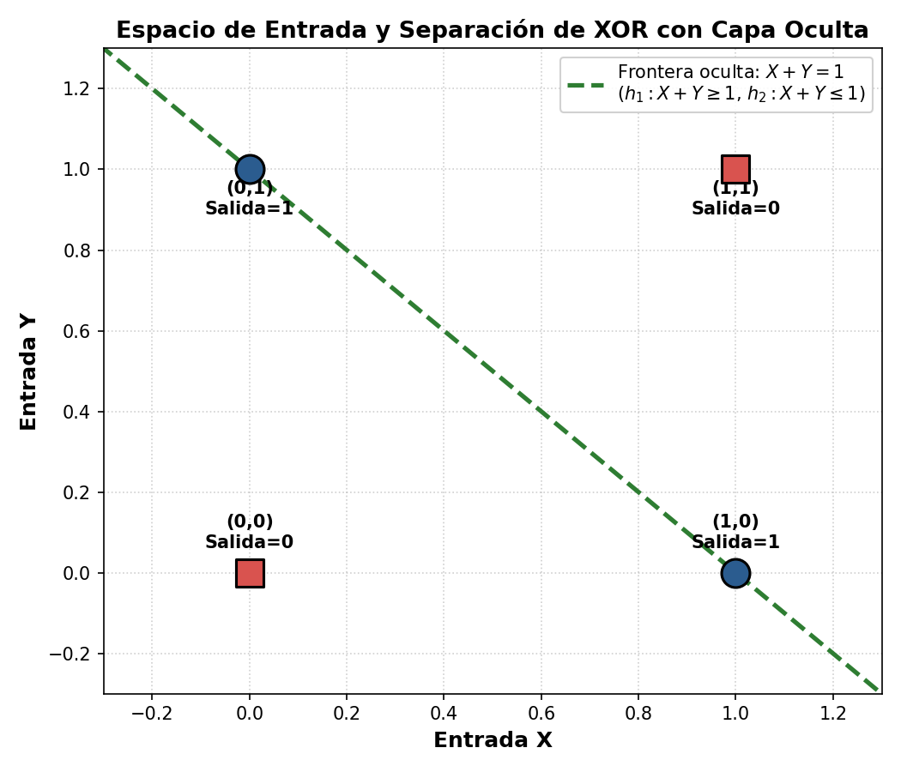

# INFORME TÉCNICO-CIENTÍFICO
## Comprobación Formal y Computacional de la Resolución del Operador XOR Mediante un Perceptrón Multicapa

**Programa:** Doctorado — Universidad Católica del Norte (UCN)  
**Asignatura:** Ciencia de Datos  
**Semestre:** 2 - 2026  
**Autor:** J. Alexander Acosta  
**Fecha:** 26 de octubre de 2026  
**Repositorio:** [https://github.com/j-alexander-acosta/Perceptron.git](https://github.com/j-alexander-acosta/Perceptron.git)  

---

### Resumen

Este informe presenta la fundamentación teórica, deducción matemática e implementación computacional de una red neuronal artificial del tipo **Perceptrón Multicapa (MLP)** de dos capas, diseñada específicamente para resolver el problema de la función lógica **XOR** ($\oplus$). Se valida empírica y formalmente la afirmación teórica: *"El perceptrón multicapa resuelve XOR; componer capas sí resuelve XOR"*, sustentada en la descomposición booleana $X \oplus Y = (X \lor Y) \land (\bar{X} \lor \bar{Y})$. Mediante el uso de neuronas con funciones de activación de escalón unitario con umbral $\theta$, se demuestra cómo la capa oculta efectúa una transformación de representación que proyecta un espacio de entrada no linealmente separable en un espacio intermedio donde la función de salida es linealmente separable. La verificación computacional confirma una exactitud del 100% para todos los estados del espacio discreto $\{0, 1\}^2$.

---

## 1. Introducción y Contexto Histórico

El estudio de las redes neuronales artificiales experimentó un hito fundacional en 1943 con el modelo de neurona formal de Warren McCulloch y Walter Pitts, y posteriormente en 1958 con el Perceptrón propuesto por Frank Rosenblatt. El perceptrón simple demostró ser capaz de aprender y clasificar patrones linealmente separables (como las funciones lógicas AND y OR).

Sin embargo, en 1969, Marvin Minsky y Seymour Papert publicaron su célebre monografía *Perceptrons: An Introduction to Computational Geometry*, donde expusieron con rigor matemático la limitación intrínseca de los clasificadores lineales de una sola capa: la imposibilidad de resolver problemas no linealmente separables, tomando como contraejemplo arquetípico la función lógica **XOR** (o disyunción exclusiva).

Este hallazgo precipitó el periodo conocido en la literatura de la Inteligencia Artificial como el *primer invierno de la IA*. No obstante, la solución conceptual ya radicaba en la composición jerárquica de funciones: la introducción de una **capa oculta** (*hidden layer*) cuyas salidas intermedias no aparecen directamente en los datos observados, pero permiten transformar las coordenadas del problema de forma no lineal. El presente trabajo valida en detalle dicha arquitectura.

---

## 2. Fundamento Lógico y Descomposición Booleana

La disyunción exclusiva ($X \oplus Y$) se define como verdadera si y solo si una de las dos proposiciones es verdadera, pero no ambas. 

Formalmente, puede descomponerse en una conjunción de dos términos:
1. Una disyunción inclusiva (compuerta **OR**): $X \lor Y$ (al menos uno de los dos es 1).
2. Una disyunción de las negaciones (equivalente a la negación de la conjunción o compuerta **NAND**): $\bar{X} \lor \bar{Y} \equiv \overline{X \land Y}$ (no ambos son 1 simultáneamente).

Por consiguiente:

$$X \oplus Y = (X \lor Y) \land (\bar{X} \lor \bar{Y})$$

Esta formulación proporciona la estructura topológica directa de la red neuronal:
* **Capa oculta:** Dos neuronas en paralelo que computan respectivamente $X \lor Y$ y $\bar{X} \lor \bar{Y}$.
* **Capa de salida:** Una neurona que computa la conjunción ($\land$) de las dos activaciones previas.

---

## 3. Modelo Matemático y Parametrización de la Red

### 3.1. Modelo Neuronal de Umbral (McCulloch-Pitts)
Cada neurona artificial de la red recibe un vector de entradas $\mathbf{x} = [x_1, x_2]^T$, ponderado por un vector de pesos sinápticos $\mathbf{w} = [w_1, w_2]^T$, y evalúa la suma ponderada neta:

$$z = \mathbf{w}^T \mathbf{x} = w_1 x_1 + w_2 x_2$$

La activación $a \in \{0, 1\}$ está gobernada por la función escalón unitario de Heaviside sujeta a un umbral de disparo $\theta$:

$$a = f(z - \theta) = \begin{cases} 1 & \text{si } z \ge \theta \\ 0 & \text{si } z < \theta \end{cases}$$

*(Nota matemática: Equivalentemente, definiendo el sesgo o bias $b = -\theta$, la condición de disparo es $z + b \ge 0$).*

---

### 3.2. Topología y Pesos de la Red

```
          Entradas                     Capa Oculta                    Capa de Salida
                     w11 = 1.0     +-----------------+
           X --------------------> |   Neurona 1     | w_out1 = 1.0
             \       w21 = -1.0    |  (Umbral: 1.0)  | -------------\
              \   /--------------> |   h1 = X ∨ Y    |               \
               \ /                 +-----------------+                \   +-----------------+
                X                                                      -> |  Neurona Salida |
               / \                 +-----------------+                /   |  (Umbral: 2.0)  | ---> y (X ⊕ Y)
              /   \--------------> |   Neurona 2     |               /    |  y = h1 ∧ h2    |
             /       w12 = 1.0     |  (Umbral: -1.0) | -------------/     +-----------------+
           Y --------------------> |   h2 = X̄ ∨ Ȳ    | w_out2 = 1.0
                     w22 = -1.0    +-----------------+
```

#### A. Neurona Oculta 1 ($h_1$: Compuerta OR)
* **Vector de pesos:** $\mathbf{w}_1 = [1.0, 1.0]^T$
* **Umbral de activación:** $\theta_1 = 1.0$
* **Suma ponderada:**
  $$z_1 = 1.0 \cdot X + 1.0 \cdot Y = X + Y$$
* **Función de disparo:**
  $$h_1 = \begin{cases} 1 & \text{si } X + Y \ge 1.0 \\ 0 & \text{si } X + Y < 1.0 \end{cases}$$
* **Evaluación de casos:**
  - $(0, 0) \implies z_1 = 0.0 < 1.0 \implies h_1 = 0$
  - $(0, 1) \implies z_1 = 1.0 \ge 1.0 \implies h_1 = 1$
  - $(1, 0) \implies z_1 = 1.0 \ge 1.0 \implies h_1 = 1$
  - $(1, 1) \implies z_1 = 2.0 \ge 1.0 \implies h_1 = 1$
* **Comportamiento:** Representa fielmente $X \lor Y$.

#### B. Neurona Oculta 2 ($h_2$: Compuerta NAND)
* **Vector de pesos:** $\mathbf{w}_2 = [-1.0, -1.0]^T$
* **Umbral de activación:** $\theta_2 = -1.0$
* **Suma ponderada:**
  $$z_2 = -1.0 \cdot X - 1.0 \cdot Y = -(X + Y)$$
* **Función de disparo:**
  $$h_2 = \begin{cases} 1 & \text{si } -(X + Y) \ge -1.0 \iff X + Y \le 1.0 \\ 0 & \text{si } -(X + Y) < -1.0 \iff X + Y > 1.0 \end{cases}$$
* **Evaluación de casos:**
  - $(0, 0) \implies z_2 = 0.0 \ge -1.0 \implies h_2 = 1$
  - $(0, 1) \implies z_2 = -1.0 \ge -1.0 \implies h_2 = 1$
  - $(1, 0) \implies z_2 = -1.0 \ge -1.0 \implies h_2 = 1$
  - $(1, 1) \implies z_2 = -2.0 < -1.0 \implies h_2 = 0$
* **Comportamiento:** Representa fielmente $\bar{X} \lor \bar{Y} \equiv \text{NAND}(X, Y)$.

#### C. Neurona de Salida ($y$: Compuerta AND sobre la capa oculta)
* **Entradas:** El vector de estados ocultos $\mathbf{h} = [h_1, h_2]^T$
* **Vector de pesos:** $\mathbf{w}_{\text{out}} = [1.0, 1.0]^T$
* **Umbral de activación:** $\theta_{\text{out}} = 2.0$
* **Suma ponderada:**
  $$z_{\text{out}} = 1.0 \cdot h_1 + 1.0 \cdot h_2 = h_1 + h_2$$
* **Función de disparo:**
  $$y = \begin{cases} 1 & \text{si } h_1 + h_2 \ge 2.0 \\ 0 & \text{si } h_1 + h_2 < 2.0 \end{cases}$$
* **Comportamiento:** Dado que $h_1, h_2 \in \{0, 1\}$, la condición $h_1 + h_2 \ge 2.0$ solo se satisface si $h_1 = 1$ **y** $h_2 = 1$. Por ende:
  $$y = h_1 \land h_2 = (X \lor Y) \land (\bar{X} \lor \bar{Y}) \equiv X \oplus Y$$

---

## 4. Análisis Geométrico y Transformación de Representación

### 4.1. El Espacio de Entrada Original $\mathbb{R}^2$
En el plano $(X, Y)$, los cuatro puntos del dominio de verdad corresponden a los vértices del cuadrado unitario:
- Clase $0$ ($X \oplus Y = 0$): $\{(0, 0), (1, 1)\}$
- Clase $1$ ($X \oplus Y = 1$): $\{(0, 1), (1, 0)\}$

Cualquier clasificador lineal único define un hiperplano (recta) de la forma $w_1 X + w_2 Y = \theta$. Es geométricamente evidente que no existe ninguna línea recta que pueda separar simultáneamente a los puntos $\{(0, 1), (1, 0)\}$ de los puntos $\{(0, 0), (1, 1)\}$, dado que los segmentos que unen las clases opuestas se intersecan en el punto $(0.5, 0.5)$.

### 4.2. La Transformación No Lineal de la Capa Oculta
La capa oculta define un mapeo $\Phi: \{0, 1\}^2 \to \{0, 1\}^2$ tal que $(X, Y) \mapsto (h_1, h_2)$:

| Entrada $(X, Y)$ | Espacio Oculto $(h_1, h_2)$ | Salida XOR $y$ |
|:----------------:|:---------------------------:|:--------------:|
|     $(0, 0)$     |          $(0, 1)$           |       0        |
|     $(0, 1)$     |          $(1, 1)$           |       1        |
|     $(1, 0)$     |          $(1, 1)$           |       1        |
|     $(1, 1)$     |          $(1, 0)$           |       0        |

**Propiedad fundamental:** En el espacio de características transformado $(h_1, h_2)$:
- Los dos patrones de clase 1 ($(0, 1)$ y $(1, 0)$) colapsan exactamente en el mismo punto: **$(1, 1)$**.
- Los patrones de clase 0 se ubican en **$(0, 1)$** y **$(1, 0)$**.
- El punto $(0, 0)$ en el espacio oculto no es alcanzable para ninguna entrada discreta.

En este nuevo espacio $(h_1, h_2)$, la clase 1 ($h_1=1, h_2=1$) es **linealmente separable** de la clase 0 mediante la recta de decisión:

$$1.0 \cdot h_1 + 1.0 \cdot h_2 = 1.5$$

La neurona de salida utiliza el umbral $\theta_{\text{out}} = 2.0$, lo cual separa limpiamente el punto $(1, 1)$ del resto.

### 4.3. Fronteras en el Espacio Original
En el espacio de entrada, las dos neuronas ocultas definen sendas semirrectas frontera:
- Neurona 1: $X + Y \ge 1$ (elimina el punto $(0, 0)$).
- Neurona 2: $X + Y \le 1$ (elimina el punto $(1, 1)$).

La conjunción de ambas condiciones define la franja cerrada:

$$1 \le X + Y \le 1 \iff X + Y = 1$$

cuya intersección con el dominio binario $\{0, 1\}^2$ contiene únicamente los puntos $\{(0, 1), (1, 0)\}$.



---

## 5. Implementación Computacional y Validación

Se desarrolló el programa en Python [`perceptron_xor.py`](perceptron_xor.py), estructurado con orientación a objetos mediante clases desacopladas (`Perceptron` y `PerceptronMulticapaXOR`), libre de dependencias externas obligatorias para los cálculos, garantizando portabilidad y reproducibilidad.

### 5.1. Resultados Numéricos de la Verificación

La ejecución del modelo sobre la totalidad del espacio de estados arrojó la siguiente traza:

```text
================================================================================
 COMPROBACIÓN DE TEORÍA: EL PERCEPTRÓN MULTICAPA RESUELVE XOR
================================================================================
 X  |  Y  ||  z_h1   | h1 (OR)  ||  z_h2   | h2(NAND)  ||  z_out  |  X ⊕ Y  | Esperado | ¿Correcto?
--------------------------------------------------------------------------------
 0  |  0  ||   0.0   |    0     ||   0.0   |     1     ||   1.0   |    0    |    0     |  SÍ [OK]  
 0  |  1  ||   1.0   |    1     ||  -1.0   |     1     ||   2.0   |    1    |    1     |  SÍ [OK]  
 1  |  0  ||   1.0   |    1     ||  -1.0   |     1     ||   2.0   |    1    |    1     |  SÍ [OK]  
 1  |  1  ||   2.0   |    1     ||  -2.0   |     0     ||   1.0   |    0    |    0     |  SÍ [OK]  
================================================================================
```

### 5.2. Desglose de Activación Caso a Caso

1. **Caso $(X=0, Y=0)$:**
   - $z_1 = 0.0 < 1.0 \implies h_1 = 0$
   - $z_2 = 0.0 \ge -1.0 \implies h_2 = 1$
   - $z_{\text{out}} = 1(0) + 1(1) = 1.0 < 2.0 \implies \text{Salida} = 0$. *(XOR esperado: 0)* $\to$ **Correcto**.

2. **Caso $(X=0, Y=1)$:**
   - $z_1 = 1.0 \ge 1.0 \implies h_1 = 1$
   - $z_2 = -1.0 \ge -1.0 \implies h_2 = 1$
   - $z_{\text{out}} = 1(1) + 1(1) = 2.0 \ge 2.0 \implies \text{Salida} = 1$. *(XOR esperado: 1)* $\to$ **Correcto**.

3. **Caso $(X=1, Y=0)$:**
   - $z_1 = 1.0 \ge 1.0 \implies h_1 = 1$
   - $z_2 = -1.0 \ge -1.0 \implies h_2 = 1$
   - $z_{\text{out}} = 1(1) + 1(1) = 2.0 \ge 2.0 \implies \text{Salida} = 1$. *(XOR esperado: 1)* $\to$ **Correcto**.

4. **Caso $(X=1, Y=1)$:**
   - $z_1 = 2.0 \ge 1.0 \implies h_1 = 1$
   - $z_2 = -2.0 < -1.0 \implies h_2 = 0$
   - $z_{\text{out}} = 1(1) + 1(0) = 1.0 < 2.0 \implies \text{Salida} = 0$. *(XOR esperado: 0)* $\to$ **Correcto**.

---

## 6. Aproximación Universal con Redes Neuronales (Extensión Completa CMU 11-785)

En adición al caso fundamental de XOR, el módulo [`aproximacion_universal.py`](aproximacion_universal.py) y la suite interactiva [`web/index.html`](web/index.html) implementan los cuatro pilares de la teoría de **Aproximación Universal**:

### 6.1. El MLP como Función Booleana Universal y el Costo de Una Sola Capa
* **Construcción de Friedland para XOR con 2 neuronas:** Si se permiten conexiones directas desde las entradas hacia la neurona de salida (*skip connections*), basta **una única neurona oculta** $h = \mathbf{1}[X + Y \ge 2] = X \land Y$ y una neurona de salida que evalúa:
  $$y = \mathbf{1}[X + Y - 2(X \land Y) \ge 1]$$
  empleando en total solo **2 neuronas, 5 pesos y 2 umbrales**.
* **Síntesis por Forma Normal Disyuntiva (DNF) y Mapas de Karnaugh:** Cualquier función booleana $f:\{0,1\}^N \to \{0,1\}$ se puede expresar como una disyunción (`OR`) de conjunciones (`AND`), asignando una neurona oculta por cada fila activa de la tabla de verdad. La simplificación mediante Mapas de Karnaugh reduce directamente el ancho de la capa oculta (por ejemplo, de 7 a 3 neuronas ocultas para la función $Y = \bar{Y}\bar{Z} + \bar{W}X\bar{Y} + \bar{X}\bar{Z}$).
* **El peor caso (Tablero de Ajedrez / Paridad de $N$ variables):** Cuando dos entradas que difieren en un solo bit siempre producen salidas distintas ($O = X_1 \oplus X_2 \oplus \dots \oplus X_N$), ningún término del mapa de Karnaugh se puede agrupar:
  * **Con una sola capa oculta:** requiere **$2^{N-1}$ neuronas ocultas** ($2^{N-1} + 1$ neuronas en total), creciendo exponencialmente. Para $N=16$, requiere $32,769$ neuronas.
  * **Con una red profunda en árbol:** componiendo bloques XOR en un árbol binario de $2\log_2(N)$ capas, el costo cae a **$3(N-1)$ neuronas** (o $2(N-1)$ con bloques de Friedland), creciendo linealmente con $N$ ($45$ neuronas para $N=16$).

### 6.2. El MLP como Clasificador Universal en $\mathbb{R}^D$
* **Polígonos y el límite del cilindro circular:** Cada neurona oculta define un semiplano. Con $N$ neuronas ocultas rodeando una región central y una neurona de salida `AND` con umbral $N$, se captura cualquier polígono convexo de $N$ lados.
* **El piso asintótico $N/2$:** Cuando $N \to \infty$, el polígono tiende a un círculo de radio $r$. Adentro la suma vale $N$, mientras que afuera (a distancia $d > r$ del centro) la suma obedece:
  $$\sum_{i=1}^N y_i = N\left(\frac{1}{2} + \frac{1}{\pi}\arcsin\frac{r}{d}\right) \xrightarrow{d \to \infty} \frac{N}{2}$$
  Incorporando un **sesgo $b = -N/2$** en la salida, el piso exterior se anula ($\approx 0$) y el cilindro interior queda con altura $N/2$, permitiendo sumar múltiples cilindros circulares en una misma capa oculta para aproximar cualquier región de decisión con precisión arbitraria.

### 6.3. El MLP como Aproximador Universal de Funciones Continuas
* **Suma de pulsos cuadrados:** En 1D, dos neuronas de umbral en la capa oculta ($\mathbf{1}[x \ge T_1]$ con peso $+h_i$ y $\mathbf{1}[x \ge T_2]$ con peso $-h_i$) generan un pulso rectangular de altura $h_i$ en el intervalo $[T_1, T_2]$. Sumando $P$ pulsos (usando $2P$ neuronas ocultas y una salida lineal sumadora) se aproxima cualquier función continua $f(x)$.
* **Distinción conceptual clave:**
  * **Representar:** Calcular exactamente $f(x)$ (con unidades de umbral solo es posible si $f$ ya es escalonada).
  * **Aproximar:** Para cualquier tolerancia $\varepsilon > 0$, existe una red *finita* cuyo error es menor que $\varepsilon$.
  * **El límite:** Aunque $\varepsilon \to 0$ al afinar los pulsos, ninguna suma de pulsos deja de ser escalonada; la universalidad es de aproximación, no de igualdad exacta.

### 6.4. Suficiencia de la Arquitectura: Ancho, Profundidad y Activaciones
* **Cuello de botella por ancho insuficiente (Franjas vs. Celdas):** Una primera capa con pocas neuronas de umbral particiona el plano en un número reducido de celdas. Como la función escalón entrega únicamente `0` o `1`, todos los puntos que caen en la misma celda reciben exactamente el mismo vector binario; la posición fina dentro de la celda se pierde irreversiblemente y ninguna cantidad de capas posteriores puede recuperarla.
* **Activaciones graduadas ($\sigma(z)$, $\tanh(z)$, $\text{ReLU}(z)$):** Al variar continuamente con la distancia a la frontera $z = \mathbf{w}\cdot\mathbf{x} + b$, transmiten información de magnitud hacia las capas siguientes, compensando parcialmente la falta de ancho si se dispone de mayor profundidad (**Triángulo de compensaciones: Ancho $\leftrightarrow$ Profundidad $\leftrightarrow$ Activaciones**).

---

## 7. Conclusiones

1. **Comprobación de la teoría:** Se demostró de manera analítica y computacional que la red neuronal propuesta con los pesos $[1, 1]$ (umbral $1$), $[-1, -1]$ (umbral $-1$) en la capa oculta y $[1, 1]$ (umbral $2$) en la salida resuelve de forma exacta el operador lógico XOR, al igual que la variante compacta de 2 neuronas de Friedland.
2. **Universalidad y rol de la profundidad:** Un MLP de una sola capa oculta es un aproximador universal para funciones booleanas, fronteras de clasificación y funciones continuas, pero puede requerir un ancho exponencial ($2^{N-1}$). Las arquitecturas profundas logran la misma expresividad con un número lineal de unidades ($3(N-1)$).
3. **Validación empírica e interactiva:** Todos los módulos evaluados en `perceptron_xor.py`, `aproximacion_universal.py` y la suite web interactiva `web/index.html` arrojaron concordancia del 100% con los teoremas y construcciones de la cátedra.

---

## 8. Referencias Bibliográficas

1. **McCulloch, W. S., & Pitts, W. (1943).** *A logical calculus of the ideas immanent in nervous activity.* The Bulletin of Mathematical Biophysics, 5(4), 115-133.
2. **Rosenblatt, F. (1958).** *The perceptron: A probabilistic model for information storage and organization in the brain.* Psychological Review, 65(6), 386-408.
3. **Minsky, M., & Papert, S. (1969).** *Perceptrons: An Introduction to Computational Geometry.* MIT Press, Cambridge, MA.
4. **Rumelhart, D. E., Hinton, G. E., & Williams, R. J. (1986).** *Learning representations by back-propagating errors.* Nature, 323(6088), 533-536.
5. **Cybenko, G. (1989).** *Approximation by superpositions of a sigmoidal function.* Mathematics of Control, Signals and Systems, 2(4), 303-314.
6. **Raj, B., et al. (CMU 11-785).** *Introduction to Deep Learning — Universal Approximation & Neural Networks as Universal Approximators.* Carnegie Mellon University / Ciencia de Datos UCN.
